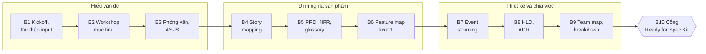

# Hướng dẫn Giai đoạn 0 – Discovery

> Ghi chú tự học · Cập nhật: 2026-11-02
> Liên quan: [speckit-backlog.md](speckit-backlog.md) · [speckit-big-picture.md](speckit-big-picture.md) · [sdlc.md](sdlc.md)
> Template dùng ngay: [speckit-docs-skeleton/docs/discovery/](speckit-docs-skeleton/docs/discovery/)

Giai đoạn 0 biến **ý tưởng và thông tin rời rạc** thành bộ tài liệu đủ để các team bắt đầu chạy `/speckit.specify`: PRD, NFR, feature map, HLD, team map, release plan. Con người dẫn dắt; AI hỗ trợ soạn nháp, tóm tắt và phát hiện chỗ thiếu.

## 1. Tóm tắt

| | |
| --- | --- |
| **Bắt đầu khi** | Có quyết định đầu tư hoặc đề bài từ sponsor (Planning đã xong) |
| **Kết thúc khi** | Qua cổng **Ready for Spec Kit** (mục 7) |
| **Thời lượng tham khảo** | 2–3 tuần cho dự án nhỏ, 4–8 tuần cho dự án vừa (ví dụ, tùy tổ chức) |
| **Người dẫn dắt** | Product Owner (nội dung), Solution Architect (kỹ thuật), PM/Delivery (lịch, người) |
| **Nơi lưu** | Repo dự án, thư mục `docs/` theo skeleton; mọi thay đổi qua Pull Request |

## 2. Đầu ra cuối cùng

| File | Nội dung | Chủ sở hữu | Bước tạo |
| --- | --- | --- | --- |
| `docs/discovery/business-context.md` | Vấn đề, mục tiêu, KPI, persona, phạm vi | PO | B2 |
| `docs/discovery/as-is.md` | Quy trình và điểm đau hiện tại | BA | B3 |
| `docs/discovery/story-map.md` | Hành trình, story, lát cắt release | PO, BA | B4 |
| `docs/product/prd.md` | REQ-xx | PO | B5 |
| `docs/product/nfr.md` | NFR-xxx | Architect, SRE, Security | B5 |
| `docs/product/glossary.md` | Thuật ngữ nghiệp vụ | BA | B5, B7 |
| `docs/product/feature-map.md` | Feature lượt 1, rồi lượt 2 | PO, Architect | B6, B9 |
| `docs/discovery/event-storming.md` | Event, command, bounded context | Architect | B7 |
| `docs/architecture/domain-model.md` | Entity, context, quyền sở hữu dữ liệu | Architect | B7 |
| `docs/architecture/hld.md`, `adr/` | Kiến trúc, quyết định | Architect | B8 |
| `docs/architecture/api-catalog.md` | API/event giữa các thành phần (mức đầu) | Architect, Tech Lead | B8 |
| `docs/delivery/team-map.md`, `release-plan.md`, `dependencies.md` | Team, mốc, phụ thuộc | PM/Delivery, Architect | B9 |
| `.specify/memory/constitution.md` | Nguyên tắc cho Spec Kit | Architect, Tech Lead | B9 |
| `docs/discovery/open-questions.md` | Câu hỏi còn mở, người trả lời, hạn | PM | Suốt giai đoạn |

## 3. Đầu vào cần chuẩn bị

Thu thập trước B2, lưu trong `docs/discovery/inputs/`. Không cần đủ hết; thiếu mục nào thì ghi vào `open-questions.md`.

| Mã | Đầu vào | Ai cung cấp | Định dạng | Template |
| --- | --- | --- | --- | --- |
| I1 | **Đề bài kinh doanh**: vấn đề, mục tiêu, ngân sách, hạn, người tài trợ | Sponsor, PO | Markdown | `inputs/business-brief.md` |
| I2 | **Danh sách stakeholder**: ai, vai trò, mức ảnh hưởng, cách liên lạc | PM, PO | Bảng Markdown | `inputs/stakeholders.md` |
| I3 | **Quy trình hiện tại** (AS-IS): các bước, người làm, công cụ, thời gian | BA, người dùng nghiệp vụ | Markdown + Mermaid, hoặc ảnh BPMN | `as-is.md` (điền ở B3) |
| I4 | **Hệ thống hiện có**: ứng dụng, tích hợp, dữ liệu, chủ sở hữu, điểm yếu | IT, Architect | Bảng Markdown | `inputs/current-systems.md` |
| I5 | **Ràng buộc**: pháp lý, compliance, công nghệ bắt buộc, chuẩn công ty, ngân sách, nhân sự | Sponsor, Legal, Security, IT | Bảng Markdown | `inputs/constraints.md` |
| I6 | **Số liệu hiện tại**: KPI, lưu lượng, khối lượng dữ liệu, số người dùng | Business, IT | CSV hoặc bảng Markdown | — |
| I7 | **Tài liệu sẵn có**: RFP, hợp đồng, phản hồi người dùng, ticket hỗ trợ, báo cáo đối thủ | PO, Support | PDF/Docs → tóm tắt Markdown kèm link gốc | — |
| I8 | **Nguồn lực**: team hiện có, kỹ năng, mức sẵn sàng | PM, Engineering Manager | Bảng Markdown | (đưa vào `team-map.md` ở B9) |

**Quy tắc cho đầu vào:**

- **Markdown trong git** là định dạng chính, để con người review được qua PR và AI đọc được.
- Tài liệu gốc dạng PDF, Word, Excel: để ở kho tài liệu của công ty, trong repo chỉ lưu **bản tóm tắt + link**.
- Sơ đồ: Mermaid trong Markdown; ảnh chụp bảng trắng thì lưu kèm và chép lại các điểm chính thành chữ.
- Ghi âm, ghi hình họp: chuyển thành biên bản theo template `workshops/workshop-notes.md`.
- **Không đưa dữ liệu nhạy cảm** (dữ liệu khách hàng thật, mật khẩu, hợp đồng mật) vào repo hay vào AI. Dùng dữ liệu mẫu đã ẩn danh.
- Mỗi file đầu vào ghi rõ **nguồn** và **ngày**, để biết thông tin còn đúng không.

## 4. Các bước

Mỗi bước gồm: mục tiêu, người tham gia, đầu vào, cách làm, đầu ra, AI hỗ trợ gì, khi nào xong.

### B1. Kickoff và thu thập đầu vào

| | |
| --- | --- |
| **Mục tiêu** | Thống nhất mục đích của Giai đoạn 0, ai tham gia, lịch workshop; gom đầu vào |
| **Người tham gia** | Sponsor, PO, PM/Delivery, Solution Architect, BA |
| **Thời lượng** | Họp kickoff 1–2 giờ; thu thập 3–5 ngày |
| **Đầu vào** | Quyết định đầu tư, đề bài sơ bộ |
| **Cách làm** | Tạo repo theo skeleton; giao người thu thập I1–I8; vẽ bản đồ stakeholder (ảnh hưởng × quan tâm); lên lịch B2–B9 |
| **Đầu ra** | `inputs/business-brief.md`, `inputs/stakeholders.md`, lịch workshop, `open-questions.md` ban đầu |
| **AI hỗ trợ** | Tóm tắt tài liệu I7 thành Markdown; liệt kê thông tin còn thiếu so với danh sách I1–I8 |
| **Xong khi** | Có I1, I2; đã hẹn lịch với stakeholder chính |

### B2. Workshop vấn đề và mục tiêu

| | |
| --- | --- |
| **Mục tiêu** | Hiểu đúng vấn đề, chốt mục tiêu đo được, persona, phạm vi |
| **Người tham gia** | Sponsor, PO, BA, đại diện người dùng và nghiệp vụ chính, Architect (nghe) |
| **Thời lượng** | 1 buổi 2–4 giờ |
| **Đầu vào** | I1, I2, I6, I7 |
| **Cách làm** | Problem statement ("Ai đang gặp khó khăn gì, khi nào, hậu quả ra sao"); mục tiêu và KPI (giá trị hiện tại → mục tiêu → hạn); persona; phạm vi trong/ngoài; điều gì *không* phải mục tiêu |
| **Đầu ra** | `business-context.md`, biên bản `workshops/YYYY-MM-DD-b2-goals.md` |
| **AI hỗ trợ** | Soạn nháp business context từ biên bản; chỉ ra mục tiêu không đo được, mâu thuẫn giữa các stakeholder |
| **Xong khi** | Sponsor và PO đồng ý mục tiêu, KPI, phạm vi |

### B3. Phỏng vấn người dùng và quy trình hiện tại (AS-IS)

| | |
| --- | --- |
| **Mục tiêu** | Hiểu người dùng làm việc thế nào hôm nay và khó khăn ở đâu |
| **Người tham gia** | BA, UX (dẫn); 5–8 người dùng thuộc các persona; vận hành, support |
| **Thời lượng** | 45–60 phút mỗi buổi phỏng vấn; quan sát tại chỗ nếu được |
| **Đầu vào** | `business-context.md`, I3, I4 |
| **Cách làm** | Hỏi về việc họ *đã làm* lần gần nhất, không hỏi họ *muốn gì*; vẽ quy trình AS-IS; ghi điểm đau, cách họ đang lách |
| **Đầu ra** | `as-is.md` (quy trình + điểm đau, xếp theo mức độ), biên bản phỏng vấn |
| **AI hỗ trợ** | Gom điểm đau trùng lặp từ nhiều biên bản; vẽ nháp sơ đồ Mermaid từ mô tả quy trình |
| **Xong khi** | Mỗi persona có ít nhất 2 người được phỏng vấn; điểm đau chính đã được xác nhận |

### B4. User story mapping

| | |
| --- | --- |
| **Mục tiêu** | Biến mục tiêu và điểm đau thành hành trình người dùng TO-BE, story, và lát cắt release |
| **Người tham gia** | PO, BA (dẫn); UX, Tech Lead, QA, 1–2 người dùng |
| **Thời lượng** | 1–2 buổi, mỗi buổi 3–4 giờ |
| **Đầu vào** | `business-context.md`, `as-is.md` |
| **Cách làm** | 1) Xếp các **hoạt động** theo trình tự hành trình (backbone). 2) Dưới mỗi hoạt động, liệt kê **story**. 3) Sắp story theo độ quan trọng từ trên xuống. 4) Kẻ đường cắt ngang: **MVP**, v1.1… MVP phải đi trọn hành trình, dù mỗi bước còn đơn giản |
| **Đầu ra** | `story-map.md` |
| **AI hỗ trợ** | Đề xuất story còn thiếu (trường hợp lỗi, quản trị, báo cáo); kiểm tra MVP có đi trọn hành trình không |
| **Xong khi** | PO chốt lát cắt MVP; mọi điểm đau quan trọng có ít nhất một story xử lý |

### B5. PRD, NFR, glossary

| | |
| --- | --- |
| **Mục tiêu** | Viết yêu cầu có mã để truy vết được |
| **Người tham gia** | PO, BA (PRD, glossary); Architect, SRE, Security, DBA (NFR); Legal nếu có compliance |
| **Thời lượng** | 3–5 ngày làm việc, 1 buổi review chung |
| **Đầu vào** | `business-context.md`, `story-map.md`, I5, I6 |
| **Cách làm** | Gom story thành REQ-xx (mức sản phẩm, không mô tả công nghệ); NFR có số đo cụ thể (latency, availability, RPO/RTO, dữ liệu cá nhân…), lấy từ I5, I6; thuật ngữ thống nhất một tên, một nghĩa |
| **Đầu ra** | `prd.md`, `nfr.md`, `glossary.md` |
| **AI hỗ trợ** | Lệnh `/project.discovery`: soạn nháp PRD, NFR, glossary từ các file discovery; chỉ ra REQ mơ hồ, NFR thiếu số đo, thuật ngữ trùng nghĩa |
| **Xong khi** | Mỗi REQ có ưu tiên (Must/Should/Could); mỗi NFR có số đo và cách đo; review chung không còn ý kiến chặn |

### B6. Feature map lượt 1

| | |
| --- | --- |
| **Mục tiêu** | Có danh sách feature thô (*làm gì*), chưa gán team |
| **Người tham gia** | PO (dẫn), Architect, BA |
| **Thời lượng** | 1 buổi 2 giờ |
| **Đầu vào** | `story-map.md`, `prd.md` |
| **Cách làm** | Mỗi hoạt động trong story map, hoặc nhóm REQ gần nhau, thành một feature; gắn REQ và lát cắt release; mỗi feature khoảng 5–7 story trở xuống |
| **Đầu ra** | `feature-map.md` (cột Team, Loại để trống hoặc ghi "chưa chia") |
| **AI hỗ trợ** | `/project.discovery` đề xuất cách gom; kiểm tra REQ nào chưa thuộc feature nào |
| **Xong khi** | Mọi REQ Must thuộc một feature MVP |

### B7. Event storming và domain model

| | |
| --- | --- |
| **Mục tiêu** | Tìm event nghiệp vụ, entity và ranh giới (bounded context) làm cơ sở chia hệ thống và team |
| **Người tham gia** | Architect (dẫn), Tech Lead, BA, chuyên gia nghiệp vụ, DBA |
| **Thời lượng** | 1 buổi 3–4 giờ (big picture), thêm buổi chi tiết nếu domain phức tạp |
| **Đầu vào** | `story-map.md`, `as-is.md`, `glossary.md` |
| **Cách làm** | Liệt kê **event** ở thì quá khứ theo dòng thời gian (Đơn hàng đã được tạo…); thêm **command** gây ra event, **actor**, **hệ thống ngoài**, **chính sách** (khi X thì Y); khoanh nhóm thành **bounded context** |
| **Đầu ra** | `event-storming.md`, `domain-model.md` (bản đầu), cập nhật `glossary.md` |
| **AI hỗ trợ** | Chép lại kết quả bảng trắng thành Markdown; đề xuất ranh giới context; chỉ ra event không có command hoặc entity không có chủ |
| **Xong khi** | Mỗi entity chính có một context sở hữu; mỗi context có thể giao cho một team |

### B8. HLD và ADR

| | |
| --- | --- |
| **Mục tiêu** | Chốt kiến trúc tổng thể và các mục xuyên suốt |
| **Người tham gia** | Architect (dẫn); Tech Lead, DevOps/Platform, SRE, Security, DBA; PO (review phạm vi, chi phí) |
| **Thời lượng** | 1–3 tuần, kèm 1–2 buổi review kiến trúc |
| **Đầu vào** | `prd.md`, `nfr.md`, `domain-model.md`, I4, I5 |
| **Cách làm** | Điền HLD theo [hld-template.md](hld-template.md): thành phần (theo bounded context) và **team sở hữu**, dữ liệu, tích hợp, security, DR, monitoring ([monitoring-design-hld.md](monitoring-design-hld.md)), infra, chi phí; mỗi lựa chọn quan trọng ghi ADR; bảng truy vết NFR |
| **Đầu ra** | `hld.md`, `adr/*.md`, `api-catalog.md` (mức đầu) |
| **AI hỗ trợ** | Soạn nháp từng mục HLD theo template; so sánh phương án cho ADR; kiểm tra NFR nào chưa có mục HLD đáp ứng |
| **Xong khi** | Architect, Security, SRE ký duyệt; mọi NFR có mục HLD tương ứng |

### B9. Team map, chia việc, release plan

| | |
| --- | --- |
| **Mục tiêu** | Chuyển feature map sang lượt 2: gán team, thêm enabler và contract, xếp mốc |
| **Người tham gia** | PM/Delivery, Architect, PO, Engineering Manager, Tech Lead các team |
| **Thời lượng** | 1–2 buổi |
| **Đầu vào** | `feature-map.md` lượt 1, `hld.md`, I8 |
| **Cách làm** | Điền `team-map.md`; chạy `/project.breakdown`; review đề xuất, chỉnh ranh giới và ưu tiên; chốt mốc M0, M1, MVP; hoàn thiện constitution |
| **Đầu ra** | `feature-map.md` lượt 2, `team-map.md`, `release-plan.md`, `dependencies.md`, `constitution.md` |
| **AI hỗ trợ** | `/project.breakdown` |
| **Xong khi** | Mọi feature có đúng một team; có F-000 và các enabler; mốc MVP có ngày |

### B10. Cổng Ready for Spec Kit

Họp review 1–2 giờ với Sponsor, PO, Architect, PM, Tech Lead các team, Security, SRE. Dùng checklist ở mục 7. Đạt thì:

1. Merge toàn bộ `docs/` vào nhánh chính, gắn tag (ví dụ `discovery-v1`).
2. Chạy `/project.backlog` → `scripts/backlog-sync.sh` để tạo backlog.
3. Team Platform bắt đầu `/speckit.specify` cho `F-000`.

## 5. Ai tham gia bước nào (RACI)

| Bước | Sponsor | PO | BA | UX | Architect | Tech Lead | DevOps | SRE | Security | QA | PM |
| --- | --- | --- | --- | --- | --- | --- | --- | --- | --- | --- | --- |
| B1 Kickoff | A | R | C | I | C | I | I | I | I | I | R |
| B2 Mục tiêu | A | R | R | C | C | I | — | — | — | — | C |
| B3 AS-IS | I | C | R | R | C | I | — | — | — | — | I |
| B4 Story map | I | A | R | C | C | C | — | — | — | C | I |
| B5 PRD, NFR | C | A | R | C | R (NFR) | C | C | R (NFR) | R (NFR) | C | I |
| B6 Feature map 1 | I | A/R | C | — | C | C | — | — | — | — | I |
| B7 Event storming | — | C | R | — | A/R | R | — | — | — | — | — |
| B8 HLD | I | C | C | — | A/R | R | R | R | R | C | I |
| B9 Chia việc | I | C | — | — | A | R | C | C | C | C | R |
| B10 Cổng | A | R | C | C | R | R | C | C | C | C | R |

*R = thực hiện, A = phê duyệt cuối, C = tham vấn, I = được thông báo*

## 6. Dùng AI trong Giai đoạn 0

| Việc | Cách dùng |
| --- | --- |
| Tóm tắt tài liệu, biên bản | Đưa file Markdown đã ẩn danh; yêu cầu giữ nguồn của từng ý |
| Soạn nháp PRD, NFR, glossary, feature map lượt 1 | Lệnh `/project.discovery` |
| Soạn nháp HLD, ADR | Đưa `hld-template.md` + PRD, NFR, domain model; mỗi lần một mục |
| Chia việc | `/project.breakdown` |
| Tìm chỗ thiếu | Hỏi: REQ nào mơ hồ, NFR nào thiếu số, story nào chưa có, entity nào chưa có chủ |

Nguyên tắc:

- AI **soạn nháp**, con người **quyết định**; file AI soạn ghi `Trạng thái: Draft (AI)` cho tới khi được duyệt.
- AI không được tự bịa số liệu, ngày, tên người; thiếu thì ghi vào `open-questions.md`.
- Không đưa dữ liệu mật hoặc dữ liệu cá nhân thật cho AI.

## 7. Checklist cổng Ready for Spec Kit

**Sản phẩm**

- [ ] Mục tiêu có KPI đo được, được Sponsor duyệt
- [ ] Persona được xác nhận qua phỏng vấn người dùng thật
- [ ] Story map có lát cắt MVP đi trọn hành trình
- [ ] Mọi REQ có mã, ưu tiên, và thuộc ít nhất một feature
- [ ] Mọi NFR có số đo và cách kiểm chứng
- [ ] Glossary không còn thuật ngữ trùng nghĩa

**Hệ thống**

- [ ] Domain model: mỗi entity chính có đúng một context sở hữu
- [ ] HLD được Architect, Security, SRE duyệt; mọi NFR có mục HLD đáp ứng
- [ ] Các quyết định quan trọng có ADR
- [ ] API/event giữa các thành phần có trong `api-catalog.md` (ít nhất ở mức tên và hướng)

**Điều phối**

- [ ] Mọi feature có đúng một team; có F-000 và enabler cho security, monitoring, infra
- [ ] Mốc MVP có ngày; phụ thuộc giữa các team đã liệt kê
- [ ] Constitution đã có nguyên tắc dự án, trỏ tới `docs/`
- [ ] `open-questions.md` không còn câu hỏi chặn MVP

## 8. Sai lầm thường gặp

| Sai lầm | Hậu quả | Cách tránh |
| --- | --- | --- |
| Bỏ B3, đoán nhu cầu người dùng | Làm đúng spec nhưng sai nhu cầu | Ít nhất 2 người dùng thật mỗi persona |
| Hỏi người dùng "muốn tính năng gì" | Danh sách mong muốn dài, không ưu tiên | Hỏi về việc họ đã làm và gặp khó ở đâu |
| PRD mô tả công nghệ | Khóa giải pháp quá sớm | PRD chỉ nói *cái gì, tại sao*; công nghệ để ở HLD |
| NFR kiểu "hệ thống phải nhanh" | Không kiểm chứng được | Mỗi NFR có số đo, ví dụ p95 ≤ 500 ms |
| MVP chỉ làm sâu một bước của hành trình | Không có giá trị dùng được | MVP đi trọn hành trình, mỗi bước đơn giản |
| Chia team trước HLD | Ranh giới team lệch ranh giới hệ thống | B9 sau B8 |
| Giai đoạn 0 kéo dài vô hạn | Không bao giờ bắt đầu | Đặt hạn; chấp nhận câu hỏi còn mở nếu không chặn MVP |
| Để tài liệu discovery trong slide, email | Không truy vết, AI không đọc được | Markdown trong repo, qua PR |
