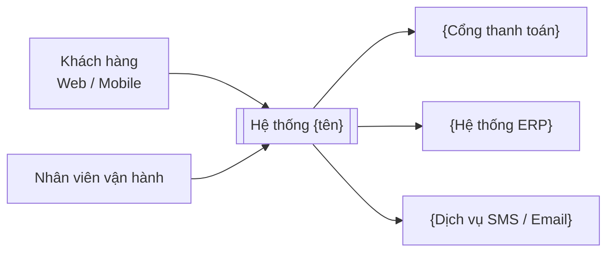
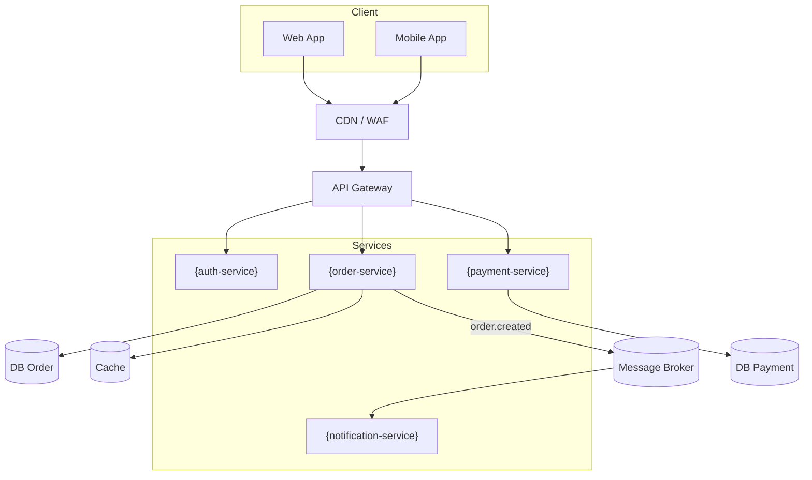
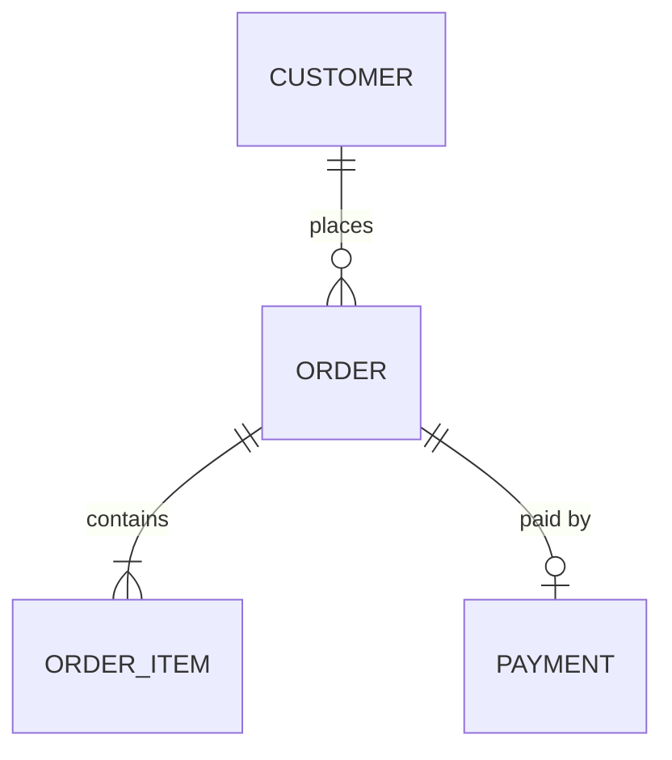
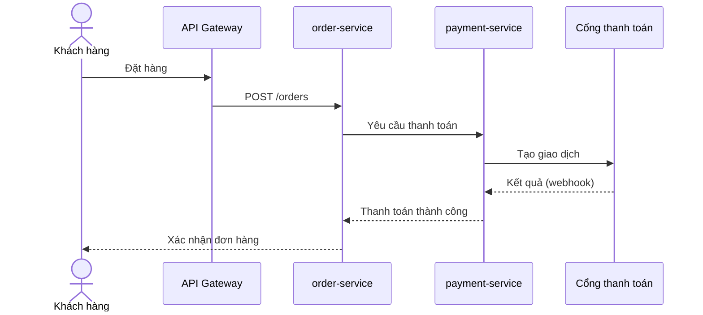
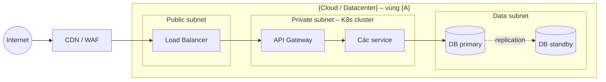

# High-Level Design (HLD) – {Tên hệ thống}

| Thông tin | Giá trị |
| --- | --- |
| Mã tài liệu | {HLD-XXX} |
| Phiên bản | {1.0} |
| Trạng thái | {Draft / In review / Approved} |
| Tác giả | {Tên, vai trò} |
| Ngày cập nhật | {YYYY-MM-DD} |
| Tài liệu liên quan | {SRS-XXX, BRD-XXX, LLD-XXX} |

## Lịch sử thay đổi

| Phiên bản | Ngày | Người sửa | Nội dung thay đổi |
| --- | --- | --- | --- |
| 0.1 | {YYYY-MM-DD} | {Tên} | Bản nháp đầu tiên |

## Phê duyệt

| Vai trò | Họ tên | Ngày | Kết quả |
| --- | --- | --- | --- |
| Solution Architect | {Tên} | | {Approved / Rejected / Có điều kiện} |
| Security | {Tên} | | |
| SRE / DevOps | {Tên} | | |
| Tech Lead | {Tên} | | |
| Product Owner | {Tên} | | |

> **Cách dùng mẫu:** thay mọi `{...}` bằng giá trị thực. Các đoạn trích dẫn bắt đầu bằng `>` là hướng dẫn, hãy xóa khi hoàn thiện. HLD trả lời *cái gì* và *tại sao*; chi tiết *làm thế nào* (class, schema đầy đủ, cấu hình) để ở LLD.

---

## 1. Giới thiệu

### 1.1 Mục đích tài liệu

> Tài liệu này dành cho ai và giúp họ quyết định điều gì.

{Mô tả kiến trúc mức cao của hệ thống {tên}, làm cơ sở để review kiến trúc, viết LLD, ước lượng chi phí và lập kế hoạch triển khai.}

### 1.2 Phạm vi

- **Trong phạm vi:** {các module, tính năng, môi trường}
- **Ngoài phạm vi:** {những gì không thiết kế trong tài liệu này}

### 1.3 Thuật ngữ và viết tắt

| Thuật ngữ | Giải thích |
| --- | --- |
| SLA / SLO | Cam kết mức dịch vụ / mục tiêu mức dịch vụ nội bộ |
| RPO / RTO | Lượng dữ liệu tối đa được phép mất / thời gian khôi phục tối đa |
| {…} | {…} |

### 1.4 Tài liệu tham chiếu

| Tài liệu | Phiên bản | Liên kết |
| --- | --- | --- |
| SRS | {x.y} | {link} |
| Chuẩn kiến trúc công ty | {x.y} | {link} |

---

## 2. Bối cảnh hệ thống

### 2.1 Mục tiêu kinh doanh

> Hệ thống giải quyết vấn đề gì, đo thành công bằng chỉ số nào.

- {Mục tiêu 1, ví dụ: giảm thời gian xử lý đơn từ 2 ngày xuống 2 giờ}
- {Mục tiêu 2}

### 2.2 Sơ đồ bối cảnh (C4 – Level 1)

### 2.3 Người dùng và hệ thống ngoài

| Đối tượng | Loại | Tương tác chính | Quy mô dự kiến |
| --- | --- | --- | --- |
| {Khách hàng} | Người dùng | {Đặt hàng, tra cứu} | {100.000 user, 2.000 đồng thời} |
| {Cổng thanh toán X} | Hệ thống ngoài | {Thanh toán, hoàn tiền} | {…} |

### 2.4 Ràng buộc

| Loại | Ràng buộc |
| --- | --- |
| Kỹ thuật | {Bắt buộc chạy trên Kubernetes nội bộ; DB chuẩn là PostgreSQL} |
| Pháp lý | {Dữ liệu khách hàng phải lưu tại Việt Nam} |
| Ngân sách | {≤ X USD/tháng hạ tầng} |
| Thời gian | {Go-live trước {YYYY-MM-DD}} |
| Tổ chức | {Team 8 người, quen Java/Spring} |

### 2.5 Giả định

- {Hệ thống ERP cung cấp API REST ổn định}
- {…}

---

## 3. Kiến trúc tổng thể

### 3.1 Kiểu kiến trúc và lý do lựa chọn

> Monolith, modular monolith, microservices, event-driven, serverless… Nêu lý do và phương án đã loại.

{Ví dụ: modular monolith cho giai đoạn 1 vì team nhỏ và domain chưa ổn định; tách service khi tải hoặc team tăng.}

### 3.2 Sơ đồ kiến trúc (C4 – Level 2)

### 3.3 Nguyên tắc kiến trúc

- {Mỗi service sở hữu dữ liệu riêng, không truy cập DB của service khác}
- {Service stateless, trạng thái lưu ở DB/cache}
- {Giao tiếp giữa các domain ưu tiên bất đồng bộ qua event}
- {API-first: API được thiết kế và review trước khi code}

---

## 4. Thiết kế thành phần

> Mỗi thành phần một mục con. Chỉ mô tả trách nhiệm và giao tiếp, không đi vào class.

**Danh sách thành phần và team sở hữu** (bắt buộc; lệnh `/project.breakdown` dùng bảng này để chia feature business):

| Thành phần | Bounded context | Team sở hữu | Tier |
| --- | --- | --- | --- |
| {auth-service} | {Identity} | {Team Identity} | {1} |
| {order-service} | {Sales} | {Team Order} | {1} |
| {payment-service} | {Payment} | {Team Payment} | {1} |
| {notification-service} | {Notification} | {Team Notify} | {2} |

### 4.1 {Tên thành phần}

| Thuộc tính | Mô tả |
| --- | --- |
| Trách nhiệm | {…} |
| Không chịu trách nhiệm | {…} |
| Công nghệ | {Java 21, Spring Boot} |
| Dữ liệu sở hữu | {Bảng/collection chính} |
| API cung cấp | {REST /api/v1/orders} |
| Phụ thuộc | {payment-service (sync), Kafka (async)} |
| Team sở hữu (bắt buộc, theo `team-map.md`) | {Team Order} |
| Mức độ quan trọng | {Tier 1} |

### 4.2 {Tên thành phần}

{…}

---

## 5. Kiến trúc dữ liệu

### 5.1 Mô hình dữ liệu mức cao

> Các thực thể chính và quan hệ; schema chi tiết để ở LLD.

### 5.2 Lưu trữ

| Kho dữ liệu | Loại | Dùng cho | Lý do chọn | Dung lượng dự kiến (năm 1) |
| --- | --- | --- | --- | --- |
| {PostgreSQL} | Quan hệ | {Đơn hàng, thanh toán} | {ACID, team quen} | {200 GB} |
| {Redis} | Cache | {Session, giỏ hàng} | {Latency thấp} | {10 GB} |
| {S3 / MinIO} | Object storage | {Hóa đơn PDF, ảnh} | {Chi phí thấp} | {1 TB} |

### 5.3 Luồng dữ liệu và tính nhất quán

- {Đơn hàng và thanh toán đồng bộ theo Saga, eventual consistency trong ≤ {5 s}}
- {Dữ liệu báo cáo đẩy sang Data Warehouse qua CDC mỗi {15 phút}}

### 5.4 Phân loại dữ liệu

| Mức | Ví dụ | Yêu cầu bảo vệ |
| --- | --- | --- |
| Public | Danh mục sản phẩm | Không |
| Internal | Báo cáo doanh thu | Phân quyền nội bộ |
| Confidential | Thông tin cá nhân (PII) | Mã hóa, masking, audit |
| Restricted | Dữ liệu thẻ thanh toán | Tokenization, PCI-DSS |

### 5.5 Retention, archive và migration

- Retention: {đơn hàng giữ 10 năm theo luật kế toán; log giữ 90 ngày}
- Migration dữ liệu cũ: {nguồn, khối lượng, chiến lược, thời điểm cắt chuyển}

---

## 6. Tích hợp và API

### 6.1 Danh sách tích hợp

| Từ | Đến | Giao thức | Sync/Async | Định dạng | Tần suất | Xử lý khi lỗi |
| --- | --- | --- | --- | --- | --- | --- |
| {order-service} | {payment-service} | REST | Sync | JSON | {50 req/s} | {Retry 3 lần, circuit breaker} |
| {order-service} | {notification-service} | Kafka | Async | Avro | {…} | {DLQ} |
| {payment-service} | {Cổng thanh toán X} | HTTPS + webhook | Cả hai | JSON | {…} | {Đối soát cuối ngày} |

### 6.2 Chuẩn API

- Kiểu API: {REST, đặc tả bằng OpenAPI 3}
- Versioning: {qua URL `/api/v1/…`, giữ tương thích ngược ≥ {6 tháng}}
- Idempotency: {header `Idempotency-Key` cho các API tạo giao dịch}
- Phân trang, mã lỗi: {theo chuẩn {link}}
- Rate limiting: {{100} req/phút/client tại API gateway}

### 6.3 Luồng nghiệp vụ chính

---

## 7. Security Design

> **Team thực hiện** (bắt buộc; lệnh `/project.breakdown` dùng bảng này để chia việc). Tên team theo `team-map.md`.

| Hạng mục | Team thực hiện | Team duyệt |
| --- | --- | --- |
| Chính sách bảo mật, threat model | {Security} | {Architect} |
| AuthN/AuthZ trong ứng dụng | {Team Identity} | {Security} |
| IAM, security group, KMS, secret manager | {Infra} | {Security} |
| Hardening OS (CIS), `auditd` | {Infra} | {Security} |
| WAF, SIEM, quét lỗ hổng, pentest | {Security} | {Architect} |

### 7.1 Threat model

> Dùng STRIDE cho các luồng dữ liệu chính.

| Mối đe dọa (STRIDE) | Điểm có thể bị tấn công | Biện pháp |
| --- | --- | --- |
| Spoofing | Đăng nhập | {MFA, OAuth2/OIDC} |
| Tampering | API thanh toán | {Ký request, kiểm tra chữ ký webhook} |
| Repudiation | Thao tác của admin | {Audit log không sửa được} |
| Information disclosure | DB khách hàng | {Mã hóa, phân quyền, masking} |
| Denial of service | API công khai | {WAF, rate limit} |
| Elevation of privilege | API quản trị | {RBAC, tách mạng quản trị} |

### 7.2 Xác thực và phân quyền

- Người dùng: {OIDC qua {Keycloak / Azure AD}, MFA cho admin}
- Service-to-service: {mTLS hoặc OAuth2 client credentials}
- Phân quyền: {RBAC; danh sách role ở phụ lục}
- Session/token: {JWT access token {15 phút}, refresh token {7 ngày}}

### 7.3 Bảo vệ dữ liệu

- Khi truyền: {TLS 1.2+ ở mọi kết nối, kể cả nội bộ}
- Khi lưu: {mã hóa disk/DB bằng {KMS}; mã hóa cấp trường cho {CCCD, số tài khoản}}
- Quản lý secret: {{Vault / KMS}, không đặt secret trong code hoặc biến môi trường dạng plain text}
- Dữ liệu cá nhân: {đồng ý của người dùng, quyền xóa dữ liệu, theo NĐ 13/2023}

### 7.4 Bảo mật mạng

- {Chia vùng mạng: public (CDN/WAF), DMZ (gateway), private (service), data (DB)}
- {Chỉ gateway được expose ra Internet; DB không có public IP}
- {Network policy giữa các namespace}

### 7.5 Bảo mật ứng dụng và chuỗi cung ứng

- {Kiểm tra theo OWASP Top 10; SAST, DAST, quét dependency trong CI}
- {Quét image container, chỉ dùng image từ registry nội bộ đã ký}
- {Pentest trước go-live và định kỳ {hằng năm}}

### 7.6 Audit và security monitoring

- {Ghi audit log cho đăng nhập, thay đổi quyền, thao tác trên dữ liệu nhạy cảm}
- {Đẩy log về {SIEM}; xem chi tiết ở mục 10}

---

## 8. Availability, Reliability và Disaster Recovery

> **Team thực hiện** (bắt buộc).

| Hạng mục | Team thực hiện | Team duyệt |
| --- | --- | --- |
| Dự phòng hạ tầng (multi-AZ, failover) | {Infra} | {SRE} |
| Backup và replication DB | {DBA} | {Infra} |
| Backup object storage, cấu hình hạ tầng | {Infra} | {SRE} |
| Timeout, retry, circuit breaker trong ứng dụng | {Mỗi team dev} | {SRE} |
| Diễn tập DR | {SRE} | {Architect} |

### 8.1 Mục tiêu

| Thành phần / chức năng | Availability | RPO | RTO |
| --- | --- | --- | --- |
| {Đặt hàng, thanh toán} | {99.9%} | {≤ 5 phút} | {≤ 1 giờ} |
| {Báo cáo} | {99%} | {≤ 24 giờ} | {≤ 8 giờ} |

### 8.2 Thiết kế dự phòng

- {Mỗi service ≥ {2} replica trải trên ≥ {2} zone}
- {DB: primary + standby đồng bộ, tự động failover}
- {Không còn single point of failure: liệt kê và cách xử lý từng điểm}

### 8.3 Xử lý lỗi và khả năng chịu lỗi

- Timeout và retry có backoff: {quy định mặc định}
- Circuit breaker cho các phụ thuộc ngoài: {…}
- Graceful degradation: {khi {dịch vụ gợi ý} lỗi thì ẩn khối gợi ý, không chặn đặt hàng}
- Idempotency và DLQ cho message: {…}

### 8.4 Backup và Disaster Recovery

| Dữ liệu | Cách backup | Tần suất | Lưu giữ | Nơi lưu |
| --- | --- | --- | --- | --- |
| {PostgreSQL} | {Snapshot + WAL archive} | {Liên tục / hằng ngày} | {30 ngày} | {Vùng khác} |
| {Object storage} | {Replication sang vùng khác} | {Liên tục} | {…} | {…} |

- Mô hình DR: {active-passive, site DR tại {vùng}}
- Diễn tập DR và kiểm tra khôi phục backup: {mỗi {6 tháng}}

---

## 9. Scalability và Performance

### 9.1 Dự báo tải

| Chỉ số | Hiện tại / năm 1 | Năm 3 | Cao điểm |
| --- | --- | --- | --- |
| Người dùng đồng thời | {2.000} | {10.000} | {×5 khi khuyến mãi} |
| Request/giây | {200} | {1.000} | {5.000} |
| Đơn hàng/ngày | {20.000} | {100.000} | {…} |
| Dữ liệu tăng thêm/tháng | {20 GB} | {…} | |

### 9.2 Mục tiêu hiệu năng

| Thao tác | Latency p95 | Throughput |
| --- | --- | --- |
| {Tra cứu sản phẩm} | {≤ 200 ms} | {2.000 req/s} |
| {Đặt hàng} | {≤ 500 ms} | {300 req/s} |

### 9.3 Chiến lược mở rộng

- {Scale ngang service stateless bằng HPA theo CPU/request}
- {Read replica cho các truy vấn đọc nhiều; partition bảng đơn hàng theo tháng}
- {Xử lý bất đồng bộ cho các tác vụ nặng (xuất hóa đơn, gửi email)}

### 9.4 Caching

| Dữ liệu | Tầng cache | TTL | Cách làm mới |
| --- | --- | --- | --- |
| {Ảnh, file tĩnh} | CDN | {1 ngày} | {Đổi tên file khi deploy} |
| {Danh mục sản phẩm} | Redis | {10 phút} | {Xóa cache khi có cập nhật} |

---

## 10. Monitoring & Observability Design

> **Team thực hiện** (bắt buộc).

| Hạng mục | Team thực hiện | Team duyệt |
| --- | --- | --- |
| Dựng stack Prometheus/Loki/Tempo/Grafana/Alertmanager, agent | {Infra} | {SRE} |
| Định nghĩa SLO, error budget | {SRE} cùng team sở hữu service | {Architect} |
| Recording rule, alert, dashboard, runbook của từng service (trong repo service) | {Team sở hữu service} | {SRE} |
| Alert hạ tầng, dashboard tổng quan, Alertmanager (trong repo infra) | {SRE} | {Infra} |
| Instrument code (metrics, log, trace, health check) | {Mỗi team dev} | {SRE} |
| Audit log → SIEM | {Infra} | {Security} |

> Xem mẫu chi tiết trong `monitoring-design-hld.md`. Tóm tắt các mục bắt buộc:

- 10.1 Mục đích và phạm vi monitoring
- 10.2 SLI, SLO và error budget
- 10.3 Monitoring theo tầng (infra, application, DB, queue, business, security)
- 10.4 Logging và distributed tracing
- 10.5 Kiến trúc và công cụ
- 10.6 Alerting và on-call
- 10.7 Dashboard
- 10.8 Retention, chi phí, bảo mật dữ liệu monitoring
- 10.9 Trách nhiệm, rủi ro, checklist

---

## 11. Deployment và Infrastructure

> **Team thực hiện** (bắt buộc). Lớp L0–L6 theo thứ tự xây dựng hạ tầng.

| Hạng mục | Lớp | Team thực hiện | Team duyệt |
| --- | --- | --- | --- |
| Account/project, IAM nền, state backend | L0 | {Infra} | {Security} |
| Mạng, DNS, VPN/bastion | L1 | {Infra} | {Security} |
| K8s cluster, VM, node pool | L3 | {Infra} | {Architect} |
| Cụm DB, cache dùng chung | L3 | {Infra + DBA} | {Architect} |
| Cấu hình OS (Ansible) | L4 | {Infra} | {Security} |
| CI/CD pipeline, registry | — | {Infra} | {Tech Lead các team} |
| Golden path: Helm chart chuẩn, ingress, cert-manager, External Secrets | L6 | {Infra} | {SRE, Security} |

### 11.1 Sơ đồ hạ tầng

### 11.2 Môi trường

| Môi trường | Mục đích | Quy mô so với prod | Dữ liệu |
| --- | --- | --- | --- |
| Dev | Phát triển | {Tối thiểu} | Dữ liệu giả |
| Staging / UAT | Kiểm thử, UAT | {≈ 50%} | Dữ liệu đã ẩn danh |
| Production | Chạy thật | 100% | Dữ liệu thật |
| DR | Dự phòng thảm họa | {≈ 50–100%} | Bản sao production |

### 11.3 Ước tính tài nguyên

| Thành phần | Số instance | CPU / RAM mỗi instance | Lưu trữ |
| --- | --- | --- | --- |
| {order-service} | {3} | {2 vCPU / 4 GB} | — |
| {PostgreSQL} | {2} | {8 vCPU / 32 GB} | {500 GB SSD} |

### 11.4 CI/CD và chiến lược release

- Pipeline: {build → unit test → SAST → build image → quét image → deploy staging → test tự động → phê duyệt → deploy prod}
- Chiến lược release: {canary 5% → 50% → 100%, tự động rollback khi SLO bị vi phạm}
- Infrastructure as Code: {Terraform + Helm, GitOps bằng {Argo CD}}
- Quản lý cấu hình: {ConfigMap; secret lấy từ {Vault}}

---

## 12. Compliance

| Quy định / tiêu chuẩn | Yêu cầu liên quan | Cách đáp ứng trong thiết kế | Mục tham chiếu |
| --- | --- | --- | --- |
| {NĐ 13/2023 – bảo vệ dữ liệu cá nhân} | {Đồng ý, quyền xóa, thông báo khi lộ lọt} | {…} | 5.4, 7.3 |
| {PCI-DSS} | {Không lưu số thẻ đầy đủ} | {Tokenization qua cổng thanh toán} | 7.3 |
| {Luật An ninh mạng} | {Lưu trữ dữ liệu trong nước} | {Hạ tầng đặt tại Việt Nam} | 11.1 |

---

## 13. Chi phí

| Hạng mục | Chi phí / tháng | Ghi chú |
| --- | --- | --- |
| Hạ tầng tính toán | {…} | {…} |
| Database và lưu trữ | {…} | |
| Network, CDN | {…} | |
| Monitoring, logging | {…} | |
| License, SaaS bên thứ ba | {…} | |
| **Tổng** | **{…}** | |

- Phương án tối ưu chi phí: {reserved instance, tự động giảm quy mô môi trường dev ngoài giờ làm việc}

---

## 14. Quyết định kiến trúc (ADR)

| Mã | Quyết định | Phương án đã cân nhắc | Lý do chọn | Hệ quả | Trạng thái |
| --- | --- | --- | --- | --- | --- |
| ADR-001 | {Dùng Kafka cho event} | {RabbitMQ, SQS} | {Throughput cao, replay được} | {Team cần học vận hành Kafka} | {Accepted} |
| ADR-002 | {…} | {…} | {…} | {…} | {Proposed} |

---

## 15. Rủi ro và vấn đề mở

### 15.1 Rủi ro

| Mã | Rủi ro | Khả năng | Ảnh hưởng | Biện pháp giảm thiểu | Người phụ trách |
| --- | --- | --- | --- | --- | --- |
| R-01 | {API ERP không đáp ứng tải} | {Trung bình} | {Cao} | {Cache + hàng đợi, test tải sớm} | {Tech Lead} |
| R-02 | {…} | | | | |

### 15.2 Vấn đề mở

| Mã | Câu hỏi | Người cần trả lời | Hạn |
| --- | --- | --- | --- |
| Q-01 | {Có cần hỗ trợ đa tiền tệ ở giai đoạn 1 không?} | {PO} | {YYYY-MM-DD} |

---

## 16. Truy vết NFR

> Mỗi NFR trong SRS phải trỏ tới ít nhất một mục thiết kế. Dòng nào còn trống là phần thiết kế còn thiếu.

| Mã NFR | Yêu cầu | Mục HLD đáp ứng | Cách kiểm chứng |
| --- | --- | --- | --- |
| NFR-01 | {Availability 99.9%} | 8.1, 8.2, 10.2 | {Báo cáo SLO hằng tháng} |
| NFR-02 | {p95 đặt hàng ≤ 500 ms} | 9.2, 9.4 | {Load test} |
| NFR-03 | {Mã hóa dữ liệu cá nhân} | 7.3 | {Security review, pentest} |
| NFR-04 | {RPO ≤ 5 phút} | 8.4 | {Diễn tập DR} |

---

## 17. Phụ lục

- A. Danh sách role và quyền (RBAC matrix)
- B. Danh sách API chính (link OpenAPI)
- C. Kết quả PoC / benchmark
- D. Biên bản review kiến trúc

---

## Checklist review HLD

- [ ] Mọi NFR trong SRS đều có mục thiết kế tương ứng (mục 16)
- [ ] Sơ đồ bối cảnh và sơ đồ kiến trúc khớp với nhau
- [ ] Mỗi thành phần có trách nhiệm rõ ràng và có team sở hữu
- [ ] Mục 7, 8, 10, 11 có bảng "Team thực hiện", tên team khớp `team-map.md`
- [ ] Không còn single point of failure chưa được xử lý
- [ ] Đã có threat model và Security đã review
- [ ] RPO/RTO được định nghĩa và có phương án backup/DR
- [ ] Có dự báo tải và kế hoạch mở rộng
- [ ] Có SLO, alert và dashboard cho các thành phần Tier 1
- [ ] Đã ước tính chi phí
- [ ] Các quyết định quan trọng đã được ghi lại dưới dạng ADR
- [ ] Rủi ro và vấn đề mở đều có người phụ trách và hạn xử lý
