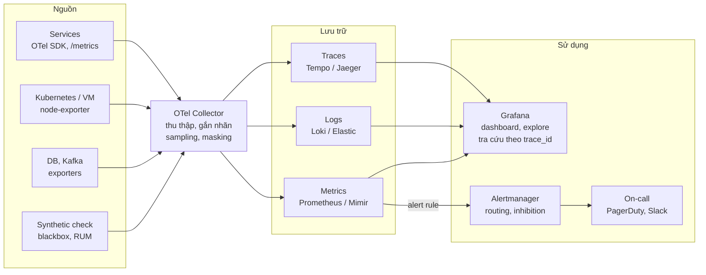

# Mẫu Monitoring Design cho HLD

> Cập nhật: 2026-11-02

## Cách dùng mẫu

Chèn toàn bộ mẫu này vào HLD như một chương riêng (ví dụ: **Chương X. Monitoring & Observability Design**), đánh số lại X.1, X.2… theo tài liệu của bạn.

- Phần trong ngoặc nhọn `{...}` là placeholder, thay bằng giá trị thực của hệ thống.
- Các số liệu trong bảng (99.9%, 300 ms, 15 phút…) là **ví dụ minh họa**, cần thống nhất lại với BA/PO và SRE.
- **Bắt buộc:** X.1, X.2, X.3, X.5, X.6, X.9. **Tùy chọn** (có thể chuyển sang LLD): X.4 chi tiết, X.7, X.8.
- HLD chỉ nêu *cái gì* và *tại sao*; chi tiết cấu hình (query PromQL, file alert rule, dashboard JSON) để ở LLD hoặc runbook.

---

## X.1 Mục đích và phạm vi

**Mục tiêu:** phát hiện sự cố trước người dùng (MTTD ≤ {5} phút), rút ngắn thời gian khắc phục (MTTR ≤ {30} phút), đo được việc đáp ứng SLA {99.9%} với khách hàng, và cung cấp số liệu nghiệp vụ cho {Business/PO}.

**Nguồn yêu cầu:** NFR số {NFR-xx} trong SRS; cam kết SLA trong hợp đồng {tên}; yêu cầu tuân thủ {PCI-DSS / ISO 27001 / NĐ 13/2023}.

**Thành phần trong phạm vi:**

| Thành phần | Loại | Mức độ quan trọng | Team sở hữu |
| --- | --- | --- | --- |
| {api-gateway} | Service | Tier 1 | {Platform} |
| {order-service} | Service | Tier 1 | {Team Order} |
| {notification-service} | Service | Tier 2 | {Team Notify} |
| {PostgreSQL cluster} | Database | Tier 1 | {DBA} |
| {Kafka} | Message broker | Tier 1 | {Platform} |
| {Payment provider X} | Bên thứ ba | Tier 1 | {Team Payment} |

*Tier 1 = sự cố ảnh hưởng trực tiếp đến doanh thu hoặc người dùng, cần on-call 24/7; Tier 2 = xử lý trong giờ hành chính.*

**Ngoài phạm vi:** {môi trường dev/test; các hệ thống nội bộ do team IT quản lý}.

## X.2 SLI, SLO và error budget

Mỗi service Tier 1 có ít nhất một SLO về availability và một SLO về latency, đo trên cửa sổ {30 ngày trượt}. SLO nội bộ phải chặt hơn SLA cam kết với khách hàng để có vùng đệm.

| Service / User journey | SLI (cách đo) | SLO | Error budget / 30 ngày | Nguồn dữ liệu |
| --- | --- | --- | --- | --- |
| {Đặt hàng} – availability | % request HTTP không trả 5xx tại API gateway | {99.9%} | {43 phút} | {Metrics gateway} |
| {Đặt hàng} – latency | % request có thời gian phản hồi < {300 ms} | {95%} | {5% request} | {Metrics gateway} |
| {Thanh toán} – correctness | % giao dịch được đối soát khớp | {99.99%} | {…} | {Job đối soát} |
| {Thông báo} – freshness | % thông báo gửi trong vòng {60 s} | {99%} | {1%} | {Consumer lag Kafka} |

**Chính sách error budget:**

- Còn > {50%} budget: release bình thường.
- Còn {0–50%}: chỉ release có canary, ưu tiên các task về độ tin cậy.
- Hết budget: đóng băng tính năng mới, chỉ deploy bản sửa lỗi cho đến khi budget hồi phục.

**Người phê duyệt SLO:** {SRE Lead} + {Product Owner}. Xem lại SLO mỗi {quý}.

## X.3 Monitoring theo tầng

Mỗi tầng dùng một phương pháp chọn metric chuẩn: **USE** (Utilization, Saturation, Errors) cho tài nguyên, **RED** (Rate, Errors, Duration) cho service, và **Golden Signals** (latency, traffic, errors, saturation) cho user journey.

| Tầng | Phương pháp | Metric chính (ví dụ) | Nguồn / cách thu thập |
| --- | --- | --- | --- |
| Infrastructure (VM, node, container) | USE | CPU, RAM, disk, số pod restart, OOMKilled | {node-exporter, kube-state-metrics} |
| Application / API | RED | Request/s, tỷ lệ lỗi 5xx, latency p50/p95/p99 | {OpenTelemetry SDK, endpoint /metrics} |
| Database | USE + query | Connection pool, slow query > {1 s}, replication lag, dung lượng | {postgres-exporter} |
| Message queue | USE | Consumer lag, số message trong DLQ, tốc độ publish/consume | {kafka-exporter} |
| Network / Load balancer | USE | Bandwidth, packet loss, hết hạn chứng chỉ TLS, lỗi DNS | {Cloud LB metrics, blackbox-exporter} |
| Bên thứ ba | RED | Latency và tỷ lệ lỗi khi gọi {Payment provider X} | {Metrics phía client} |
| End user | Golden Signals | Synthetic check từ {3} vùng, Core Web Vitals, crash rate app | {Synthetic monitoring, RUM} |
| Business | KPI | Số đơn/phút, tỷ lệ thanh toán thành công, số đăng ký mới | {Custom metrics từ service} |
| Security | Sự kiện | Đăng nhập thất bại, truy cập bị từ chối (403), thay đổi quyền | {Audit log → SIEM} |

**Health check:** mỗi service cung cấp `/health/live` (process còn chạy) và `/health/ready` (đã kết nối được DB và các dependency bắt buộc).

**Quy ước đặt tên metric:** `{domain}_{service}_{tên}_{đơn vị}`, ví dụ `shop_order_request_duration_seconds`. Không dùng giá trị có cardinality cao (user_id, order_id) làm label.

## X.4 Logging và distributed tracing

Mọi service ghi log dạng JSON ra stdout, và mọi request mang một `trace_id` xuyên suốt các service để ghép log, metric và trace với nhau.

**Trường bắt buộc trong mỗi dòng log:**

```json
{
  "timestamp": "2026-11-01T08:15:30.123Z",
  "level": "ERROR",
  "service": "order-service",
  "env": "prod",
  "version": "1.4.2",
  "trace_id": "4bf92f3577b34da6a3ce929d0e0e4736",
  "span_id": "00f067aa0ba902b7",
  "message": "Payment provider timeout",
  "error_code": "PAY_TIMEOUT"
}
```

| Level | Khi nào dùng | Bật ở prod |
| --- | --- | --- |
| ERROR | Lỗi cần can thiệp, request thất bại | Có |
| WARN | Bất thường nhưng đã tự xử lý (retry thành công, fallback) | Có |
| INFO | Sự kiện nghiệp vụ chính (tạo đơn, thanh toán xong) | Có |
| DEBUG | Chi tiết để gỡ lỗi | Không (bật tạm thời theo service) |

**Tracing:**

- Chuẩn: {OpenTelemetry}, truyền context theo W3C Trace Context (header `traceparent`), kể cả qua message queue.
- Sampling: {10%} request bình thường, {100%} request lỗi hoặc chậm hơn {1 s} (tail-based sampling tại collector).
- `trace_id` được trả về trong response header để bộ phận hỗ trợ tra cứu khi khách báo lỗi.

**Cấm ghi vào log:** mật khẩu, token, số thẻ đầy đủ, CCCD/CMND; email và số điện thoại phải được che (masking).

## X.5 Kiến trúc và công cụ

Metrics, log và trace đều đi qua một lớp collector chung ({OpenTelemetry Collector}), nên đổi backend lưu trữ sau này không phải sửa code của service. Hệ thống monitoring được triển khai trên {cluster/vùng} tách biệt với hệ thống chính.



Alert sinh ra từ rule đánh giá trên metrics, đi qua Alertmanager để gộp và định tuyến tới người trực. Audit log được gửi thẳng sang {SIEM} và không thể hiện trong hình.

| Thành phần | Lựa chọn | Phương án thay thế | Lý do chọn |
| --- | --- | --- | --- |
| Collector | {OpenTelemetry Collector} | {Fluent Bit + Prometheus Agent} | Chuẩn mở, không phụ thuộc nhà cung cấp |
| Metrics | {Prometheus + Mimir} | {Datadog, CloudWatch} | {PromQL phổ biến, tự vận hành được} |
| Logs | {Loki} | {Elasticsearch / OpenSearch} | {Chi phí lưu trữ thấp} |
| Traces | {Tempo} | {Jaeger} | {Tích hợp sẵn với Grafana} |
| Hiển thị | {Grafana} | {Kibana} | {Một giao diện cho cả 3 loại dữ liệu} |
| Alerting | {Alertmanager + PagerDuty} | {Opsgenie} | {…} |
| Security | {SIEM: Wazuh / Splunk} | {…} | {Yêu cầu compliance} |

## X.6 Alerting và on-call

Chỉ alert khi có việc cần con người làm ngay; mọi alert phải có runbook. Ưu tiên alert theo triệu chứng người dùng thấy (SLO burn rate) hơn alert theo nguyên nhân (CPU cao).

**Mức độ nghiêm trọng:**

| Mức | Định nghĩa | Kênh | Thời gian phản hồi |
| --- | --- | --- | --- |
| P1 – Critical | Tier 1 ngừng hoạt động hoặc mất dữ liệu | Gọi điện + SMS ({PagerDuty/Opsgenie}) | {5 phút}, 24/7 |
| P2 – High | Suy giảm rõ rệt, đang đốt error budget nhanh | Push notification + {Slack #incident} | {15 phút}, 24/7 |
| P3 – Medium | Vấn đề chưa ảnh hưởng người dùng | {Slack #alerts} | Trong giờ hành chính |
| P4 – Low | Cảnh báo xu hướng (disk sẽ đầy sau 7 ngày) | Ticket tự động | Trong {sprint} |

**Quy tắc alert mẫu:**

| Alert | Điều kiện | Mức | Runbook |
| --- | --- | --- | --- |
| OrderAvailabilityBurnFast | Burn rate > 14.4 trong 1 giờ (đốt 2% budget/giờ) | P1 | {link} |
| OrderAvailabilityBurnSlow | Burn rate > 6 trong 6 giờ | P2 | {link} |
| OrderLatencyHigh | p95 > {500 ms} liên tục 10 phút | P2 | {link} |
| KafkaConsumerLag | Lag > {10.000} message trong 15 phút | P2 | {link} |
| DBReplicationLag | Lag > {30 s} trong 5 phút | P2 | {link} |
| TLSCertExpiring | Chứng chỉ hết hạn trong < 14 ngày | P3 | {link} |
| DiskWillFill | Dự báo đầy disk trong < 7 ngày | P4 | {link} |

**Escalation:** on-call chính → sau {15 phút} không xác nhận → on-call phụ → sau {30 phút} → {Engineering Manager}. Lịch on-call xoay vòng {hàng tuần}, mỗi ca có {2} người.

**Runbook tối thiểu gồm:** alert có nghĩa gì, ảnh hưởng tới người dùng, dashboard cần xem, các bước kiểm tra và xử lý, cách rollback, cần báo cho ai.

**Giảm nhiễu:** gộp alert theo service, không báo alert của service con khi service cha đã down (inhibition), tắt alert trong lúc bảo trì có kế hoạch. Mỗi {tháng} xem lại và xóa những alert không dẫn tới hành động nào.

## X.7 Dashboard

Dashboard được quản lý dưới dạng code ({Grafana JSON / Terraform}), không tạo thủ công trên môi trường prod. Dashboard tổng quan và hạ tầng nằm ở `observability/dashboards/` trong repo infra (SRE giữ); dashboard chi tiết của từng service nằm ở `observability/dashboards/` trong repo của service đó (team dev giữ, SRE duyệt). Alert rule và runbook chia theo cùng cách.

| Dashboard | Người dùng | Nội dung chính |
| --- | --- | --- |
| Tổng quan hệ thống | On-call, NOC | Trạng thái SLO của các service Tier 1, error budget còn lại, alert đang mở |
| Service detail (mỗi service một bản) | Team dev sở hữu | RED metrics, lỗi theo endpoint, latency của dependency, phiên bản đang chạy |
| Infrastructure | DevOps / Platform | Tài nguyên cluster, node, database, queue |
| Business | PO, Business | Đơn hàng, doanh thu, tỷ lệ chuyển đổi theo thời gian thực |
| Security | Security / SOC | Đăng nhập bất thường, truy cập bị từ chối, sự kiện audit |
| Release | Dev, QA | So sánh metrics trước và sau deploy, trạng thái canary |

## X.8 Retention, chi phí và bảo mật

| Loại dữ liệu | Lưu trữ nóng (truy vấn nhanh) | Lưu trữ lạnh / archive | Ghi chú |
| --- | --- | --- | --- |
| Metrics | {15 ngày}, độ phân giải {15 s} | {13 tháng}, downsample {5 phút} | Để so sánh cùng kỳ năm trước |
| Application log | {14 ngày} | {90 ngày} trên {object storage} | |
| Audit / security log | {90 ngày} | {1–5 năm} theo quy định | Không được xóa hoặc sửa (WORM) |
| Trace | {7 ngày} | Không lưu | |

**Chi phí:** ước tính {X GB log/ngày}, {Y active series}, khoảng {Z USD/tháng}. Giới hạn mỗi service tối đa {N} active series và {M GB} log/ngày; vượt ngưỡng thì cảnh báo P4 cho team sở hữu.

**Bảo mật:** hệ thống monitoring đăng nhập qua {SSO}, phân quyền theo team; dữ liệu truyền đi được mã hóa TLS; quyền xem audit log chỉ cấp cho {Security}. Bản thân hệ thống monitoring cũng được monitor (meta-monitoring), ví dụ bằng một alert "dead man's switch" gửi tín hiệu liên tục ra một dịch vụ bên ngoài.

## X.9 Trách nhiệm, rủi ro và checklist

**RACI** (R = thực hiện, A = chịu trách nhiệm cuối cùng, C = tham vấn, I = thông báo):

| Hoạt động | Architect | SRE | DevOps | Dev | BA/PO | Security |
| --- | --- | --- | --- | --- | --- | --- |
| Định nghĩa SLI/SLO | C | R/A | I | C | C | I |
| Kiến trúc và công cụ | A | R | R | C | I | C |
| Instrument code | C | C | I | R/A | I | I |
| Alert rule, runbook của thành phần hạ tầng | I | C | R/A | I | I | I |
| Chuẩn alert, Alertmanager, dashboard tổng quan | I | R/A | C | I | I | I |
| Alert rule, runbook của từng service | I | C | I | R/A | I | I |
| On-call | I | R/A | R | R | I | C |
| Dashboard nghiệp vụ | C | C | I | R | A | I |
| Security monitoring | C | C | C | I | I | R/A |

**Rủi ro và cách giảm thiểu:**

| Rủi ro | Cách giảm thiểu |
| --- | --- |
| Quá nhiều alert khiến on-call bỏ qua alert thật | Alert theo SLO burn rate, review alert hàng tháng |
| Hệ thống monitoring sập cùng lúc với hệ thống chính | Đặt monitoring ở {cluster/vùng} riêng, dùng dead man's switch |
| Cardinality metric tăng vọt làm tăng chi phí | Giới hạn series theo service, review label khi code review |
| Lộ dữ liệu cá nhân qua log | Thư viện log có masking mặc định, quét log định kỳ |

**Checklist trước khi duyệt HLD:**

- [ ] Mọi service Tier 1 đã có SLO được SRE và PO phê duyệt
- [ ] Mọi alert P1/P2 có runbook và người nhận
- [ ] Log có `trace_id` và đã loại bỏ dữ liệu nhạy cảm
- [ ] Có health check và synthetic check cho các user journey chính
- [ ] Đã tính retention và chi phí
- [ ] Hệ thống monitoring có meta-monitoring
- [ ] Đã lên kế hoạch kiểm tra alert trong giai đoạn Testing (load test, chaos test)
