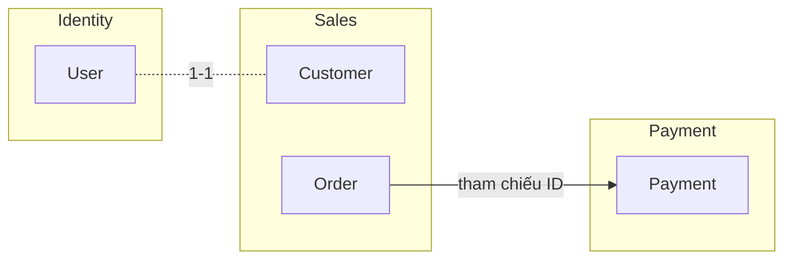
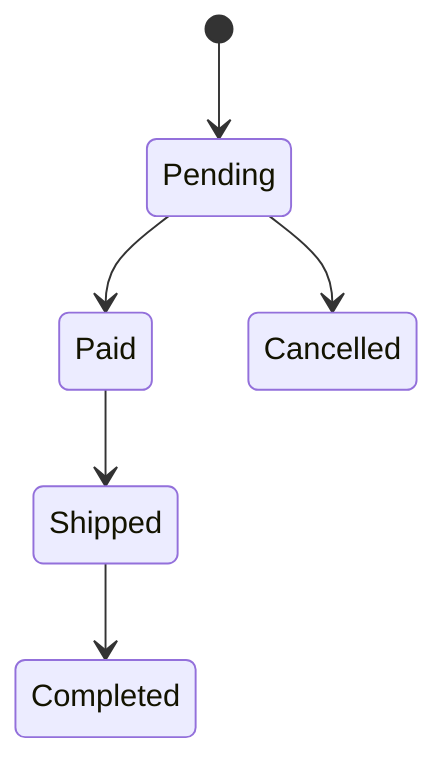

# Domain model

> Tầng 2 – Hệ thống. Nguồn sự thật về entity và quyền sở hữu dữ liệu. `plan.md` của mỗi tính năng phải đối chiếu `data-model.md` với file này: entity mới hoặc thay đổi phải được cập nhật vào đây.

## Bounded context

## Entity

| Entity | Context | Service sở hữu | Thuộc tính chính | Tính năng tạo/sửa |
| --- | --- | --- | --- | --- |
| {User} | {Identity} | {auth-service} | {id, email, status} | F-000 |
| {Order} | {Sales} | {order-service} | {id, customerId, status, total} | F-00x |
| {Payment} | {Payment} | {payment-service} | {id, orderId, amount, status} | F-00x |

## Quy tắc

- Mỗi entity chỉ có **một** service sở hữu và được ghi dữ liệu.
- Service khác chỉ tham chiếu bằng ID, lấy dữ liệu qua API/event trong [api-catalog.md](api-catalog.md).
- Tên entity phải khớp [../product/glossary.md](../product/glossary.md).

## Vòng đời trạng thái quan trọng

