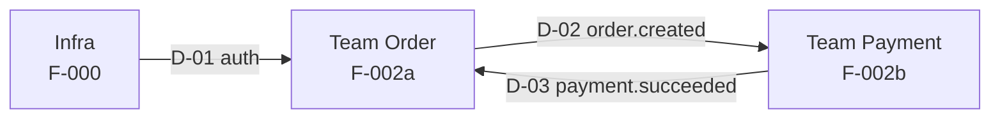

# Phụ thuộc giữa các team

> Tầng điều phối. Ghép từ nhãn `[Needs: …]` và `[Provides: …]` trong mọi `<repo>:specs/*/tasks.md` (đọc qua `workspace/`). Lệnh `/project.plan` sinh bản nháp; Delivery Manager duyệt và theo dõi.

## Bảng phụ thuộc

| Mã | Thứ cần | Bên cung cấp (team / tính năng / task) | Bên cần (team / tính năng / task) | Hạn chốt contract | Hạn sẵn sàng | Trạng thái |
| --- | --- | --- | --- | --- | --- | --- |
| D-01 | {auth middleware} | {Infra / F-000 / T005} | {Team Order / F-002a / T012} | — | {YYYY-MM-DD} | {Done} |
| D-02 | {`order.created` v1} | {Team Order / F-002a / T013} | {Team Payment / F-002b / T004} | {YYYY-MM-DD} | {YYYY-MM-DD} | {Contract approved} |
| D-03 | {`payment.succeeded` v1} | {Team Payment / F-002b / T010} | {Team Order / F-002a / T020} | {YYYY-MM-DD} | {YYYY-MM-DD} | {Planned} |

Trạng thái: `Planned` → `Contract approved` (bên cần làm được bằng mock) → `Ready` (đã có trên staging) → `Done`.

## Sơ đồ phụ thuộc

## Cảnh báo cần xử lý

> `/project.plan` liệt kê ở đây: `Needs` không có `Provides` tương ứng, phụ thuộc vòng, phụ thuộc trễ hạn, phụ thuộc nằm trên đường găng.

| Cảnh báo | Mô tả | Người xử lý | Hạn |
| --- | --- | --- | --- |
| {…} | {…} | {…} | {…} |

## Quy tắc

- Bên cần chỉ được bắt đầu khi phụ thuộc ở trạng thái `Contract approved` trở lên.
- Thay đổi contract đã `Contract approved` phải báo cho mọi bên cần và cập nhật `api-catalog.md`.
- Phụ thuộc vòng giữa hai team (như D-02 và D-03) phải chốt cả hai contract cùng lúc.
