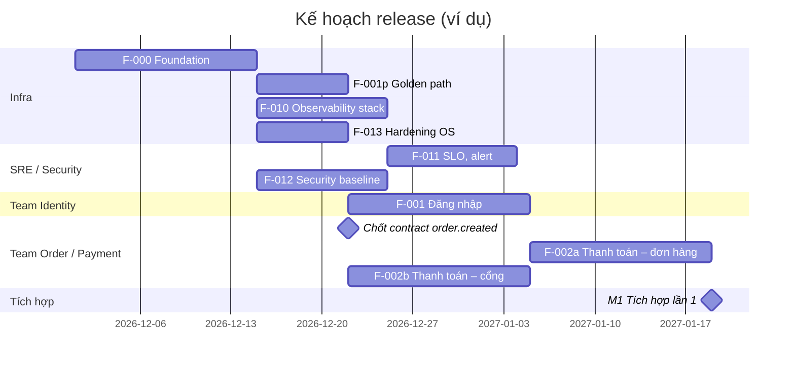

# Release plan

> Tầng điều phối. Các mốc release, mốc tích hợp giữa các team, và việc thủ công không đi qua Spec Kit. Lệnh `/project.plan` sinh bản nháp cập nhật; con người duyệt.

## Các mốc

| Mốc | Ngày dự kiến | Tính năng | Tiêu chí hoàn thành |
| --- | --- | --- | --- |
| M0 – Foundation | {YYYY-MM-DD} | F-000, F-001p, F-010, F-012, F-013 | {Môi trường staging chạy được; CI/CD; golden path dùng được; stack monitoring nhận được log, metrics} |
| M1 – Tích hợp lần 1 | {YYYY-MM-DD} | F-001, F-002a, F-002b | {Luồng đăng nhập → đặt hàng → thanh toán chạy end-to-end trên staging} |
| MVP | {YYYY-MM-DD} | {…} | {UAT đạt, pentest không còn lỗi High, SLO dashboard sẵn sàng} |

## Lịch tích hợp

- Ghép code của các team trên staging: {mỗi sprint / mỗi tuần}.
- Contract API/event phải được duyệt trước mốc tích hợp ít nhất {1 sprint}.
- Test end-to-end chạy tự động sau mỗi lần deploy lên staging.

## Việc thủ công (ngoài Spec Kit)

| Việc | Team | Mốc | Trạng thái |
| --- | --- | --- | --- |
| Pentest | {Security / bên ngoài} | MVP | {Planned} |
| UAT với người dùng thật | {QA + PO} | MVP | {Planned} |
| Change ticket go-live | {Infra} | MVP | {Planned} |
| Đào tạo đội vận hành, bàn giao runbook | {SRE} | MVP | {Planned} |

## Sơ đồ thời gian

