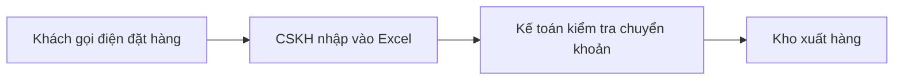

# Quy trình hiện tại (AS-IS)

> Đầu ra B3. Trạng thái: {Draft / Approved} · Nguồn: {danh sách biên bản phỏng vấn}

## Quy trình {tên}

| Bước | Ai làm | Công cụ | Thời gian trung bình | Vấn đề |
| --- | --- | --- | --- | --- |
| {Nhập đơn} | {CSKH} | {Excel} | {5 phút/đơn} | {Gõ sai, trùng đơn} |

## Điểm đau

| # | Điểm đau | Persona | Tần suất | Mức độ (1–5) | Bằng chứng (biên bản, số liệu) | Cách người dùng đang lách |
| --- | --- | --- | --- | --- | --- | --- |
| P1 | {Không biết đơn đang ở đâu} | {Khách hàng} | {Hằng ngày} | 5 | {Phỏng vấn 3/5 người; 40% ticket hỗ trợ} | {Gọi tổng đài} |
