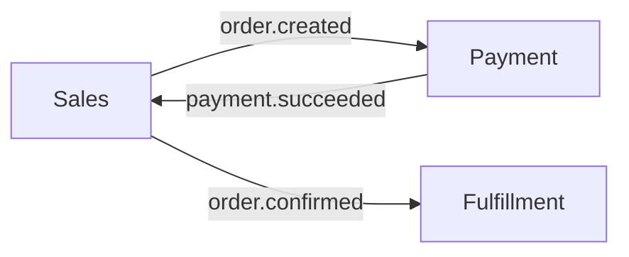

# Event storming

> Đầu ra B7. Trạng thái: {Draft / Approved} · Người tham gia: {…} · Ảnh bảng trắng: {link}

## Dòng event nghiệp vụ

Event viết ở thì quá khứ, xếp theo thời gian.

| # | Actor / hệ thống | Command | Event | Chính sách (khi event xảy ra thì…) | Bounded context |
| --- | --- | --- | --- | --- | --- |
| 1 | Khách hàng | Đặt hàng | Đơn hàng đã được tạo | Yêu cầu thanh toán | Sales |
| 2 | Cổng thanh toán | Xác nhận thanh toán | Thanh toán đã thành công | Xác nhận đơn, báo kho | Payment |
| 3 | Nhân viên kho | Xuất hàng | Đơn hàng đã được giao cho vận chuyển | Gửi thông báo cho khách | Fulfillment |

## Bounded context

| Context | Trách nhiệm | Entity chính | Event phát ra | Event lắng nghe | Team dự kiến |
| --- | --- | --- | --- | --- | --- |
| Sales | {Giỏ hàng, đơn hàng} | Cart, Order | `order.created` | `payment.succeeded` | {Team Order} |
| Payment | {Thanh toán, hoàn tiền} | Payment | `payment.succeeded` | `order.created` | {Team Payment} |

## Điểm nóng (hotspot)

| Điểm nóng | Mô tả | Người xử lý |
| --- | --- | --- |
| {Hoàn tiền một phần} | {Chưa rõ quy tắc} | {PO} |
