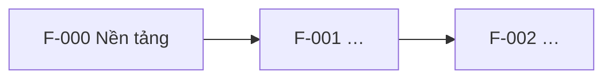

# Feature map

> Tầng 1 – Sản phẩm. Bảng chỉ mục giữ cái nhìn tổng thể: mỗi tính năng ứng với một thư mục `specs/F-xxx-…` của Spec Kit, nằm trong repo của team theo bảng "Danh sách repo" (`docs/delivery/team-map.md`). Cập nhật trạng thái ở phase cuối của `tasks.md` mỗi tính năng.

## Danh sách tính năng

| Mã | Tính năng | Loại | REQ / NFR / HLD | Lớp | Team | Phụ thuộc | Spec | Release | Trạng thái | Issue |
| --- | --- | --- | --- | --- | --- | --- | --- | --- | --- | --- |
| F-000 | {Foundation: account/IAM, mạng, K8s, CI/CD} | Enabler | HLD 11, 7.2 | L0–L3 | {Infra} | — | `{infra}:specs/F-000-foundation` | {M0} | {Planned} | {acme/project-docs#12} |
| F-001p | {Golden path: Helm chart chuẩn, ingress, cert-manager, External Secrets} | Enabler | HLD 11, 7.3 | L6 | {Infra} | F-000 | — | {M0} | {Planned} | |
| F-010 | {Observability stack: Prometheus, Loki, Tempo, Grafana, Alertmanager} | Enabler | HLD 10 | L5 | {Infra} | F-000 | — | {M0} | {Planned} | |
| F-011 | {SLO, chuẩn alert, Alertmanager, dashboard tổng quan} | Enabler | HLD 10, NFR-001, NFR-005 | — | {SRE} | F-010 | {`{infra}:specs/F-011-…` (SRE đóng góp vào repo infra)} | {M1} | {Planned} | |
| F-012 | {Security baseline: SIEM, WAF, quét lỗ hổng} | Enabler | HLD 7, NFR-003 | — | {Security} | F-000 | — | {M0} | {Planned} | |
| F-013 | {Hardening OS theo CIS (Ansible)} | Enabler | HLD 7, NFR-003 | L4 | {Infra} | F-000 | — | {M0} | {Planned} | |
| F-014 | {Backup và DR} | Enabler | HLD 8.4, NFR-006 | — | {Infra} | F-000 | — | {M1} | {Planned} | |
| C-01 | {Contract `order.created` v1} | Contract | HLD 6 | — | {Team Order} | — | — | {M1} | {Planned} | |
| F-001 | {Đăng nhập} | Business | REQ-01 | — | {Team Identity} | F-001p | `{auth-service}:specs/F-001-…` | {M1} | {Planned} | |
| F-002a | {Thanh toán – phía đơn hàng} | Business | REQ-02 | — | {Team Order} | F-001p, F-001, C-01 | — | {M1} | {Planned} | |
| F-002b | {Thanh toán – phía cổng thanh toán} | Business | REQ-02 | — | {Team Payment} | F-001p, C-01 | — | {M1} | {Planned} | |

- **Loại:** Business (tính năng nghiệp vụ), Enabler (việc nền tảng cho Infra, SRE, Security, DBA, QA), Contract (thỏa thuận API/event giữa hai team, làm trước các feature dùng nó).
- **Lớp:** lớp hạ tầng L0–L6 cho enabler của Infra (L0 nền móng, L1 mạng, L2 security baseline, L3 compute/K8s/DB, L4 cấu hình OS, L5 observability stack, L6 golden path).
- Feature business phụ thuộc **golden path** (F-001p), không chỉ foundation, vì đó là thứ cho phép team deploy service lên staging.
- **Spec:** `<repo>:specs/F-xxx-…`. Repo là repo chứa `specs/` của tính năng: repo của team sở hữu, hoặc repo mà team đó đóng góp theo đường dẫn (ví dụ tính năng của SRE ở repo infra).
- **Issue:** issue của feature nằm ở repo `project-docs`, dạng `owner/repo#số`, lấy từ `docs/delivery/backlog-issues.json` sau khi chạy `scripts/backlog-sync.sh --apply`. Task là sub-issue nằm ở repo của team.
- Bản nháp chia việc lấy từ lệnh `/project.breakdown`; con người duyệt rồi mới ghi vào bảng này.

> Việc của từng team và phụ thuộc giữa các team: [../delivery/](../delivery/).

Trạng thái: `Planned` → `Specified` → `Planned (plan.md)` → `In progress` → `Done`.

## Thứ tự và phụ thuộc

## Quy tắc

- Không chạy `/speckit.specify` cho tính năng chưa có dòng trong bảng này.
- Tính năng chỉ được bắt đầu khi mọi tính năng nó phụ thuộc đã `Done`, hoặc phần phụ thuộc đã có contract (API/event) được duyệt trong `api-catalog.md`.
- Một tính năng nên có tối đa khoảng 5–7 user story; lớn hơn thì tách.
- **Một tính năng, một team.** Chia theo lát cắt dọc. Tính năng buộc phải trải qua nhiều team thì tách thành nhiều spec (F-002a, F-002b), nối với nhau bằng contract trong `api-catalog.md`.
- Việc của Infra, SRE, Security cần sinh code hoặc cấu hình (CI/CD, IaC, alert rule) cũng là một tính năng có spec riêng. Việc thủ công (pentest, UAT, change ticket) để trong `docs/delivery/release-plan.md`.
