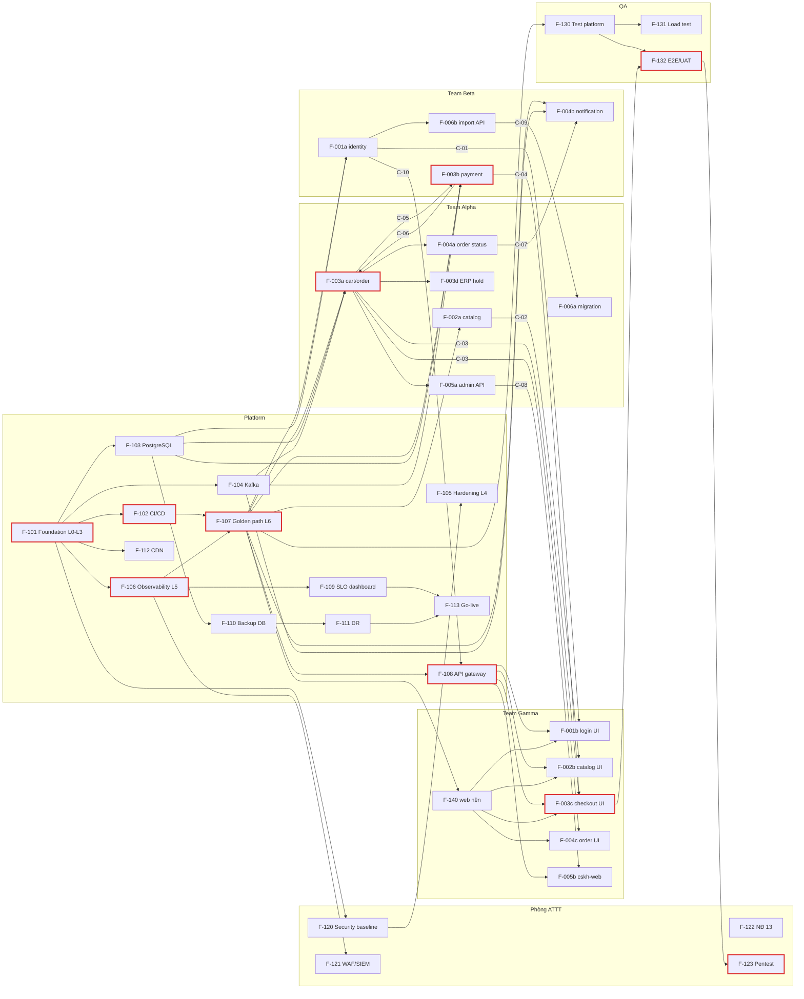

# Ví dụ output của `/project.breakdown` – dự án ShopNow

> **Kết quả chạy thật** (Claude Code, `claude -p "/project.breakdown"`, chỉ cho phép đọc file, 2026-11-02). Giữ nguyên, chỉ bỏ một câu cuối ngỏ ý đăng báo cáo thành trang riêng (không liên quan tới lệnh).
>
> Liên quan: [../.claude/commands/project.breakdown.md](../.claude/commands/project.breakdown.md) · [shopnow/](shopnow/) · bước trước: [shopnow-teammap.example.md](shopnow-teammap.example.md)

## Đầu vào

Chuỗi đầy đủ trước lệnh này:

1. [shopnow/input/](shopnow/input/): đầu vào sau B7.
2. `/project.hld` rồi `/project.teammap`: [shopnow/output/](shopnow/output/) (`Draft (AI)`).
3. **Review giả lập**: EM và Architect trả lời các câu hỏi chặn chia việc (Q-03, Q-08, Q-10, Q-15–Q-21, Q-23), áp vào HLD, team-map, release-plan và chuyển `Approved`. Kết quả: [shopnow/reviewed/](shopnow/reviewed/). Các câu trả lời này **là giả lập** để chạy tiếp ví dụ, xem [open-questions.md](shopnow/reviewed/docs/discovery/open-questions.md).

Các quyết định chính của review giả lập: notification-service → Team Beta; data-migration và adapter ERP → Team Alpha (ADR-0008); cskh-web → Team Gamma qua contract; Kafka + outbox (ADR-0004); Platform làm cả việc DBA, Hùng (Platform) là SRE tạm; pentest thuê ngoài; load test → QA (k6). MVP 2027-01-25, M0 và M1 chưa có ngày.

## Đáng chú ý

- Lệnh tự phát hiện chỗ lệch giữa các file đã duyệt: `api-catalog.md` còn producer "ERP integration" trái ADR-0008 (G7), thiếu API nhập khách hàng cho data-migration (G8 → C-09), thiếu quy ước xác thực token tại gateway (G9 → C-10).
- Đánh mã enabler theo dải F-101…F-140 thay vì F-000, F-001p, F-010 như trong mẫu, và hỏi lại ở câu 1 của mục 7. Lệnh không quy định cách đánh mã, nên đây là chỗ con người chốt.
- Không đặt ngày; hạn chốt contract ghi dạng "M1 − 1 sprint".

---

## Output

Tôi đã đọc toàn bộ đầu vào và không sửa file nào. Dưới đây là bản đề xuất để con người review.

# Đề xuất chia việc – ShopNow (`/project.breakdown`)

## 1. Thiếu sót đầu vào (Bước 0) và giả định đã dùng

| # | Kiểm tra | Kết quả | Ảnh hưởng tới cách chia / giả định đã dùng |
| --- | --- | --- | --- |
| G1 | Thành phần trong HLD chưa có team sở hữu | **Không có.** Cả 10 thành phần ở HLD §3 đều có team sở hữu | — |
| G2 | Mục xuyên suốt chưa có bảng "Team thực hiện" | **Không có.** HLD §6–§10 đều có bảng. Ba dòng vẫn ghi "(giả định)" hoặc "mặc định `/project.breakdown`": WAF/SIEM, hardening OS, môi trường test. Thêm hai dòng giả định là đánh giá NĐ 13 và SLO dashboard | Các enabler F-105, F-109, F-121, F-122, F-130 được đánh dấu **Mặc định/giả định** |
| G3 | Tên team trong HLD không có trong `team-map.md` | Không lệch. Các bên "Đơn vị pentest bên ngoài", "Phòng IT", "Pháp chế" không phải team trong team-map | Pentest (F-123) gán cho **Phòng ATTT** làm đầu mối. Phòng IT và cổng thanh toán là **phụ thuộc bên ngoài**, không sinh contract `C-xx` |
| G4 | NFR chưa điền "Mục HLD đáp ứng" | **Có.** Cột này trong `docs/product/nfr.md` còn trống ở cả 8 NFR | Tôi lấy dữ liệu từ **HLD §12** (Approved). Cần chép sang `nfr.md` |
| G5 | Team trong team-map không sở hữu thành phần nào | **Phòng ATTT, QA.** Đây là thiết kế có chủ đích, vì hai team này sở hữu việc chứ không sở hữu thành phần | Mỗi team nhận enabler riêng (F-120…F-123, F-130…F-132) |
| G6 | `domain-model.md`: cột "Service sở hữu" còn `{chưa đặt}` | Lệch so với HLD §3 | Tôi dùng HLD §3 (User/Customer → identity-service, …) |
| G7 | `api-catalog.md` còn ghi producer "ERP integration" cho `order.shipped` và cho API ERP | Trái ADR-0008 (không có thành phần ACL riêng) | Tôi coi **sales-service** phát `order.shipped`, còn catalog-service và sales-service gọi ERP trực tiếp |
| G8 | `api-catalog.md` **thiếu API nhập khách hàng** cho data-migration | data-migration (Alpha) phải ghi dữ liệu Customer vào identity-service (Beta). Nguyên tắc P2 cấm ghi thẳng vào DB của service khác | Thêm contract mới **C-09** và feature **F-006b** (Beta) |
| G9 | Thiếu quy ước xác thực token tại API gateway | Gateway (Platform) xác thực token của IdP khách (ADR-0005, Beta) và token Keycloak | Thêm contract **C-10** |
| G10 | Các ADR quyết định nội dung enabler chưa chốt: 0001, 0003, 0005, 0007, 0009, 0011–0013, 0016. Các câu hỏi Q-01, Q-04, Q-05, Q-07 vẫn Open | Không đổi cách chia, nhưng đổi phạm vi và cỡ việc | Giả định **microservice theo bounded context** (khớp HLD §3). Nếu ADR-0001 chọn modular monolith thì F-107 và F-103 nhỏ đi, còn cách chia business giữ nguyên |
| G11 | `release-plan.md` có mốc M0, M1, MVP; chỉ MVP có ngày (2027-01-25) | — | Chỉ gán M0, M1, MVP; không tự đặt ngày |

## 2. Đề xuất feature map

Chú thích cột Ghi chú: **Mới** là dòng thêm mới; **Đổi** là dòng đã có nhưng thay đổi; **Mặc định** là dòng dùng ánh xạ mặc định hoặc giả định; **ĐG** là feature nằm trên đường găng. Hai cột "Cỡ" và "Ghi chú" được thêm vào cuối, các cột khác giữ đúng `feature-map.md`.

### 2a. Feature đã có, chuyển thành epic (giữ mã)

| Mã | Tính năng | Loại | REQ / NFR / HLD | Lớp | Team | Phụ thuộc | Spec | Release | Trạng thái | Issue | Cỡ | Ghi chú |
| --- | --- | --- | --- | --- | --- | --- | --- | --- | --- | --- | --- | --- |
| F-001 | Đăng ký, đăng nhập khách | Epic → F-001a, F-001b | REQ-01 | — | (tách) | — | — | MVP | Planned | | — | Đổi |
| F-002 | Danh mục, tìm sản phẩm | Epic → F-002a, F-002b | REQ-02 | — | (tách) | — | — | MVP | Planned | | — | Đổi |
| F-003 | Giỏ hàng, đặt hàng, thanh toán thẻ | Epic → F-003a, F-003b, F-003c, F-003d | REQ-03, REQ-04 | — | (tách) | — | — | MVP | Planned | | — | Đổi |
| F-004 | Theo dõi đơn, thông báo | Epic → F-004a, F-004b, F-004c | REQ-05, REQ-06 | — | (tách) | — | — | MVP | Planned | | — | Đổi |
| F-005 | Màn hình CSKH | Epic → F-005a, F-005b | REQ-07 | — | (tách) | — | — | MVP | Planned | | — | Đổi |
| F-006 | Chuyển đổi dữ liệu | Epic → F-006a, F-006b | REQ-08 | — | (tách) | — | — | MVP | Planned | | — | Đổi |

### 2b. Contract

| Mã | Tính năng | Loại | REQ / NFR / HLD | Lớp | Team (bên cung cấp → bên dùng) | Phụ thuộc | Spec | Release | Trạng thái | Issue | Cỡ | Ghi chú |
| --- | --- | --- | --- | --- | --- | --- | --- | --- | --- | --- | --- | --- |
| C-01 | Identity API cho customer-web: đăng ký, `GET /customers/me`, luồng OIDC | Contract | REQ-01, NFR-003 | — | Team Beta → Team Gamma | ADR-0005 | — | M0 | Planned | | S | Mới |
| C-02 | Catalog API: `GET /products?q=`, `GET /products/{id}` | Contract | REQ-02 | — | Team Alpha → Team Gamma | ADR-0009 | — | M0 | Planned | | S | Mới |
| C-03 | Cart và Order API cho khách: carts, `POST /orders`, `GET /orders` | Contract | REQ-03, REQ-05 | — | Team Alpha → Team Gamma | — | — | M0 | Planned | | S | Mới |
| C-04 | Payment checkout API: `POST /payments/{orderId}/checkout` | Contract | REQ-04 | — | Team Beta → Team Gamma | ADR-0007, Q-07 | — | M0 | Planned | | S | Mới |
| C-05 | Event `order.created` v1 | Contract | REQ-03, NFR-001 | — | Team Alpha → Team Beta | ADR-0004 | — | M0 | Planned | | S | Mới · **chốt cùng C-06** |
| C-06 | Event `payment.succeeded` / `payment.failed` v1 | Contract | REQ-04, NFR-001 | — | Team Beta → Team Alpha | ADR-0004 | — | M0 | Planned | | S | Mới · **chốt cùng C-05** |
| C-07 | Event `order.status_changed`, `order.shipped` v1 | Contract | REQ-05, REQ-06, REQ-07 | — | Team Alpha → Team Beta | ADR-0004, ADR-0008, Q-04 | — | M1 | Planned | | S | Mới |
| C-08 | Admin Order API cho CSKH, kèm claim/role từ Keycloak | Contract | REQ-07, NFR-003 | — | Team Alpha → Team Gamma | ADR-0006 | — | M1 | Planned | | S | Mới |
| C-09 | API nhập khách hàng hàng loạt và trả bảng ánh xạ ID cũ → mới | Contract | REQ-08, P2 | — | Team Beta → Team Alpha | ADR-0015, Q-12 | — | M1 | Planned | | S | Mới · thiếu trong api-catalog (G8) |
| C-10 | Quy ước route và xác thực token tại gateway: issuer, JWKS, claim, rate limit | Contract | NFR-003, HLD 3, 10 | — | Team Beta (IdP khách) → Platform; Platform → Gamma, Alpha, Beta | ADR-0005, ADR-0006 | — | M0 | Planned | | S | Mới (G9) |

### 2c. Business (một feature, một team)

| Mã | Tính năng | Loại | REQ / NFR / HLD | Lớp | Team | Phụ thuộc | Spec | Release | Trạng thái | Issue | Cỡ | Ghi chú |
| --- | --- | --- | --- | --- | --- | --- | --- | --- | --- | --- | --- | --- |
| F-001a | identity-service: đăng ký, đăng nhập email/SĐT qua OIDC, phát `customer.registered` | Business | REQ-01, NFR-003, NFR-004 | — | Team Beta | F-107, F-103, F-104, C-01, C-10 | — | M1 | Planned | | M | Mới · Q-11 (SĐT dùng mật khẩu hay OTP) |
| F-001b | customer-web: màn hình đăng ký, đăng nhập | Business | REQ-01, NFR-008 | — | Team Gamma | F-140, F-108, C-01 | — | M1 | Planned | | M | Mới |
| F-002a | catalog-service: sản phẩm, tìm kiếm, adapter ERP đồng bộ giá/tồn kho, cache | Business | REQ-02, NFR-002, HLD 8 (X-18) | — | Team Alpha | F-107, F-103, ADR-0008, ADR-0009 | — | M1 | Planned | | L | Mới · tách tiếp nếu ADR-0009 chọn search engine riêng |
| F-002b | customer-web: danh mục, tìm kiếm, chi tiết sản phẩm | Business | REQ-02, NFR-008 | — | Team Gamma | F-140, F-108, C-02 | — | M1 | Planned | | M | Mới |
| F-003a | sales-service: giỏ hàng, đặt hàng, outbox `order.created`, xử lý `payment.*` | Business | REQ-03, NFR-001 (X-13a), NFR-006 | — | Team Alpha | F-107, F-103, F-104, C-03, C-05, C-06 | — | M1 | Planned | | L | Mới · ĐG M1 |
| F-003b | payment-service: checkout, tích hợp cổng thanh toán, callback idempotent, outbox `payment.*` | Business | REQ-04, NFR-001 (X-13b), X-08 | — | Team Beta | F-107, F-103, F-104, C-04, C-05, C-06, Q-07 | — | M1 | Planned | | L | Mới · ĐG M1 · rủi ro Q-07 |
| F-003c | customer-web: giỏ hàng, checkout, chuyển sang trang thanh toán | Business | REQ-03, REQ-04, NFR-008 | — | Team Gamma | F-140, F-108, C-03, C-04 | — | M1 | Planned | | L | Mới · ĐG M1 |
| F-003d | sales-service: adapter ERP giữ / hủy giữ tồn kho | Business | REQ-03, P7, NFR-002 | — | Team Alpha | F-003a, ADR-0008, **Q-04** | — | M1 | Planned | | M | Mới · tách khỏi F-003a để cô lập rủi ro H1; M1 chạy với ERP stub nếu Q-04 chưa có câu trả lời |
| F-004a | sales-service: API trạng thái đơn, nhận xuất kho từ ERP, phát `order.status_changed` / `order.shipped` | Business | REQ-05, REQ-06 | — | Team Alpha | F-003a, C-03, C-07, Q-04 | — | MVP | Planned | | M | Mới |
| F-004b | notification-service: gửi email/SMS theo event (`customer.registered`, `payment.*`, `order.*`) | Business | REQ-06, NFR-007 | — | Team Beta | F-107, F-103, F-104, C-06, C-07, Q-06 | — | MVP | Planned | | M | Mới · rủi ro Q-06 (NĐ 13) |
| F-004c | customer-web: danh sách đơn, trạng thái đơn | Business | REQ-05, NFR-008 | — | Team Gamma | F-140, F-108, C-03 | — | MVP | Planned | | S | Mới |
| F-005a | sales-service: Admin Order API, phân quyền theo token Keycloak (X-06b) | Business | REQ-07, NFR-003 | — | Team Alpha | F-003a, C-08, C-10 | — | MVP | Planned | | M | Mới |
| F-005b | cskh-web: SSO và MFA qua Keycloak (X-06a), tìm đơn, cập nhật trạng thái | Business | REQ-07, NFR-003 | — | Team Gamma | F-107, F-108, C-08, client Keycloak (Phòng IT) | — | MVP | Planned | | M | Mới |
| F-006a | data-migration: trích xuất, khử trùng ~5% khách, chuyển đơn 24 tháng, chạy thử | Business | REQ-08 | — | Team Alpha | F-003a, C-09, ADR-0015, **Q-12** | — | MVP | Planned | | L | Mới |
| F-006b | identity-service: endpoint nhập khách hàng hàng loạt | Business | REQ-08 | — | Team Beta | F-001a, C-09 | — | MVP | Planned | | S | Mới |

**DoD chung cho mọi feature business** (không tạo enabler riêng, theo HLD §7 và §9):

- Instrument đủ NFR-005 (X-22): health check, log JSON có trace_id, metrics RED.
- SLO, alert, runbook của service (X-21), để Hùng duyệt.
- Cấu hình HA (X-12b).
- Mã hóa PII khi lưu (X-07).
- Schema và migration của service (X-28b).
- Schema event do producer sở hữu (X-13c).

### 2d. Enabler

| Mã | Tính năng (kết quả cho team khác dùng được) | Loại | REQ / NFR / HLD | Lớp | Team | Phụ thuộc | Spec | Release | Trạng thái | Issue | Cỡ | Ghi chú |
| --- | --- | --- | --- | --- | --- | --- | --- | --- | --- | --- | --- | --- |
| F-101 | **Foundation:** namespace, môi trường dev/staging/prod, Terraform state, mạng/DNS/TLS, network policy, secret/khóa (ADR-0014), dung lượng cụm và autoscaling. *Kết quả: mọi team có namespace staging và secret store dùng được* | Enabler | HLD 6 (X-03), 10 (X-24, X-25), 8 (X-16); NFR-004, NFR-007 | L0–L3 | Platform | — | — | M0 | Planned | | L | Mới · **ĐG mọi team** · Q-05 |
| F-102 | **CI/CD và registry** (ADR-0016). *Kết quả: các team build và push image, deploy service mẫu lên dev/staging qua pipeline* | Enabler | HLD 10 (X-26) | L3 | Platform | F-101 | — | M0 | Planned | | M | Mới · ĐG |
| F-103 | **Cụm PostgreSQL dùng chung và migration tooling** (ADR-0003). *Kết quả: mỗi service xin được DB/schema và chạy migration trong pipeline* | Enabler | HLD 10 (X-28a); NFR-004, NFR-006 | L3 | Platform | F-101 | — | M0 | Planned | | M | Mới · ĐG cho Alpha, Beta |
| F-104 | **Kafka** (ADR-0004): topic, ACL, quy ước đặt tên. *Kết quả: service publish/consume được trên staging* | Enabler | HLD 2, 10 (X-33); NFR-001 | L3 | Platform | F-101 | — | M0 | Planned | | M | Mới |
| F-105 | **Hardening OS / node K8s** theo CIS | Enabler | HLD 6 (X-04) | L4 | Platform | F-101, F-120 (chuẩn CIS) | — | M1 | Planned | | S | Mới · **Mặc định** |
| F-106 | **Stack observability** (ADR-0012). *Kết quả: log, metrics, trace của service mẫu hiện trên Grafana* | Enabler | HLD 9 (X-20); NFR-005 | L5 | Platform | F-101 | — | M0 | Planned | | M | Mới · ĐG (tiêu chí M0) |
| F-107 | **Golden path** Helm chart Java/Node.js: probe, PDB, HPA, ingress, cert, external secret, agent observability (ADR-0011). *Kết quả: các team deploy service mẫu lên staging bằng chart chuẩn* | Enabler | HLD 10 (X-27), 7 (X-12a); NFR-005, NFR-001 | L6 | Platform | F-101, F-102, F-106 | — | M0 | Planned | | L | Mới · **ĐG mọi team** |
| F-108 | **API gateway:** cấu hình ingress, route, xác thực token khách và Keycloak, rate limit. *Kết quả: customer-web và cskh-web gọi được API qua gateway trên staging* | Enabler | HLD 3, 10 (X-25); NFR-003 | L6 | Platform | F-101, F-107, C-10 | — | M0 | Planned | | M | Mới · ĐG cho Gamma |
| F-109 | **SLO dashboard đặt hàng/thanh toán, alert routing, on-call hạ tầng**; Hùng duyệt SLO của các service | Enabler | HLD 9 (X-23), 7 (X-15b); NFR-001 | L5 | Platform | F-106, SLO của F-003a, F-003b | — | MVP | Planned | | M | Mới · **Mặc định** (X-23 giả định) |
| F-110 | **Backup và replication PostgreSQL** đạt RPO ≤ 5 phút | Enabler | HLD 7 (X-11); NFR-006 | L3 | Platform | F-101, F-103, ADR-0013 | — | M1 | Planned | | M | Mới |
| F-111 | **Kiến trúc DR, site dự phòng, diễn tập DR** đạt RTO ≤ 1 giờ | Enabler | HLD 7 (X-10, X-14); NFR-006 | L3 | Platform | F-110, ADR-0013, **Q-05** | — | MVP | Planned | | M | Mới · rủi ro lớn nếu không có site 2 |
| F-112 | **CDN / cache tĩnh** cho customer-web | Enabler | HLD 8 (X-17a); NFR-002 | L1 | Platform | F-101, ADR-0010 | — | MVP | Planned | | S | Mới |
| F-113 | **Go-live:** change ticket, đào tạo đội vận hành, bàn giao runbook (việc thủ công) | Enabler | HLD 10 (X-30, X-32), release-plan | — | Platform | F-109, F-111, runbook của các team | — | MVP | Planned | | S | Mới |
| F-120 | **Security baseline:** chính sách bảo mật, threat model, chuẩn CIS, quét lỗ hổng trong pipeline | Enabler | HLD 6 (X-01); NFR-003, NFR-004 | — | Phòng ATTT | F-101, F-102 | — | M0 | Planned | | M | Mới |
| F-121 | **WAF rule, SIEM** (nhận log từ stack observability) | Enabler | HLD 6 (X-02) | — | Phòng ATTT | F-101, F-106, F-108 | — | MVP | Planned | | M | Mới · **Mặc định** (giả định) |
| F-122 | **Đánh giá tuân thủ NĐ 13/2023, data residency** | Enabler | HLD 6 (X-09); NFR-007 | — | Phòng ATTT | Q-05, Q-06, Q-13 | — | MVP | Planned | | S | Mới · **Mặc định** (giả định) |
| F-123 | **Pentest trước MVP** (đơn vị ngoài thực hiện, Phòng ATTT duyệt) | Enabler | HLD 6 (X-01b), release-plan | — | Phòng ATTT | M1 hoàn thành, F-121 | — | MVP | Planned | | M | Mới · ĐG MVP |
| F-130 | **Test platform:** môi trường, dữ liệu test dùng chung, khung E2E Playwright chạy sau mỗi lần deploy lên staging | Enabler | HLD 10 (X-29), release-plan | — | QA | F-107 | — | M0 | Planned | | M | Mới · **Mặc định** |
| F-131 | **Load test NFR-002** (k6) | Enabler | HLD 8 (X-19); NFR-002 | — | QA | F-130, F-003a/b/c, F-002a, **Q-01** | — | MVP | Planned | | M | Mới · thiếu số req/s |
| F-132 | **E2E luồng chính và UAT** | Enabler | X-31, release-plan | — | QA | F-130, các feature business | — | MVP | Planned | | M | Mới · ĐG MVP |
| F-140 | **customer-web nền:** app shell mobile-first, component đạt WCAG 2.1 AA, kiểm tra a11y tự động trong CI, cache header | Enabler | NFR-008, HLD 8 (X-17b), P8 | — | Team Gamma | F-107, ADR-0010 | — | M0 | Planned | | M | Mới |

## 3. Việc theo team

**Platform** (theo thứ tự lớp):

1. L0–L3: F-101 Foundation (ĐG)
2. L3: F-102 CI/CD (ĐG), F-103 PostgreSQL, F-104 Kafka, F-110 Backup DB, F-111 DR
3. L1: F-112 CDN, xếp sau vì phụ thuộc ADR-0010
4. L4: F-105 Hardening
5. L5: F-106 Observability stack, F-109 SLO dashboard và on-call
6. L6: F-107 Golden path (ĐG), F-108 API gateway
7. Thủ công: F-113 Go-live

Platform cũng là bên dùng của C-10.

**Team Alpha:**

- Feature: F-002a, F-003a, F-003d, F-004a, F-005a, F-006a.
- Contract cung cấp: C-02, C-03, C-05, C-07, C-08.
- Contract dùng: C-06, C-09.

**Team Beta:**

- Feature: F-001a, F-003b, F-004b, F-006b.
- Contract cung cấp: C-01, C-04, C-06, C-09, C-10 (phía IdP).
- Contract dùng: C-05, C-07.

**Team Gamma:**

- Feature: F-140, F-001b, F-002b, F-003c, F-004c, F-005b.
- Contract dùng: C-01, C-02, C-03, C-04, C-08, C-10.

**Phòng ATTT:** F-120, F-121, F-122, F-123. Phòng ATTT duyệt X-03…X-08 và X-25…X-27.

**QA:** F-130, F-131, F-132.

## 4. Phụ thuộc đề xuất (định dạng `dependencies.md`)

Hạn chốt contract theo release-plan là "trước mốc tích hợp ít nhất 1 sprint". Tôi không đặt ngày. Các dòng D-01…D-03 trong file hiện tại chỉ là ví dụ và sẽ được thay bằng bảng này.

| Mã | Thứ cần | Bên cung cấp (team / tính năng) | Bên cần (team / tính năng) | Hạn chốt contract | Hạn sẵn sàng | Trạng thái |
| --- | --- | --- | --- | --- | --- | --- |
| D-01 | Môi trường, mạng, secret store **(ĐG)** | Platform / F-101 | Platform / F-102…F-108; Phòng ATTT / F-120, F-121 | — | M0 | Planned |
| D-02 | Pipeline CI/CD, registry **(ĐG)** | Platform / F-102 | Platform / F-107; Phòng ATTT / F-120 | — | M0 | Planned |
| D-03 | Stack observability | Platform / F-106 | Platform / F-107, F-109; Phòng ATTT / F-121 | — | M0 | Planned |
| D-04 | Golden path Helm chart **(ĐG mọi team)** | Platform / F-107 | Alpha / F-002a, F-003a; Beta / F-001a, F-003b, F-004b; Gamma / F-140, F-005b; QA / F-130 | — | M0 | Planned |
| D-05 | DB/schema PostgreSQL và migration tooling | Platform / F-103 | Alpha / F-002a, F-003a; Beta / F-001a, F-003b, F-004b; Platform / F-110 | — | M0 | Planned |
| D-06 | Kafka topic, ACL | Platform / F-104 | Alpha / F-003a, F-004a; Beta / F-001a, F-003b, F-004b | — | M0 | Planned |
| D-07 | API gateway route và xác thực **(ĐG cho Gamma)** | Platform / F-108 | Gamma / F-001b, F-002b, F-003c, F-004c, F-005b | — | M0 | Planned |
| D-08 | C-10 issuer, JWKS, claim | Beta / F-001a | Platform / F-108 | M0 − 1 sprint | M0 | Planned |
| D-09 | Chuẩn CIS | Phòng ATTT / F-120 | Platform / F-105 | — | M1 | Planned |
| D-10 | C-01 Identity API | Beta / F-001a | Gamma / F-001b | M1 − 1 sprint | M1 | Planned |
| D-11 | C-02 Catalog API | Alpha / F-002a | Gamma / F-002b | M1 − 1 sprint | M1 | Planned |
| D-12 | C-03 Cart/Order API | Alpha / F-003a | Gamma / F-003c, F-004c | M1 − 1 sprint | M1 | Planned |
| D-13 | C-04 Checkout API | Beta / F-003b | Gamma / F-003c | M1 − 1 sprint | M1 | Planned |
| D-14 | C-05 `order.created` v1 **(ĐG M1; vòng với D-15)** | Alpha / F-003a | Beta / F-003b | M1 − 1 sprint | M1 | Planned |
| D-15 | C-06 `payment.*` v1 **(ĐG M1; vòng với D-14)** | Beta / F-003b | Alpha / F-003a; Beta / F-004b | M1 − 1 sprint | M1 | Planned |
| D-16 | C-07 `order.status_changed`, `order.shipped` | Alpha / F-004a | Beta / F-004b | MVP − 1 sprint | MVP | Planned |
| D-17 | C-08 Admin Order API | Alpha / F-005a | Gamma / F-005b | MVP − 1 sprint | MVP | Planned |
| D-18 | C-09 API nhập khách hàng | Beta / F-006b | Alpha / F-006a | MVP − 1 sprint | MVP | Planned |
| D-19 | Môi trường test và E2E | QA / F-130 | QA / F-131, F-132 | — | M1 | Planned |
| D-20 | Backup DB | Platform / F-110 | Platform / F-111 | — | MVP | Planned |
| D-21 | SLO và runbook của service Tier 1 | Alpha / F-003a; Beta / F-003b | Platform / F-109, F-113 | — | MVP | Planned |
| E-01 | API giữ hàng và sự kiện xuất kho (Q-04) | Phòng IT (ngoài) | Alpha / F-003d, F-004a | — | M1 | Planned |
| E-02 | Đặc tả cổng thanh toán (Q-07) | Ngân hàng đối tác (ngoài) | Beta / F-003b | — | M1 | Planned |
| E-03 | Client Keycloak | Phòng IT (ngoài) | Gamma / F-005b; Platform / F-108 | — | MVP | Planned |

**Đường găng:**

- Nhánh chính: F-101 → F-102 → F-106 → **F-107** → F-003a, F-003b, F-003c (cùng F-108 cho Gamma) → M1 → F-132, F-123 → MVP.
- Nhánh DR: F-101 → F-103 → F-110 → F-111 (phụ thuộc Q-05).

## 5. Sơ đồ phụ thuộc

## 6. Truy vết

**Feature theo REQ:** cả 8 REQ đều có feature.

| REQ | Feature |
| --- | --- |
| REQ-01 | F-001a, F-001b |
| REQ-02 | F-002a, F-002b |
| REQ-03 | F-003a, F-003c, F-003d |
| REQ-04 | F-003b, F-003c |
| REQ-05 | F-004a, F-004c |
| REQ-06 | F-004b |
| REQ-07 | F-005a, F-005b |
| REQ-08 | F-006a, F-006b |

**NFR và enabler:** cả 8 NFR đều có ít nhất một enabler.

| NFR | Enabler |
| --- | --- |
| NFR-001 | F-107 (HA), F-109; outbox nằm trong F-003a, F-003b |
| NFR-002 | F-101 (autoscale), F-112, F-131 |
| NFR-003 | F-108, F-120 |
| NFR-004 | F-101 (L2, TLS), F-120 |
| NFR-005 | F-106, F-107 |
| NFR-006 | F-110, F-111 |
| NFR-007 | F-122, F-101 |
| NFR-008 | F-140 |

**Mục HLD và enabler:** HLD §6–§10 đều có enabler.

- Từ X-01 đến X-33, mọi dòng đều có nơi nhận việc.
- X-07, X-12b, X-13a/b/c, X-15a, X-21, X-22, X-28b nằm trong DoD của các feature business.
- HLD §4 và §5 (phần chưa soạn về retention, idempotency, versioning) chưa có enabler. Phần này là việc của Architect, không phải feature.

**Rủi ro tải và đường găng:**

- **Platform:** 13 enabler, 2 người cộng 1 người hợp đồng từ 2026-12. Platform nằm trên **đường găng của mọi team** qua F-101, F-107 và F-108. Còn khoảng 12 tuần tới MVP, nên M0 phải xong rất sớm.
- **Phòng ATTT:** 4 enabler cộng 10 hạng mục duyệt, chỉ với 30% của 1 người. Đây là nút thắt cho F-105 (chuẩn CIS) và cho việc duyệt F-107 và F-108.
- **Team Alpha:** 6 feature, gồm 2 feature cỡ L và F-006a cỡ L, cộng 5 contract cung cấp. Đây là team dev nặng nhất.
- **Team Gamma:** 6 feature nhưng phụ thuộc hoàn toàn vào contract và F-108. Team có thể làm trước bằng mock khi contract ở trạng thái `Contract approved`.
- **Team Beta:** tải vừa phải, nhưng F-003b phụ thuộc Q-07 (bên ngoài).
- **QA:** F-131 bị chặn vì thiếu số req/s (Q-01).

## 7. Câu hỏi cần con người quyết định

1. **Đánh mã enabler:** dùng dải F-101…F-140 cho enabler (theo team), hay đánh tiếp F-007 trở đi?
2. **Tách F-003a và F-003d:** có tách adapter ERP giữ hàng thành feature riêng để cô lập rủi ro Q-04 không? M1 có được chạy với ERP stub không?
3. **F-002a:** nếu ADR-0009 chọn search engine riêng, tách F-002c (search) cho Alpha hay nhờ Platform dựng hạ tầng search?
4. **C-09 và F-006b:** chấp nhận thêm API nhập khách hàng vào identity-service (Beta) thay vì để data-migration ghi thẳng vào DB của Identity? Nếu chấp nhận, cần cập nhật `api-catalog.md`.
5. **C-10:** có chốt quy ước xác thực token tại gateway như một contract chính thức không? Hạn chốt là trước M0, nên ADR-0005 phải chốt rất sớm.
6. **Golden path cho Gamma:** Next.js chạy SSR trên K8s (cần chart Node.js) hay xuất static lên CDN? Quyết định này phụ thuộc ADR-0010 và ảnh hưởng tới F-107, F-112, F-140.
7. **Các giả định ánh xạ mặc định:** WAF/SIEM và NĐ 13 giao Phòng ATTT, SLO dashboard giao Platform, môi trường test giao QA, hardening giao Platform. Các giả định này có đúng không? Với Phòng ATTT chỉ 30% của 1 người, có nên chuyển F-121 (phần dựng SIEM) sang Platform, để Phòng ATTT chỉ viết rule?
8. **Xếp mốc:** F-105 (hardening) và F-110 (backup) xếp M1 có chấp nhận được không, hay phải xong ở M0 trước khi có dữ liệu thật?
9. **DR (F-111):** nếu Q-05 trả lời là không có site thứ hai, có chấp nhận hạ NFR-006 cho MVP hay phải bổ sung nguồn lực?
10. **Event envelope và quy ước outbox:** Architect giữ phần này. Có cần đưa vào M0 như một contract chung (C-00) trước C-05 và C-06 không?
11. **Ngày cho M0 và M1:** cần chốt ngày để tính hạn chốt contract ("−1 sprint").

Sau khi duyệt, cần cập nhật các file trong `docs/`:

- `feature-map.md`
- `dependencies.md`
- `api-catalog.md` (thêm C-09, sửa producer `order.shipped`)
- `domain-model.md` (cột "Service sở hữu")
- `nfr.md` (cột "Mục HLD đáp ứng")
- `release-plan.md` (cột Tính năng của từng mốc)

Bước tiếp theo là `/project.backlog`.
