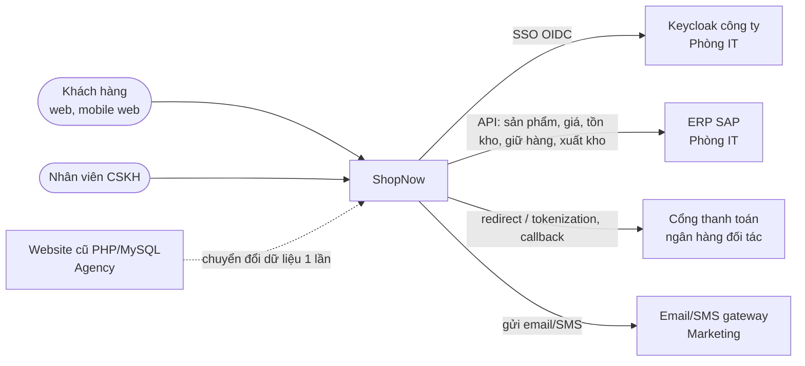
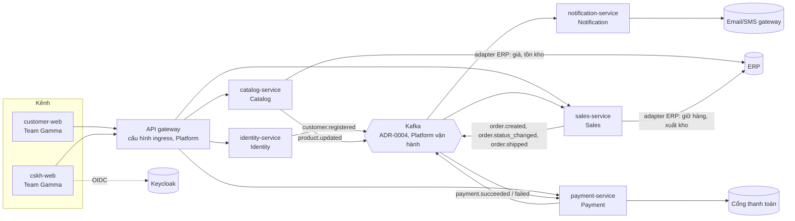

# HLD – ShopNow

Trạng thái: Approved (giả lập cho ví dụ) · Người giữ: Solution Architect {cần xác nhận tên} · Cập nhật: 2026-11-02

> Tầng 2 – Hệ thống. AI đọc file này trước mỗi lần `/speckit.plan`. Plan nào cần đi ngược HLD phải đề xuất ADR mới.
>
> Dùng mẫu đầy đủ: [hld-template.md](https://github.com/mrvntech/self-study/blob/main/hld-template.md). Mục monitoring dùng: [monitoring-design-hld.md](https://github.com/mrvntech/self-study/blob/main/monitoring-design-hld.md).
>
> **Phạm vi duyệt:** các bảng bắt buộc cho `/project.breakdown` (mục 3, bảng "Team thực hiện" ở mục 6–10, mục 11, mục 12) đã được duyệt theo quyết định trong [open-questions.md](../discovery/open-questions.md). Phần nội dung chi tiết của mục 4–10 còn để `{chưa soạn}`; soạn từng mục bằng `/project.hld <tên mục>`.
>
> **Tên team:** khớp [team-map.md](../delivery/team-map.md): Team Alpha, Team Beta, Team Gamma, Platform, Phòng ATTT, QA. Chưa có SRE và DBA: Hùng (Platform) giữ vai trò SRE tạm đến khi tuyển SRE (Q1/2027); việc DBA (cụm PostgreSQL, backup, replication) giao Platform; schema và migration do team sở hữu service (Q-08).

## Mục lục tối thiểu cho Giai đoạn 0

1. Bối cảnh hệ thống (C4 – Level 1)
2. Kiến trúc tổng thể (C4 – Level 2) và nguyên tắc kiến trúc
3. Danh sách thành phần và team sở hữu
4. Kiến trúc dữ liệu → chi tiết ở [domain-model.md](domain-model.md)
5. Tích hợp và API → chi tiết ở [api-catalog.md](api-catalog.md)
6. Security
7. Availability, Reliability, DR
8. Scalability, Performance
9. Monitoring & Observability
10. Deployment, Infrastructure
11. Quyết định kiến trúc → [adr/](adr/)
12. Truy vết NFR → [../product/nfr.md](../product/nfr.md)

## Bắt buộc để chia việc

Lệnh `/project.breakdown` chỉ chia đúng khi HLD có:

- **Bảng thành phần và team sở hữu** ở mục thành phần.
- **Bảng "Team thực hiện"** ở đầu các mục Security, Availability/DR, Monitoring, Deployment/Infra. Mẫu bảng có trong `hld-template.md`.
- Tên team khớp [../delivery/team-map.md](../delivery/team-map.md).

---

## 1. Bối cảnh hệ thống (C4 – Level 1)

Trạng thái: Draft (AI)

ShopNow là nền tảng bán đồ gia dụng online (web + mobile web) thay website PHP cũ (I1, I4). MVP ra mắt trước **2027-01-25** (I5).

| Hệ thống ngoài | Vai trò với ShopNow | Cách tích hợp | Nguồn |
| --- | --- | --- | --- |
| ERP (SAP) | Nguồn sự thật cho sản phẩm, giá, tồn kho; xuất kho (context Fulfillment) | Chỉ qua API, không đọc DB; API chậm p95 ~2 s | I4, I5, event storming #2, #3, #7 |
| Keycloak công ty | SSO + MFA cho nhân viên CSKH | OIDC | I5, NFR-003 |
| Cổng thanh toán ngân hàng đối tác | Thu tiền thẻ; ShopNow không lưu số thẻ | Redirect hoặc tokenization {theo ADR-0007} | I5, REQ-04 |
| Email/SMS gateway | Gửi thông báo | API dịch vụ ngoài, dùng lại | I4, REQ-06 |
| Website cũ | Nguồn dữ liệu chuyển đổi: 300.000 khách (~5% trùng), đơn 24 tháng | Chuyển đổi một lần {theo ADR-0015} | I4, REQ-08 |

## 2. Kiến trúc tổng thể (C4 – Level 2) và nguyên tắc kiến trúc

Trạng thái: Draft (AI) – sơ đồ là phác thảo, kiểu kiến trúc {theo ADR-0001}

### Nguyên tắc kiến trúc

| # | Nguyên tắc | Nguồn |
| --- | --- | --- |
| P1 | Thành phần chia theo bounded context, mỗi context thuộc đúng một thành phần và một team | domain-model, event storming |
| P2 | Mỗi thành phần sở hữu dữ liệu của mình; không đọc DB của thành phần khác, chỉ qua API/event trong `api-catalog.md` | domain-model |
| P3 | ERP là nguồn sự thật cho giá và tồn kho; chỉ gọi qua API, không đọc DB ERP | I5, REQ-02 |
| P4 | Không lưu, không xử lý số thẻ; thanh toán qua cổng ngân hàng | I5 (Phòng ATTT) |
| P5 | Dữ liệu khách hàng lưu tại Việt Nam; xử lý theo NĐ 13/2023 | I5, NFR-007 |
| P6 | Chạy trên cụm Kubernetes nội bộ tại data center công ty | I5 |
| P7 | Đường gọi đồng bộ trên luồng đặt hàng không phụ thuộc trực tiếp vào API ERP chậm (p95 ~2 s) khi có thể; cách xử lý {theo ADR-0008} | I4, NFR-002 |
| P8 | Giao diện khách đạt WCAG 2.1 AA, mobile-first | NFR-008, PRD persona |
| P9 | Mọi service theo golden path chung: health check, log JSON có trace_id, metrics RED | NFR-005 |

## 3. Danh sách thành phần và team sở hữu

Trạng thái: Approved (giả lập cho ví dụ)

**Định nghĩa tier** (đề xuất, cần Architect + PO xác nhận – Q-09):

- **Tier 1:** nằm trên luồng đặt hàng, thanh toán; chịu SLO 99.9%/30 ngày (NFR-001), RPO/RTO của NFR-006 nếu giữ dữ liệu đơn.
- **Tier 2:** khách dùng trực tiếp nhưng NFR chưa đặt SLO riêng; mục tiêu {cần xác nhận}.
- **Tier 3:** bất đồng bộ, nội bộ hoặc chạy một lần; được phép trễ.

| Thành phần (tên dự kiến) | Bounded context | Trách nhiệm | Team sở hữu | Tier | Nguồn |
| --- | --- | --- | --- | --- | --- |
| identity-service | Identity | Tài khoản khách (User, Customer), đăng ký/đăng nhập email hoặc SĐT qua OIDC {theo ADR-0005} | Team Beta | Tier 1 (giả định: khách phải đăng nhập để đặt hàng) | REQ-01, NFR-003, event storming |
| catalog-service | Catalog | Sản phẩm, tìm kiếm; adapter ERP đồng bộ giá/tồn kho (ADR-0008) | Team Alpha | Tier 2 (giả định – Q-09) | REQ-02, event storming, Q-15 |
| sales-service | Sales | Giỏ hàng, đơn hàng, API cho màn hình CSKH; adapter ERP giữ tồn kho, nhận xuất kho và phát `order.shipped` (ADR-0008) | Team Alpha | Tier 1 | REQ-03, REQ-05, REQ-07, NFR-001, NFR-006, Q-15 |
| payment-service | Payment | Payment, tích hợp cổng thanh toán, xử lý callback | Team Beta | Tier 1 | REQ-04, NFR-001, I5 |
| notification-service | Notification | Gửi email/SMS theo event | Team Beta | Tier 3 | REQ-06, event storming, Q-03 |
| customer-web | — (kênh, dùng Identity, Catalog, Sales, Payment) | Giao diện khách web/mobile web | Team Gamma | Tier 1 | PRD §3, NFR-008, I8 |
| cskh-web | — (kênh, dùng Sales) | Màn hình CSKH: tìm, cập nhật trạng thái đơn; đăng nhập SSO; dùng API của sales-service (Team Alpha) qua contract | Team Gamma | Tier 2 | REQ-07, Q-10 |
| API gateway | — (hạ tầng kênh) | Cấu hình ingress: định tuyến, xác thực token, rate limit. MVP không có BFF | Platform | Tier 1 | NFR-003, Q-16 |
| data-migration (tạm thời) | Identity + Sales (dữ liệu đích) | Chuyển 300.000 khách (khử trùng ~5%) và đơn 24 tháng từ website cũ {theo ADR-0015} | Team Alpha | Tier 3 | REQ-08, I4, Q-10 |
| Nền tảng dùng chung (K8s, CI/CD, observability stack, Kafka, cụm PostgreSQL) | — | Xem mục 7, 9, 10 | Platform | — | I5, I8, Q-08, Q-18 |

**Context ngoài phạm vi thành phần:** Fulfillment thuộc ERP (event storming #7), không phải thành phần của ShopNow. Không có thành phần ERP integration (ACL) riêng: adapter ERP nằm trong catalog-service và sales-service (ADR-0008).

**Kiểm tra:** 5/5 bounded context (Identity, Catalog, Sales, Payment, Notification) đều thuộc đúng một thành phần và một team.

## 4. Kiến trúc dữ liệu

Trạng thái: Draft (AI) – khung; chi tiết ở [domain-model.md](domain-model.md)

| Thành phần | Dữ liệu sở hữu | Có dữ liệu cá nhân (NĐ 13)? | Kho dữ liệu | RPO/RTO |
| --- | --- | --- | --- | --- |
| identity-service | User, Customer | Có (email, SĐT, tên, địa chỉ) | {theo ADR-0003} | {cần xác nhận – NFR-006 chỉ nêu dữ liệu đơn hàng} |
| catalog-service | Product (bản sao từ ERP) | Không | {theo ADR-0003}; chỉ mục tìm kiếm {theo ADR-0009} | Dựng lại được từ ERP |
| sales-service | Cart, Order | Có (customerId, địa chỉ giao) | {theo ADR-0003} | RPO ≤ 5 phút, RTO ≤ 1 giờ (NFR-006) |
| payment-service | Payment (không có số thẻ) | Có (gắn với khách) | {theo ADR-0003} | Giả định theo dữ liệu đơn hàng (NFR-006) – {cần xác nhận} |
| notification-service | Notification | Có (kênh, nội dung gửi) | {theo ADR-0003} | {cần xác nhận} |

{chưa soạn: mô hình nhất quán giữa Order và Payment, retention, phân loại dữ liệu, chuyển đổi dữ liệu – chạy `/project.hld data`}

## 5. Tích hợp và API

Trạng thái: Draft (AI) – danh mục mức đầu ở [api-catalog.md](api-catalog.md)

| Tích hợp | Hướng | Kiểu | Thành phần chịu trách nhiệm | Vấn đề mở | Nguồn |
| --- | --- | --- | --- | --- | --- |
| ERP – đồng bộ giá, tồn kho | ERP → ShopNow | {theo ADR-0008} (pull theo lịch / push) | catalog-service | Tần suất đồng bộ {cần xác nhận} | event storming #2 |
| ERP – giữ / hủy giữ tồn kho | ShopNow → ERP | Đồng bộ hoặc bất đồng bộ {theo ADR-0008} | sales-service | **H1:** ERP có hỗ trợ giữ hàng không; p95 ~2 s | event storming #3, #5 |
| ERP – xuất kho | ERP → ShopNow | {theo ADR-0008} (ERP push hay ShopNow poll) | sales-service → `order.shipped` | ERP có phát sự kiện không (Q-04) | event storming #7 |
| Cổng thanh toán | Hai chiều | Redirect/tokenization + callback {theo ADR-0007} | payment-service | Ngân hàng đối tác, đặc tả API (Q-07) | I5 |
| Keycloak công ty | ShopNow → Keycloak | OIDC | cskh-web, API gateway | — | I5 |
| Email/SMS gateway | ShopNow → gateway | API | notification-service | Nơi lưu dữ liệu, hợp đồng xử lý dữ liệu (Q-06) | I4 |
| Website cũ | Một lần | Export/import {theo ADR-0015} | data-migration | Quy tắc khử trùng (Q-12) | I4, REQ-08 |

{chưa soạn: luồng tuần tự đặt hàng – thanh toán, idempotency, retry, versioning – chạy `/project.hld integration`}

## 6. Security

Trạng thái: bảng "Team thực hiện" Approved (giả lập cho ví dụ); nội dung {chưa soạn – `/project.hld security`}

### Team thực hiện

| Hạng mục | Team thực hiện | Team duyệt | Nguồn |
| --- | --- | --- | --- |
| Chính sách bảo mật, threat model, quét lỗ hổng | Phòng ATTT | Architect | I5, I8 |
| Pentest trước MVP | Đơn vị pentest bên ngoài (thuê) | Phòng ATTT (duyệt kết quả) | I5, Q-19 |
| WAF rule, SIEM | Phòng ATTT (giả định) | Platform | mặc định `/project.breakdown` |
| Hiện thực network policy, TLS/cert, quản lý secret và khóa mã hóa {theo ADR-0014} | Platform | Phòng ATTT | NFR-004 |
| Hardening OS / node K8s | Platform | Phòng ATTT | mặc định `/project.breakdown` |
| AuthN/AuthZ khách hàng (OIDC) {theo ADR-0005} | Team Beta | Phòng ATTT | NFR-003, REQ-01 |
| SSO + MFA nhân viên CSKH qua Keycloak (ADR-0006) | Team Gamma (cskh-web), Team Alpha (phân quyền API Sales) | Phòng ATTT; Phòng IT cấp client Keycloak | NFR-003, I5 |
| Mã hóa dữ liệu cá nhân khi lưu trong từng service | Team sở hữu service | Phòng ATTT | NFR-004 |
| Tích hợp cổng thanh toán không lưu số thẻ | Team Beta | Phòng ATTT | I5 |
| Đánh giá tuân thủ NĐ 13/2023, data residency | Phòng ATTT (giả định) | Pháp chế | NFR-007, I5 |

## 7. Availability, Reliability, DR

Trạng thái: bảng "Team thực hiện" Approved (giả lập cho ví dụ); nội dung {chưa soạn – `/project.hld availability`}

Mục tiêu (từ `nfr.md`, không đổi): đặt hàng, thanh toán **99.9%/30 ngày** (NFR-001); dữ liệu đơn hàng **RPO ≤ 5 phút, RTO ≤ 1 giờ** (NFR-006). Hỗ trợ 24/7 cho đặt hàng, thanh toán là *mong muốn* (I5).

### Team thực hiện

| Hạng mục | Team thực hiện | Team duyệt | Nguồn |
| --- | --- | --- | --- |
| Kiến trúc DR, site dự phòng {theo ADR-0013} | Platform | Architect | NFR-006 |
| Backup và replication DB (RPO ≤ 5 phút) | Platform | Architect | NFR-006, Q-08 |
| HA ứng dụng (replica, probe, PodDisruptionBudget) qua golden path | Platform (golden path), team sở hữu service (cấu hình) | Architect | NFR-001 |
| Nhất quán đơn hàng – thanh toán: transactional outbox, idempotency, retry trong sales-service (ADR-0004, choreography) | Team Alpha | Architect | NFR-001, event storming #3–5, Q-18 |
| Nhất quán đơn hàng – thanh toán: transactional outbox, idempotency, retry trong payment-service (ADR-0004, choreography) | Team Beta | Architect | NFR-001, event storming #3–5, Q-18 |
| Schema event | Team producer của event | Architect (giữ quy ước schema) | Q-18 |
| Diễn tập DR | Platform (Hùng – SRE tạm, điều phối) | Architect; phối hợp Team Alpha, Team Beta | NFR-006, Q-08 |
| On-call 24/7 Tier 1 – ứng dụng | Team Alpha, Team Beta (luân phiên) | Engineering Manager | I5, Q-08 |
| On-call 24/7 Tier 1 – hạ tầng | Platform | Engineering Manager | I5, Q-08 |

## 8. Scalability, Performance

Trạng thái: bảng "Team thực hiện" Approved (giả lập cho ví dụ); nội dung {chưa soạn – `/project.hld scalability`}

Mục tiêu (từ `nfr.md`): **p95 API ≤ 500 ms** ở **{cần xác nhận} req/s** cao điểm Tết (NFR-002, Q-01). Dữ liệu tham khảo từ I4: website cũ 5.000 lượt/ngày, cao điểm Tết 40.000 lượt/ngày (đơn vị lượt/ngày, chưa quy đổi được sang req/s). Rủi ro: API ERP p95 ~2 s vượt ngân sách 500 ms nếu gọi đồng bộ (I4).

### Team thực hiện

| Hạng mục | Team thực hiện | Team duyệt | Nguồn |
| --- | --- | --- | --- |
| Autoscaling, dung lượng cụm K8s | Platform | Architect | NFR-002 |
| CDN / cache tĩnh cho customer-web | Platform | Architect | NFR-002, Q-17 |
| Cache header của customer-web | Team Gamma | Architect | NFR-002, Q-17 |
| Cache dữ liệu ERP, tìm kiếm {theo ADR-0008, ADR-0009} | Team Alpha | Architect | NFR-002, I4 |
| Load test theo NFR-002 (k6, QA được đào tạo) | QA | Platform (cấp môi trường), Architect | NFR-002, Q-20 |

## 9. Monitoring & Observability

Trạng thái: bảng "Team thực hiện" Approved (giả lập cho ví dụ); nội dung {chưa soạn – `/project.hld monitoring`, theo `monitoring-design-hld.md`}

### Team thực hiện

| Hạng mục | Team thực hiện | Team duyệt | Nguồn |
| --- | --- | --- | --- |
| Dựng stack observability {theo ADR-0012} | Platform | Architect | NFR-005 |
| SLO, alert, runbook cho từng service | Team sở hữu service | Platform (Hùng – SRE tạm, duyệt SLO) | NFR-001, NFR-005, Q-08 |
| Instrument code: health check, log JSON có trace_id, metrics RED | Mỗi team dev (Team Alpha, Team Beta, Team Gamma) | Platform | NFR-005 |
| Dashboard, SLO dashboard cho đặt hàng, thanh toán | Platform (giả định) | Team Alpha, Team Beta | NFR-001 |

## 10. Deployment, Infrastructure

Trạng thái: bảng "Team thực hiện" Approved (giả lập cho ví dụ); nội dung {chưa soạn – `/project.hld infra`}

Ràng buộc bắt buộc: cụm Kubernetes nội bộ tại data center công ty (I5); dữ liệu khách hàng tại Việt Nam (I5). Vị trí data center và site DR {cần xác nhận – Q-05}.

### Team thực hiện

| Hạng mục | Team thực hiện | Team duyệt | Nguồn |
| --- | --- | --- | --- |
| Namespace, môi trường dev / staging / prod trên cụm K8s nội bộ | Platform | Architect | I5 |
| Mạng, DNS, ingress (gồm cấu hình API gateway), TLS | Platform | Phòng ATTT | I5, NFR-004, Q-16 |
| CI/CD pipeline, registry {theo ADR-0016} | Platform | Phòng ATTT | I8 |
| Golden path Helm chart (cho Java và Node.js, {theo ADR-0011}) | Platform | Phòng ATTT; Team Alpha, Team Beta | NFR-005 |
| Cụm PostgreSQL dùng chung / migration tooling {theo ADR-0003} | Platform | Architect | I8, Q-08 |
| Schema và migration của từng service | Team sở hữu service | Architect | Q-08 |
| Vận hành Kafka (ADR-0004) | Platform | Architect | Q-18 |
| Môi trường và dữ liệu test dùng chung | QA | Platform | mặc định `/project.breakdown` |
| Change ticket go-live | Platform | Architect | release-plan |

## 11. Quyết định kiến trúc

Trạng thái: danh sách ADR Approved (giả lập cho ví dụ); **chưa tạo file** (tạo bằng `/project.hld adr`)

| ADR | Quyết định cần đưa ra | Trạng thái | Người quyết | NFR / ràng buộc liên quan |
| --- | --- | --- | --- | --- |
| ADR-0001 | Kiểu kiến trúc: microservice theo bounded context hay modular monolith (5 context, 3 team dev, hạn 2027-01-25) | Chưa có file | Architect | NFR-001, NFR-002, I5 thời gian |
| ADR-0002 | Nền tảng chạy: K8s nội bộ tại DC công ty | **Accepted** (ràng buộc I5) – chưa có file | Architect | I5, NFR-007 |
| ADR-0003 | Cơ sở dữ liệu và mô hình sở hữu (DB riêng mỗi service hay cụm chung, schema riêng) | Chưa có file | Architect, Platform (việc DBA – Q-08) | NFR-004, NFR-006 |
| ADR-0004 | Giao tiếp bất đồng bộ: Kafka (Platform vận hành) + transactional outbox trong từng service, choreography, không có saga orchestrator; schema event do team producer sở hữu, Architect giữ quy ước schema | **Accepted** (Q-18) – chưa có file | Architect | NFR-001, NFR-006 |
| ADR-0005 | IdP cho khách hàng (OIDC, đăng nhập email/SĐT) | Chưa có file | Architect, Phòng ATTT | NFR-003, REQ-01 |
| ADR-0006 | SSO nhân viên qua Keycloak công ty | **Accepted** (ràng buộc I5) – chưa có file | Phòng ATTT | NFR-003, I5 |
| ADR-0007 | Kiểu tích hợp cổng thanh toán: redirect hay tokenization | Chưa có file | Phòng ATTT, Architect | I5, NFR-001 |
| ADR-0008 | Tích hợp ERP: không tách ACL riêng; adapter ERP nằm trong catalog-service (đồng bộ giá, tồn kho) và sales-service (giữ hàng, nhận xuất kho), cùng do Team Alpha sở hữu. Cache giá/tồn, cách giữ tồn kho (H1) và nhận sự kiện xuất kho chờ Q-04 | **Accepted** (Q-15) – chưa có file | Architect, Phòng IT | I5, NFR-002, I4 |
| ADR-0009 | Tìm kiếm sản phẩm: full-text trong DB hay search engine riêng | Chưa có file | Architect | NFR-002, REQ-02 |
| ADR-0010 | Frontend rendering và API gateway (đã quyết ở Q-16: MVP không có BFF, gateway là cấu hình ingress) | Chưa có file | Architect | NFR-002, NFR-003, NFR-008 |
| ADR-0011 | Ngôn ngữ / framework theo team (Java Spring, Node.js) và ảnh hưởng tới golden path | Chưa có file | Architect | NFR-005, I8 |
| ADR-0012 | Stack observability | Chưa có file | Platform (Hùng – SRE tạm) | NFR-005 |
| ADR-0013 | Chiến lược DR (một DC hay hai site; backup/replication) đạt RPO 5 phút, RTO 1 giờ | Chưa có file | Architect, Platform (Hùng – SRE tạm) | NFR-006, I5 |
| ADR-0014 | Mã hóa dữ liệu cá nhân và quản lý secret / khóa | Chưa có file | Phòng ATTT | NFR-004, NFR-007 |
| ADR-0015 | Chiến lược chuyển đổi dữ liệu từ website cũ (big bang hay chạy song song) | Chưa có file | Architect, PO | REQ-08, I4 |
| ADR-0016 | CI/CD và cách triển khai (pipeline push hay GitOps) | Chưa có file | Platform, Architect | I5, I8 |

## 12. Truy vết NFR

Trạng thái: Approved (giả lập cho ví dụ)

| NFR | Mục tiêu (theo `nfr.md`) | Mục HLD đáp ứng | ADR | Cách kiểm chứng | Ghi chú |
| --- | --- | --- | --- | --- | --- |
| NFR-001 | Đặt hàng, thanh toán 99.9%/30 ngày | 3 (Tier 1), 7, 9 | ADR-0004, ADR-0013 | SLO dashboard | Phạm vi SLO cho Identity, Catalog chưa rõ (Q-09) |
| NFR-002 | p95 API ≤ 500 ms ở {cần xác nhận} req/s | 8, 5 (ERP) | ADR-0008, ADR-0009, ADR-0010 | Load test | Thiếu số req/s (Q-01); ERP p95 ~2 s |
| NFR-003 | Khách OIDC; nhân viên SSO công ty, MFA | 6 | ADR-0005, ADR-0006 | Security review | Đăng nhập bằng SĐT cần làm rõ (Q-11) |
| NFR-004 | Mã hóa dữ liệu cá nhân khi lưu và khi truyền | 6, 4, 10 (TLS) | ADR-0014 | Security review | |
| NFR-005 | Health check, log JSON có trace_id, metrics RED | 9, 10 (golden path) | ADR-0012, ADR-0011 | Checklist review | |
| NFR-006 | RPO ≤ 5 phút, RTO ≤ 1 giờ cho dữ liệu đơn hàng | 7, 4 | ADR-0013, ADR-0003 | Diễn tập DR | Site DR chưa rõ (Q-05) |
| NFR-007 | Tuân thủ NĐ 13/2023; dữ liệu lưu tại Việt Nam | 6, 10, 4, 5 (Email/SMS gateway) | ADR-0002, ADR-0014 | Rà soát pháp lý | Gateway ngoài cần xác nhận (Q-06) |
| NFR-008 | Giao diện khách WCAG 2.1 AA | 2 (P8), 3 (customer-web) | ADR-0010 | Kiểm tra tự động và thủ công | Không có mục HLD riêng; kiểm chứng ở spec F-001…F-004 |

## Lịch sử thay đổi do tính năng

| Ngày | Tính năng | Mục thay đổi | ADR liên quan |
| --- | --- | --- | --- |
| 2026-11-02 | — (B8) | Dựng khung HLD; điền mục 1, 2, 3, bảng "Team thực hiện" 6–10, mục 11, 12 | — |
| 2026-11-02 | — (review B8–B9) | Áp dụng quyết định Q-03, Q-08, Q-10, Q-15–Q-21 vào mục 2, 3, 6–11; HLD Approved (giả lập cho ví dụ) | ADR-0002, ADR-0004, ADR-0006, ADR-0008 |
