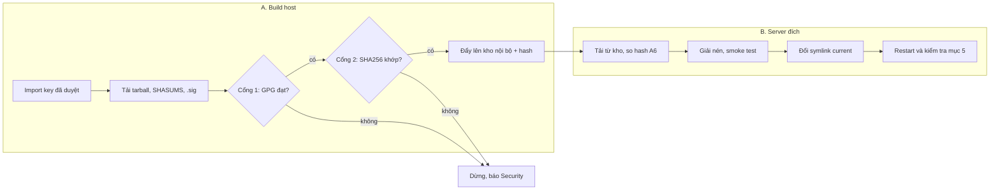

# Runbook: Cài đặt Node.js từ nodejs.org/dist

Oct 31, 2026 · @phucnq9

## 1. Mục đích và phạm vi

Runbook này cài Node.js từ tarball chính thức trên nodejs.org/dist lên server Linux. Binary chỉ được cài sau khi đã qua hai lớp kiểm tra: chữ ký GPG của releaser và hash SHA256.

**Quy trình chia làm hai giai đoạn, chạy trên hai máy khác nhau:**

- **Giai đoạn A, nhận artifact:** chạy trên build host hoặc bastion có Internet. Bước này tải, verify rồi đẩy tarball đã verify lên kho artifact nội bộ.
- **Giai đoạn B, cài đặt:** chạy trên server đích (DEV, Staging, PRD). Server chỉ lấy tarball từ kho nội bộ và không gọi ra Internet.

| Nên dùng runbook này khi | Không dùng runbook này khi |
| --- | --- |
| Server VM hoặc bare-metal cần đúng một version Node, kiểm soát chặt | Ứng dụng chạy container: dùng image `node` chính thức pin theo digest |
| Không được dùng repo apt bên ngoài (NodeSource) | Đã có repo apt nội bộ đang mirror NodeSource |
| Cần chạy nhiều version song song và đổi qua lại nhanh | Máy của developer: dùng nvm kèm file `.nvmrc` |

**Đối tượng:** DevOps/SRE vận hành server. **Mức rủi ro:** trung bình, vì thao tác thay runtime của ứng dụng đang chạy. Trên PRD bắt buộc có change ticket.

## 2. Điều kiện tiên quyết

Chỉ bắt đầu khi mọi mục dưới đây đã được tích.

- [ ] Có change ticket đã duyệt, ghi rõ version cũ, version mới và cửa sổ thời gian (bắt buộc trên PRD)
- [ ] Version mới là bản **LTS** (Active hoặc Maintenance) và đã chạy qua DEV và Staging
- [ ] Có **danh sách fingerprint GPG đã duyệt** của releaser Node.js, lưu trong repo cấu hình nội bộ (ví dụ `infra-config/nodejs/release-fingerprints.txt`). Danh sách lấy từ README của [nodejs/node](https://github.com/nodejs/node#release-keys) hoặc repo [nodejs/release-keys](https://github.com/nodejs/release-keys), và mọi thay đổi phải đi qua PR có review
- [ ] Build host có Internet và cài sẵn `curl`, `gpg` (GnuPG 2.2 trở lên), `sha256sum`, `xz-utils`
- [ ] Có kho artifact nội bộ (Nexus, Artifactory raw repo hoặc S3 bucket) mà server đích đọc được
- [ ] Có quyền `sudo` trên server đích
- [ ] Server đích còn trống ít nhất 500 MB trên phân vùng chứa `/opt`
- [ ] Đã kiểm tra glibc trên server đích đáp ứng yêu cầu của version Node mới (`ldd --version`, đối chiếu file BUILDING.md của version đó)
- [ ] Có người on-call của ứng dụng sẵn sàng trong cửa sổ thời gian thay đổi

## 3. Biến và quy ước

Mỗi version nằm trong một thư mục riêng. Version đang dùng được chọn bằng một symlink duy nhất, nên cả việc nâng cấp lẫn rollback chỉ là đổi symlink.

| Biến | Ví dụ | Ý nghĩa |
| --- | --- | --- |
| `NODE_VERSION` | `22.12.0` | Version cần cài, không có chữ `v` ở đầu |
| `NODE_ARCH` | `linux-x64` hoặc `linux-arm64` | Kiến trúc của server, xem bằng `uname -m` |
| `DIST_URL` | `https://nodejs.org/dist` | Nguồn upstream, chỉ dùng ở giai đoạn A |
| `ARTIFACT_URL` | `https://nexus.internal/repository/nodejs` | Kho nội bộ, dùng ở giai đoạn B |
| `FPR_FILE` | `release-fingerprints.txt` | Danh sách fingerprint đã duyệt, mỗi dòng một fingerprint 40 ký tự |
| `INSTALL_ROOT` | `/opt/nodejs` | Thư mục gốc chứa các version |

Bố cục thư mục trên server đích:

```
/opt/nodejs/
├── node-v22.11.0-linux-x64/     ← version cũ, giữ lại để rollback
├── node-v22.12.0-linux-x64/     ← version mới
└── current -> node-v22.12.0-linux-x64

/usr/local/bin/node -> /opt/nodejs/current/bin/node
/usr/local/bin/npm  -> /opt/nodejs/current/bin/npm
/usr/local/bin/npx  -> /opt/nodejs/current/bin/npx
```

**Quy ước bắt buộc:**

- Thư mục version thuộc `root:root`, quyền `755`. User chạy ứng dụng không được ghi vào đây.
- Không chạy `npm install -g` trên PRD. Dependency của ứng dụng đi kèm artifact build từ CI.
- Giữ ít nhất **2 version gần nhất** trên mỗi server để có thể rollback.

## 4. Các bước thực hiện

Có hai cổng bắt buộc: chữ ký GPG phải đến từ một fingerprint đã duyệt, và hash SHA256 phải khớp. Chỉ cần một cổng fail là **dừng lại, không cài**, và chuyển sang mục 7.



Server đích không bao giờ gọi ra Internet. Nó chỉ nhận tarball đã qua hai cổng ở build host, và so lại hash một lần nữa trước khi giải nén.

### Giai đoạn A: Nhận artifact (trên build host)

**A1. Chuẩn bị thư mục làm việc và keyring cách ly.** Keyring riêng chỉ chứa key đã duyệt, nên một key lạ có sẵn trong keyring cá nhân không thể làm chữ ký "hiệu lực".

```bash
export NODE_VERSION=22.12.0 NODE_ARCH=linux-x64
export DIST_URL=https://nodejs.org/dist
export FPR_FILE=$PWD/release-fingerprints.txt
export WORK=$(mktemp -d) GNUPGHOME=$(mktemp -d)
chmod 700 "$GNUPGHOME"
cd "$WORK"
```

**A2. Import đúng các key đã duyệt.** Lấy key từ repo `nodejs/release-keys` (nên pin theo một commit cụ thể), sau đó đối chiếu lại fingerprint đã import.

```bash
while read -r fpr; do
  curl -fsSL "https://raw.githubusercontent.com/nodejs/release-keys/<COMMIT>/keys/${fpr}.asc" | gpg --batch --import
done < "$FPR_FILE"

# Mọi key trong keyring phải nằm trong danh sách đã duyệt
gpg --batch --with-colons --list-keys | awk -F: '/^pub/{p=1;next} /^fpr/&&p{print $10;p=0}' | sort -u > imported.txt
comm -3 imported.txt <(sort -u "$FPR_FILE")   # phải rỗng: không thiếu, không thừa key nào
```

**A3. Tải tarball, file checksum và chữ ký.**

```bash
TARBALL=node-v${NODE_VERSION}-${NODE_ARCH}.tar.xz
for f in "$TARBALL" SHASUMS256.txt SHASUMS256.txt.sig; do
  curl -fsSLO --proto '=https' --tlsv1.2 "$DIST_URL/v$NODE_VERSION/$f"
done
```

**A4. Cổng 1: verify chữ ký GPG và người ký.** Chỉ thấy "Good signature" là chưa đủ. Phải kiểm tra thêm fingerprint của người ký nằm trong danh sách đã duyệt.

```bash
gpg --batch --status-fd 1 --verify SHASUMS256.txt.sig SHASUMS256.txt > gpg-status.txt 2>/dev/null \
  || { echo "FAIL: chu ky khong hop le"; exit 1; }
SIGNER=$(awk '/^\[GNUPG:\] VALIDSIG/{print $NF}' gpg-status.txt)
grep -qx "$SIGNER" "$FPR_FILE" || { echo "FAIL: nguoi ky $SIGNER khong duoc duyet"; exit 1; }
echo "OK: ky boi $SIGNER"
```

**A5. Cổng 2: verify SHA256 của tarball.**

```bash
grep " ${TARBALL}\$" SHASUMS256.txt | sha256sum -c -   # phải in ra: <TARBALL>: OK
sha256sum "$TARBALL" | tee "${TARBALL}.sha256"
```

**A6. Đẩy lên kho nội bộ và ghi lại hash.** Upload `$TARBALL`, `SHASUMS256.txt`, `SHASUMS256.txt.sig` và `gpg-status.txt` vào `$ARTIFACT_URL/v$NODE_VERSION/`. Ghi hash SHA256 và fingerprint người ký vào change ticket và vào biến cấu hình (ví dụ `group_vars` của Ansible). Hash này là giá trị mà giai đoạn B sẽ so khớp.

### Giai đoạn B: Cài đặt (trên server đích)

**B1. Ghi nhận trạng thái trước khi cài.**

```bash
node -v; readlink -f /opt/nodejs/current; uname -m; df -h /opt
```

**B2. Tải từ kho nội bộ và verify lại hash** với giá trị đã ghi ở A6. Không tin vào file `.sha256` đặt cạnh tarball trong kho.

```bash
export EXPECTED_SHA256=<hash ghi ở A6>
cd "$(mktemp -d)"
curl -fsSLO "$ARTIFACT_URL/v$NODE_VERSION/$TARBALL"
echo "${EXPECTED_SHA256}  ${TARBALL}" | sha256sum -c -
```

**B3. Giải nén vào thư mục version.**

```bash
sudo mkdir -p /opt/nodejs
sudo tar -xJf "$TARBALL" -C /opt/nodejs --no-same-owner
sudo chown -R root:root "/opt/nodejs/node-v${NODE_VERSION}-${NODE_ARCH}"
```

**B4. Smoke test binary mới trước khi chuyển.** Bước này chưa ảnh hưởng tới ứng dụng đang chạy.

```bash
NEW=/opt/nodejs/node-v${NODE_VERSION}-${NODE_ARCH}
"$NEW/bin/node" -v                                  # phải ra v$NODE_VERSION
"$NEW/bin/node" -e "require('crypto').randomBytes(8); console.log('ok')"
"$NEW/bin/node" -p "process.versions.openssl"
PATH="$NEW/bin:$PATH" "$NEW/bin/npm" -v          # npm dùng shebang "#!/usr/bin/env node", cần node mới trong PATH
```

**B5. Chuyển symlink theo cách atomic.** Dùng `mv -T` để không có thời điểm nào `current` bị thiếu.

```bash
sudo ln -sfn "$NEW" /opt/nodejs/current.tmp
sudo mv -T /opt/nodejs/current.tmp /opt/nodejs/current
```

**B6. Tạo symlink trong `/usr/local/bin`** (chỉ cần làm ở lần cài đầu tiên).

```bash
for b in node npm npx; do sudo ln -sfn "/opt/nodejs/current/bin/$b" "/usr/local/bin/$b"; done
```

**B7. Restart ứng dụng** theo mục 5. Trên cụm nhiều server, làm từng server một (hoặc từng lô) sau load balancer, bắt đầu từ một server canary.

## 5. Kiểm tra sau cài đặt và tích hợp systemd

Chỉ được coi là cài xong khi **tiến trình đang chạy** dùng binary mới và health check đạt. Một tiến trình đã chạy từ trước vẫn giữ binary cũ cho đến khi được restart.

### Unit systemd chuẩn

Unit gọi node bằng đường dẫn tuyệt đối qua symlink `current`, nên đổi version không cần sửa unit.

```ini
# /etc/systemd/system/myapp.service
[Unit]
Description=myapp (Node.js)
After=network-online.target
Wants=network-online.target

[Service]
Type=simple
User=myapp
Group=myapp
WorkingDirectory=/srv/myapp
Environment=NODE_ENV=production
Environment=NODE_OPTIONS=--max-old-space-size=1024
ExecStart=/opt/nodejs/current/bin/node /srv/myapp/dist/server.js
Restart=on-failure
RestartSec=5

# Hardening
NoNewPrivileges=true
ProtectSystem=strict
ProtectHome=true
PrivateTmp=true
ReadWritePaths=/srv/myapp/data /var/log/myapp

[Install]
WantedBy=multi-user.target
```

User chạy ứng dụng tạo một lần bằng `sudo useradd -r -s /usr/sbin/nologin myapp`. Giá trị `--max-old-space-size` chỉnh theo RAM của server.

### Restart và xác nhận

```bash
sudo systemctl daemon-reload
sudo systemctl restart myapp
systemctl is-active myapp                                   # active
PID=$(systemctl show -p MainPID --value myapp)
sudo readlink -f /proc/$PID/exe                             # phải trỏ vào node-v$NODE_VERSION
journalctl -u myapp --since "5 min ago" --no-pager | tail -n 50
curl -fsS http://127.0.0.1:3000/healthz                     # endpoint health của ứng dụng
```

### Tiêu chí đạt

| Hạng mục | Tiêu chí |
| --- | --- |
| `node -v` | Đúng `v$NODE_VERSION` |
| `/proc/$PID/exe` | Trỏ vào thư mục version mới |
| Health check | Trả HTTP 200 |
| Log 15 phút đầu | Không có lỗi mới so với trước khi cài |
| Error rate, latency p95, memory | Không tăng bất thường so với baseline trên dashboard giám sát |

## 6. Nâng cấp bản vá và rollback

Nâng cấp bản vá chính là chạy lại mục 4 với `NODE_VERSION` mới. Rollback chỉ là trỏ symlink `current` về version cũ rồi restart, mất dưới 1 phút.

### Nâng cấp

1. Mở change ticket, ghi version cũ và version mới.
2. Chạy giai đoạn A cho version mới, ghi hash và fingerprint người ký.
3. Cài lên DEV, rồi Staging, chạy test của ứng dụng.
4. Trên PRD: làm một server canary trước, theo dõi ít nhất 30 phút theo tiêu chí ở mục 5.
5. Làm các server còn lại theo lô, mỗi lô không quá 25% số server, server đang làm được rút khỏi load balancer.
6. Giữ thư mục version cũ cho đến khi version mới chạy ổn qua một chu kỳ release tiếp theo.

Khi có security release mức Critical: vẫn đi đủ các bước trên, chỉ rút ngắn thời gian theo dõi ở Staging và canary. **Không bỏ qua cổng GPG và SHA256.**

### Rollback

Rollback ngay khi một tiêu chí ở mục 5 không đạt, không cần chờ phân tích nguyên nhân.

```bash
OLD=/opt/nodejs/node-v22.11.0-linux-x64          # version trước đó, lấy từ bước B1
sudo ln -sfn "$OLD" /opt/nodejs/current.tmp
sudo mv -T /opt/nodejs/current.tmp /opt/nodejs/current
sudo systemctl restart myapp
sudo readlink -f /proc/$(systemctl show -p MainPID --value myapp)/exe   # phải trỏ về $OLD
```

Sau khi rollback: ghi lại vào change ticket, giữ log của lần lỗi, và dừng triển khai version mới trên các server khác.

### Dọn version cũ

```bash
ls -1d /opt/nodejs/node-v* | sort -V          # liệt kê các version
# Xóa version không còn dùng, giữ lại ít nhất 2 bản gần nhất và bản mà current đang trỏ tới
sudo rm -rf /opt/nodejs/node-v<version-cu>-linux-x64
```

## 7. Xử lý sự cố

Mọi lỗi ở cổng GPG hoặc SHA256 đều **dừng thay đổi và báo Security**. Tuyệt đối không tải lại cho đến khi khớp, và không tắt bước verify.

| Triệu chứng | Nguyên nhân thường gặp | Xử lý |
| --- | --- | --- |
| `BADSIG` hoặc `gpg: BAD signature` | File checksum bị sửa hoặc tải thiếu | Dừng. Giữ nguyên các file đã tải làm bằng chứng, báo Security, so với bản tải từ một mạng khác |
| `NO_PUBKEY <keyid>` | Release do một releaser chưa có trong danh sách duyệt ký | Tra key ID trong README của nodejs/node. Nếu đúng là releaser mới, mở PR thêm fingerprint, có review, rồi chạy lại từ A1 |
| Chữ ký hợp lệ nhưng người ký không nằm trong danh sách | Keyring bị lẫn key khác hoặc danh sách đã cũ | Kiểm tra `GNUPGHOME` có đúng là keyring cách ly không. Nếu đúng thì xử lý như dòng `NO_PUBKEY` |
| `EXPKEYSIG` hoặc `KEYEXPIRED` | Key của releaser đã hết hạn trong bản đã import | Import lại key mới nhất từ nguồn chính thức. Nếu key vẫn hết hạn thì báo Security |
| `REVKEYSIG` | Key đã bị thu hồi | Dừng. Không cài, báo Security, theo dõi thông báo từ Node.js |
| `sha256sum: WARNING: 1 computed checksum did NOT match` | Tarball bị hỏng hoặc bị thay | Kiểm tra không có proxy hay mirror nào đang sửa nội dung. Nếu đường truyền sạch mà vẫn lệch thì báo Security |
| `grep` không tìm thấy dòng của tarball | Sai `NODE_ARCH` hoặc sai tên file | Đối chiếu `uname -m` (`x86_64` tương ứng `linux-x64`, `aarch64` tương ứng `linux-arm64`) |
| `node: /lib/.../libc.so.6: version 'GLIBC_2.28' not found` | glibc của OS cũ hơn yêu cầu của Node | Không chuyển symlink. Nâng OS hoặc chuyển sang chạy container |
| `/proc/$PID/exe` vẫn trỏ vào version cũ | Chưa restart, hoặc unit gọi đường dẫn cứng tới một version | Restart service. Kiểm tra `ExecStart` phải trỏ vào `/opt/nodejs/current` |
| Ứng dụng lỗi native module (`NODE_MODULE_VERSION` mismatch) | Module native build cho version khác | Chỉ xảy ra khi đổi major. Rollback, rồi build lại artifact ở CI với version mới |

## 8. Script tự động hóa

Hai script dưới đây đóng gói mục 4 thành lệnh chạy được ngay. Ngày 31/10/2026 đã chạy thử với bản Node v26.13.0 linux-x64 thật. Kết quả: chữ ký và hash đều đạt; script dừng đúng khi người ký không có trong danh sách (`NO_PUBKEY`) và khi hash sai; chạy lại lần hai vẫn an toàn.

Nên đưa hai script vào repo infra và gọi từ Ansible hoặc pipeline CI, không chạy tay từ bản sao trên laptop.

### fetch-verify-node.sh (giai đoạn A)

```bash
#!/usr/bin/env bash
# Giai đoạn A: tải và verify Node.js từ nodejs.org/dist
# Dùng: fetch-verify-node.sh <version> <arch> <fingerprint-file> <release-keys-commit> <out-dir>
set -euo pipefail

NODE_VERSION=${1:?version, vd 22.12.0}
NODE_ARCH=${2:?arch, vd linux-x64}
FPR_FILE=$(realpath "${3:?fingerprint file}")
KEYS_COMMIT=${4:?commit cua nodejs/release-keys}
OUT_DIR=$(realpath -m "${5:?out dir}")
DIST_URL=${DIST_URL:-https://nodejs.org/dist}
TARBALL="node-v${NODE_VERSION}-${NODE_ARCH}.tar.xz"

die() { echo "FAIL: $*" >&2; exit 1; }
log() { echo "==> $*"; }

[[ $NODE_VERSION =~ ^[0-9]+\.[0-9]+\.[0-9]+$ ]] || die "version sai dinh dang: $NODE_VERSION"
grep -Eq '^[0-9A-F]{40}$' "$FPR_FILE" || die "fingerprint file rong hoac sai dinh dang"
grep -Evq '^[0-9A-F]{40}$' "$FPR_FILE" && die "fingerprint file co dong sai dinh dang"

WORK=$(mktemp -d)
export GNUPGHOME=$(mktemp -d)
chmod 700 "$GNUPGHOME"
trap 'rm -rf "$WORK" "$GNUPGHOME"' EXIT
cd "$WORK"

log "A2. Import key da duyet (release-keys@${KEYS_COMMIT:0:12})"
while read -r fpr; do
  curl -fsSL --proto '=https' "https://raw.githubusercontent.com/nodejs/release-keys/${KEYS_COMMIT}/keys/${fpr}.asc" \
    | gpg --batch --quiet --import 2>/dev/null || die "khong import duoc key $fpr"
done < "$FPR_FILE"
gpg --batch --with-colons --list-keys \
  | awk -F: '/^pub/{p=1;next} /^fpr/&&p{print $10;p=0}' | sort -u > imported.txt
[[ -z $(comm -3 imported.txt <(sort -u "$FPR_FILE")) ]] || die "keyring khong khop danh sach duyet"

log "A3. Tai $TARBALL"
for f in "$TARBALL" SHASUMS256.txt SHASUMS256.txt.sig; do
  curl -fsSLO --proto '=https' --tlsv1.2 "$DIST_URL/v$NODE_VERSION/$f" || die "khong tai duoc $f"
done

log "A4. Cong 1: verify chu ky GPG"
gpg --batch --status-fd 1 --verify SHASUMS256.txt.sig SHASUMS256.txt > gpg-status.txt 2>/dev/null \
  || die "chu ky khong hop le: $(grep -Eo 'BADSIG|NO_PUBKEY|EXPKEYSIG|REVKEYSIG' gpg-status.txt | head -1)"
SIGNER=$(awk '/^\[GNUPG:\] VALIDSIG/{print $NF}' gpg-status.txt)
grep -qx "$SIGNER" "$FPR_FILE" || die "nguoi ky $SIGNER khong nam trong danh sach duyet"
log "OK: ky boi $SIGNER"

log "A5. Cong 2: verify SHA256"
grep " ${TARBALL}\$" SHASUMS256.txt | sha256sum -c - || die "SHA256 khong khop"
SHA256=$(sha256sum "$TARBALL" | cut -d' ' -f1)

mkdir -p "$OUT_DIR/v$NODE_VERSION"
cp "$TARBALL" SHASUMS256.txt SHASUMS256.txt.sig gpg-status.txt "$OUT_DIR/v$NODE_VERSION/"
cat > "$OUT_DIR/v$NODE_VERSION/${TARBALL}.verify.txt" <<EOF
tarball=$TARBALL
sha256=$SHA256
signer=$SIGNER
release_keys_commit=$KEYS_COMMIT
verified_at=$(date -u +%Y-%m-%dT%H:%M:%SZ)
verified_by=$(id -un)@$(hostname)
EOF
log "A6. San sang upload: $OUT_DIR/v$NODE_VERSION"
cat "$OUT_DIR/v$NODE_VERSION/${TARBALL}.verify.txt"
```

Ví dụ chạy và kết quả thật:

```
$ ./fetch-verify-node.sh 26.13.0 linux-x64 release-fingerprints.txt 481637f813e9... ./out
==> A4. Cong 1: verify chu ky GPG
==> OK: ky boi C82FA3AE1CBEDC6BE46B9360C43CEC45C17AB93C
==> A5. Cong 2: verify SHA256
node-v26.13.0-linux-x64.tar.xz: OK
sha256=d28a96af6c38596f6d9d97c0ee531c13d238d757742387d1928de822d959e997
```

### install-node.sh (giai đoạn B)

```bash
#!/usr/bin/env bash
# Giai đoạn B: cài Node.js đã verify từ kho nội bộ
# Dùng: sudo install-node.sh <version> <arch> <sha256> <artifact-url>
set -euo pipefail

NODE_VERSION=${1:?version}
NODE_ARCH=${2:?arch}
EXPECTED_SHA256=${3:?sha256 ghi o buoc A6}
ARTIFACT_URL=${4:?artifact url}
INSTALL_ROOT=${INSTALL_ROOT:-/opt/nodejs}
BIN_DIR=${BIN_DIR:-/usr/local/bin}
TARBALL="node-v${NODE_VERSION}-${NODE_ARCH}.tar.xz"
NEW="$INSTALL_ROOT/node-v${NODE_VERSION}-${NODE_ARCH}"

die() { echo "FAIL: $*" >&2; exit 1; }
log() { echo "==> $*"; }

[[ $EUID -eq 0 ]] || die "can chay voi sudo"
[[ $EXPECTED_SHA256 =~ ^[0-9a-f]{64}$ ]] || die "sha256 sai dinh dang"

log "B1. Trang thai hien tai: $(readlink -f "$INSTALL_ROOT/current" 2>/dev/null || echo 'chua co')"

WORK=$(mktemp -d)
trap 'rm -rf "$WORK"' EXIT
cd "$WORK"

log "B2. Tai tu kho noi bo va verify SHA256"
curl -fsSLO "$ARTIFACT_URL/v$NODE_VERSION/$TARBALL" || die "khong tai duoc $TARBALL"
echo "${EXPECTED_SHA256}  ${TARBALL}" | sha256sum -c - || die "SHA256 khong khop"

log "B3. Giai nen vao $NEW"
mkdir -p "$INSTALL_ROOT"
if [[ -d $NEW ]]; then
  log "da ton tai, bo qua giai nen"
else
  tar -xJf "$TARBALL" -C "$WORK" --no-same-owner
  chown -R root:root "$WORK/node-v${NODE_VERSION}-${NODE_ARCH}"
  mv "$WORK/node-v${NODE_VERSION}-${NODE_ARCH}" "$NEW"
fi

log "B4. Smoke test"
[[ $("$NEW/bin/node" -v) == "v$NODE_VERSION" ]] || die "node -v khong dung version"
"$NEW/bin/node" -e "require('crypto').randomBytes(8)" || die "node khong chay duoc"
# npm dung shebang "#!/usr/bin/env node" nen can node cua ban moi trong PATH
PATH="$NEW/bin:$PATH" "$NEW/bin/npm" -v >/dev/null || die "npm khong chay duoc"

log "B5. Chuyen symlink current (atomic)"
ln -sfn "$NEW" "$INSTALL_ROOT/current.tmp"
mv -T "$INSTALL_ROOT/current.tmp" "$INSTALL_ROOT/current"

log "B6. Symlink trong $BIN_DIR"
for b in node npm npx; do ln -sfn "$INSTALL_ROOT/current/bin/$b" "$BIN_DIR/$b"; done

log "Xong: $("$BIN_DIR/node" -v). Buoc tiep: restart service va kiem tra theo muc 5"
```

Script giải nén vào thư mục tạm trước rồi mới `mv` sang `/opt/nodejs`. Nhờ vậy, nếu giải nén bị ngắt giữa chừng thì không để lại một thư mục version dở dang trông như đã cài xong.

## 9. Checklist sign-off và lịch sử thay đổi

Mỗi lần thực hiện, dán checklist này vào change ticket và đính kèm file `*.verify.txt` sinh ra ở bước A6.

- [ ] A4: chữ ký GPG hợp lệ, fingerprint người ký nằm trong danh sách duyệt (ghi fingerprint vào ticket)
- [ ] A5: SHA256 khớp (ghi hash vào ticket)
- [ ] A6: tarball, file checksum, chữ ký và `*.verify.txt` đã lên kho nội bộ
- [ ] DEV: cài xong, test ứng dụng đạt
- [ ] Staging: cài xong, test ứng dụng đạt
- [ ] PRD canary: đạt đủ tiêu chí mục 5 sau 30 phút
- [ ] PRD toàn bộ: mọi server có `/proc/$PID/exe` trỏ vào version mới
- [ ] Version cũ vẫn còn trên mọi server để rollback
- [ ] Cập nhật `.nvmrc`, `engines` trong `package.json` và biến Ansible về cùng version

| Vai trò | Người ký | Ngày |
| --- | --- | --- |
| Người thực hiện |  |  |
| Người review |  |  |
| Owner ứng dụng |  |  |

### Lịch sử thay đổi của runbook

| Ngày | Phiên bản | Thay đổi |
| --- | --- | --- |
| 2026-10-31 | 1.0 | Bản đầu tiên. Script đã chạy thử với Node v26.13.0 |
