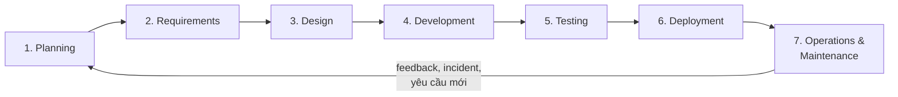
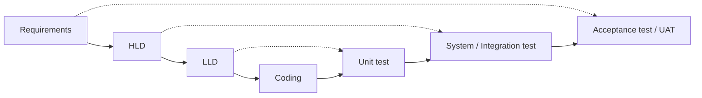

# SDLC – Software Development Life Cycle

> Ghi chú tự học · Cập nhật: 2026-11-02
> Liên quan: [hld-template.md](hld-template.md) · [monitoring-design-hld.md](monitoring-design-hld.md)

## Tổng quan

SDLC là quy trình phát triển phần mềm từ ý tưởng đến vận hành, gồm **7 giai đoạn**. Output của giai đoạn trước là input của giai đoạn sau. Kết quả vận hành (incident, phản hồi, yêu cầu mới) quay lại làm input cho vòng tiếp theo.

## Tóm tắt nhanh

| # | Phase | Câu hỏi chính | Output chính | Role chính |
| --- | --- | --- | --- | --- |
| 1 | Planning | Có nên làm không? | Charter, Business Case | Sponsor, PM |
| 2 | Requirements | Hệ thống phải làm gì? | SRS/BRD, NFR, RTM | BA, PO |
| 3 | Design | Xây dựng thế nào? | HLD, LLD, API spec | Architect, Tech Lead |
| 4 | Development | Hiện thực hóa | Code, artifact, unit test | Developer |
| 5 | Testing | Có đúng và đủ chất lượng không? | Test report, biên bản UAT | QA, khách hàng |
| 6 | Deployment | Đưa lên production an toàn | Release, biên bản bàn giao | DevOps, SRE |
| 7 | Operations | Giữ hệ thống ổn định | Báo cáo SLA, postmortem, yêu cầu mới | SRE, Ops, Support |

---

## 1. Planning (Lập kế hoạch / Khởi tạo)

**Mục tiêu:** quyết định có làm dự án không, làm trong phạm vi nào, với nguồn lực bao nhiêu.

| Input | Output |
| --- | --- |
| Ý tưởng kinh doanh, vấn đề cần giải quyết | Project Charter / Business Case |
| Chiến lược công ty, ngân sách | Feasibility Study (khả thi về kỹ thuật, kinh tế, pháp lý) |
| Phân tích thị trường, đối thủ | Phạm vi sơ bộ (scope) |
| Yêu cầu từ khách hàng hoặc stakeholder | Ước lượng chi phí và thời gian (high-level) |
| | Kế hoạch dự án, roadmap, phân bổ nhân sự |
| | Danh sách rủi ro ban đầu (risk register) |

**Role:** Sponsor, PM, Business Owner, Architect (ước lượng kỹ thuật).

## 2. Requirements (Phân tích yêu cầu)

**Mục tiêu:** xác định hệ thống *phải làm gì* và *phải đạt chất lượng thế nào*.

| Input | Output |
| --- | --- |
| Project Charter, scope | **SRS / BRD** (tài liệu đặc tả yêu cầu) |
| Phỏng vấn, workshop với stakeholder | Yêu cầu chức năng: use case, user story kèm acceptance criteria |
| Quy trình nghiệp vụ hiện tại (AS-IS) | **Yêu cầu phi chức năng (NFR):** hiệu năng, availability/SLA, bảo mật, compliance, khả năng mở rộng |
| Quy định pháp lý, compliance | Quy trình nghiệp vụ mới (TO-BE) |
| | Wireframe / prototype |
| | Requirements Traceability Matrix (RTM) |
| | Product backlog (nếu làm Agile) |

**Role:** BA, PO, khách hàng, SRE/Architect (để chốt NFR).

## 3. Design (Thiết kế)

**Mục tiêu:** quyết định hệ thống *được xây dựng thế nào*.

| Input | Output |
| --- | --- |
| SRS/BRD, NFR | **HLD:** kiến trúc tổng thể, thành phần, tích hợp, công nghệ, security, availability/DR, performance, **monitoring**, deployment |
| Wireframe | **LLD:** thiết kế chi tiết module, class, sequence diagram |
| Ràng buộc kỹ thuật (hạ tầng sẵn có, chuẩn công ty) | Thiết kế database (ERD, schema) |
| Ngân sách, timeline | Đặc tả API (OpenAPI/Swagger) |
| | UI/UX design (mockup) |
| | Threat model, thiết kế bảo mật |
| | ADR (Architecture Decision Records) |
| | Test strategy / Master Test Plan (QA bắt đầu từ đây) |

**Role:** Architect, Tech Lead, SRE/DevOps, UI/UX Designer, Security, DBA.

> Mẫu HLD đầy đủ: [hld-template.md](hld-template.md)

## 4. Development (Phát triển)

**Mục tiêu:** hiện thực hóa thiết kế thành phần mềm chạy được.

| Input | Output |
| --- | --- |
| HLD, LLD, API spec, UI design | Source code (trong repository) |
| User story / task | Unit test, kết quả code review |
| Coding convention, chuẩn bảo mật | Build artifact (binary, Docker image) |
| Môi trường dev, CI pipeline | CI/CD pipeline, Infrastructure as Code |
| | Code đã instrument (metrics, log, trace, health check) |
| | Tài liệu kỹ thuật, README, API docs |

**Role:** Developer, Tech Lead, DevOps.

## 5. Testing (Kiểm thử)

**Mục tiêu:** xác minh phần mềm đúng yêu cầu và đạt chất lượng.

| Input | Output |
| --- | --- |
| Build artifact | Test plan, test case |
| SRS (acceptance criteria), RTM | Kết quả test: functional, integration, regression |
| Test strategy | Báo cáo hiệu năng (load/stress test) |
| Môi trường test/staging, test data | Báo cáo bảo mật (SAST, DAST, pentest) |
| | Danh sách bug (defect log) |
| | **Biên bản UAT** (khách hàng chấp nhận) |
| | Test summary report, quyết định Go/No-go |

**Role:** QA/Tester, Performance Engineer, Security, khách hàng (UAT).

## 6. Deployment (Triển khai)

**Mục tiêu:** đưa phần mềm lên production an toàn.

| Input | Output |
| --- | --- |
| Build đã pass test, biên bản UAT | Hệ thống chạy trên production |
| Deployment plan, runbook | Release notes |
| Hạ tầng production (IaC) | Biên bản bàn giao (handover) cho đội vận hành |
| Kế hoạch rollback, chuyển đổi dữ liệu | Tài liệu vận hành, hướng dẫn sử dụng |
| Change request đã được phê duyệt | Kết quả smoke test sau deploy |
| | Monitoring, alert và on-call đã sẵn sàng |

**Role:** DevOps, SRE, Release Manager, Tech Lead.

## 7. Operations & Maintenance (Vận hành và bảo trì)

**Mục tiêu:** giữ hệ thống ổn định và cải tiến liên tục.

| Input | Output |
| --- | --- |
| Hệ thống production | Báo cáo SLA/SLO định kỳ |
| Dữ liệu monitoring, alert | Incident report, **postmortem** |
| Phản hồi người dùng, ticket hỗ trợ | Bản vá lỗi (hotfix, patch) |
| Bản vá bảo mật từ nhà cung cấp | Yêu cầu thay đổi, tính năng mới → **quay lại Planning/Requirements** |
| | Tối ưu hiệu năng và chi phí |
| | Kế hoạch ngừng sử dụng hệ thống (decommission) khi hết vòng đời |

**Role:** SRE, Ops/NOC, Support, Developer (on-call).

---

## Các khía cạnh xuyên suốt SDLC

Một số khía cạnh không chỉ thuộc một phase mà cần được tính đến từ sớm (*shift-left*) và đi qua toàn bộ vòng đời.

### Monitoring / Observability

| Phase | Việc cần làm |
| --- | --- |
| Requirements | Xác định SLA/SLO, MTTD/MTTR, yêu cầu audit |
| **Design** ⭐ | Thiết kế SLI/SLO, metrics theo tầng, logging/tracing, alert, dashboard, công cụ |
| Development | Instrument code: metrics, structured log, trace, `/health` |
| Testing | Kiểm tra alert kích hoạt đúng; quan sát dashboard khi load test, chaos test |
| Deployment | Triển khai stack monitoring; canary và rollback dựa trên metrics |
| Operations | Trực on-call, xử lý sự cố, postmortem, tinh chỉnh alert |

> Chi tiết: [monitoring-design-hld.md](monitoring-design-hld.md)

### Security (DevSecOps)

| Phase | Việc cần làm |
| --- | --- |
| Requirements | Yêu cầu bảo mật, compliance, phân loại dữ liệu |
| Design | Threat model (STRIDE), thiết kế authN/authZ, mã hóa, phân vùng mạng |
| Development | Secure coding (OWASP), SAST, quét dependency, quản lý secret |
| Testing | DAST, pentest, security review |
| Deployment | Quét image, hardening, phân quyền tối thiểu |
| Operations | SIEM, vá lỗ hổng, ứng phó sự cố bảo mật |

### Testing / Quality

QA tham gia từ phase Requirements (review acceptance criteria) và Design (test strategy), không chỉ ở phase Testing.

---

## Role trong thiết kế monitoring

| Role | Đóng góp |
| --- | --- |
| Solution Architect | Chủ trì thiết kế kiến trúc observability, chọn công cụ |
| SRE | Định nghĩa SLI/SLO, error budget, alert, runbook, on-call |
| DevOps / Platform | Xây dựng và vận hành hạ tầng monitoring, IaC cho dashboard/alert |
| Developer / Tech Lead | Instrument code, metrics nghiệp vụ cho service của mình |
| BA / PO | Yêu cầu SLA, KPI nghiệp vụ cần theo dõi |
| QA / Performance | Xác nhận ngưỡng alert qua load test |
| Security / SOC | Audit log, SIEM, yêu cầu compliance |
| DBA, Network | Monitor database, mạng |
| Ops / NOC / Support | Người dùng cuối của dashboard và alert |

> Nên để **người sẽ nhận alert lúc 3 giờ sáng** tham gia thiết kế alert ngay từ đầu.

---

## SDLC theo các mô hình

| Mô hình | Cách chạy các phase | Tài liệu | Phù hợp khi |
| --- | --- | --- | --- |
| **Waterfall** | Tuần tự, phase trước xong và được ký duyệt mới sang phase sau | Đầy đủ, chính thức | Yêu cầu ổn định, hợp đồng cố định, ngành có quy định chặt |
| **V-Model** | Như Waterfall, mỗi phase thiết kế ứng với một mức test | Đầy đủ | Hệ thống cần kiểm chứng cao (tài chính, y tế) |
| **Agile / Scrum** | Lặp lại đủ các phase trong mỗi sprint 1–4 tuần | Nhẹ: backlog, user story; HLD giữ ở mức kiến trúc và cập nhật dần | Yêu cầu thay đổi nhiều, cần ra sản phẩm sớm |
| **DevOps** | Development → Testing → Deployment tự động qua CI/CD, phản hồi từ Operations rất nhanh | Tài liệu dạng code (IaC, pipeline) | Release thường xuyên, sản phẩm chạy online |

### V-Model: ánh xạ thiết kế và kiểm thử

---

## Ghi nhớ

- Thiết kế monitoring, security, DR… nằm chủ yếu ở **Design**, nhưng yêu cầu của chúng bắt đầu từ **Requirements** (NFR).
- Mỗi NFR trong SRS phải trỏ tới ít nhất một mục trong HLD (bảng truy vết NFR).
- **Operations** không phải điểm cuối: postmortem và phản hồi người dùng là input cho vòng SDLC tiếp theo.

## Tham khảo

- [Types of Monitoring in System Design – GeeksforGeeks](https://www.geeksforgeeks.org/system-design/types-of-monitoring-in-system-design/)
