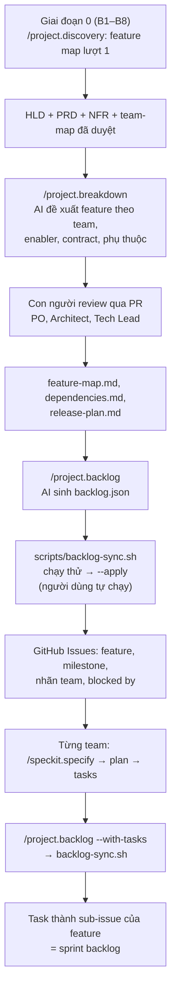

# Chia việc cho các team và tạo backlog với Spec Kit

> Ghi chú tự học · Cập nhật: 2026-11-02
> Liên quan: [discovery-phase0-guideline.md](discovery-phase0-guideline.md) · [speckit-big-picture.md](speckit-big-picture.md) · [speckit-vs-sdlc.md](speckit-vs-sdlc.md)
> Hiện thực: [speckit-docs-skeleton/](speckit-docs-skeleton/) (lệnh `/project.discovery`, `/project.breakdown`, `/project.backlog`, script `scripts/backlog-sync.sh`)

## Vấn đề

Spec Kit bắt đầu từ `/speckit.specify` cho **một tính năng**. Nó không có bước nào để:

1. **Tạo ra danh sách feature ban đầu** từ ý tưởng, mục tiêu và nhu cầu người dùng.
2. Biến HLD thành **danh sách việc cho từng team** và **backlog** trên công cụ quản lý công việc.

Lệnh Spec Kit thực chất là file prompt Markdown, nên ta tự thêm lệnh, chạy **trước `specify`**: `/project.discovery` cho việc (1), `/project.breakdown` và `/project.backlog` cho việc (2).

## Giai đoạn 0: tạo feature ban đầu

Feature ban đầu được tạo ở **Giai đoạn 0 (Discovery)**, trước mọi lệnh `/speckit.*`. Con người dẫn dắt qua workshop; AI hỗ trợ soạn nháp. Hướng dẫn chi tiết từng bước (đầu vào, định dạng, ai tham gia, đầu ra, checklist): [discovery-phase0-guideline.md](discovery-phase0-guideline.md).

Feature được hình thành qua **hai lượt**:

| Lượt | Khi nào | Trả lời | Công cụ |
| --- | --- | --- | --- |
| **Lượt 1** | Sau PRD (B6) | *Làm gì*: feature thô, gắn REQ và lát cắt release, chưa có team | Story map, `/project.discovery` |
| **Lượt 2** | Sau HLD (B9) | *Ai làm, thứ tự nào*: tách theo team, thêm enabler, contract | `/project.breakdown` |

### Chuỗi bước

```
Đầu vào I1–I8: đề bài, stakeholder, quy trình hiện tại, hệ thống hiện có, ràng buộc, số liệu
        │
        ▼
B1 Kickoff → B2 Workshop mục tiêu → B3 Phỏng vấn người dùng, AS-IS
        │      (business-context.md)   (as-is.md: điểm đau)
        ▼
B4 User story mapping ───────── hành trình → story → lát cắt MVP, v1.1   (story-map.md)
        │
        ▼
B5 PRD, NFR, glossary ───────── REQ-xx, NFR-xxx                         (/project.discovery soạn nháp)
        │
        ▼
B6 Feature map lượt 1 ───────── gom story/REQ thành feature thô          (/project.discovery soạn nháp)
        │
        ▼
B7 Event storming ───────────── event, entity, bounded context           (domain-model.md)
        │
        ▼
B8 HLD, ADR ─────────────────── thành phần, team sở hữu, mục xuyên suốt
        │
        ▼
B9 Feature map lượt 2 ───────── /project.breakdown → team, enabler, contract, mốc
        │
        ▼
B10 Cổng Ready for Spec Kit ─── checklist sản phẩm, hệ thống, điều phối
```

### Story map là nguồn chính sinh ra feature

```
Hoạt động:  Tìm sản phẩm    →  Đặt hàng        →  Thanh toán        →  Theo dõi đơn
            ─────────────      ─────────────      ──────────────      ────────────
MVP         Xem danh mục       Thêm vào giỏ       Thanh toán thẻ      Xem trạng thái
            Tìm theo tên       Xác nhận đơn
─ ─ ─ ─ ─ ─ ─ ─ ─ ─ ─ ─ ─ ─ ─ ─ ─ ─ ─ ─ ─ ─ ─ ─ ─ ─ ─ ─ ─ ─ ─ ─ ─ ─ ─ ─ ─ ─ ─
v1.1        Lọc, gợi ý         Mã giảm giá        Ví điện tử          Thông báo
```

| Trong story map | Trở thành |
| --- | --- |
| Cột hoạt động | Một hoặc vài **feature** trong `feature-map.md` |
| Story trong cột | **User story** trong `spec.md` khi chạy `/speckit.specify` |
| Lát cắt ngang | **Mốc release** trong `release-plan.md` |

### Từ lượt 1 sang lượt 2

| Lượt 1 (sau PRD) | Lượt 2 (sau HLD) |
| --- | --- |
| F-002 Đặt hàng và thanh toán | F-002a (Team Order), F-002b (Team Payment), C-01 contract `order.created` |
| *(không có)* | F-000 Foundation, F-001p Golden path, F-010 Observability stack (Infra); F-011 SLO, alert (SRE); F-012 Security baseline (Security) |

### `/project.discovery`

- **Đầu vào:** `docs/discovery/` (đầu vào I1–I8, biên bản workshop, business context, AS-IS, story map).
- **Việc làm:** tìm chỗ thiếu (KPI không đo được, persona chưa xác nhận, điểm đau chưa có story, NFR thiếu số); soạn nháp story map, PRD, NFR, glossary, feature map lượt 1; thêm câu hỏi vào `open-questions.md`.
- **Quy tắc:** không sửa file đã `Approved`; ghi `Draft (AI)`; không bịa số liệu, ngày, tên người; không đề xuất công nghệ.

### Thứ tự hay bị làm ngược

| Làm sai | Hậu quả |
| --- | --- |
| Chạy `/speckit.specify` ngay khi có ý tưởng | Feature không gắn mục tiêu, ranh giới lộn xộn, trùng lặp giữa các spec |
| Chia feature theo tầng kỹ thuật ("Backend", "Database") | Không feature nào tự giao được giá trị; team phải chờ nhau |
| Chia team trước khi có HLD | Ranh giới team lệch ranh giới hệ thống |
| Bỏ qua enabler | Foundation, monitoring, security làm muộn, chặn các team dev |

## Quy trình sau Giai đoạn 0



## Hai cấp backlog

| Cấp | Tạo khi nào | Nguồn | Ai quyết định |
| --- | --- | --- | --- |
| Product backlog (feature/epic) | Sau HLD, trước `specify` | `/project.breakdown` → `feature-map.md` | PO ưu tiên, Architect duyệt cách chia |
| Sprint backlog (task) | Sau `/speckit.tasks` của từng feature | `specs/xxx/tasks.md` | Team tự nhận và ước lượng |

## `/project.breakdown`: chia việc từ HLD

**Đầu vào:** PRD, NFR, HLD, domain model, API catalog, team map, release plan.

**Quy tắc chia:**

| Quy tắc | Lý do |
| --- | --- |
| Mỗi REQ thuộc ít nhất một feature | Không bỏ sót yêu cầu |
| Một feature, một team; chia theo lát cắt dọc dựa trên thành phần team sở hữu trong HLD | Tránh feature phải chờ nhiều team |
| Mỗi mục xuyên suốt của HLD (Security, DR, Monitoring, Infra) và mỗi NFR sinh **enabler feature** | Phần hay bị bỏ quên |
| Mỗi API/event giữa hai team là một **contract `C-xx`**, xếp trước feature dùng nó | Các team làm song song được |
| `F-000` foundation đứng đầu | Không chặn team dev |
| Feature lớn hơn khoảng 5–7 user story thì tách | Vừa sức AI, vừa một mốc |
| Không tự đặt ngày | Ngày do con người quyết |

**Đầu ra (chỉ đề xuất):** thiếu sót đầu vào; bảng feature map có cột Loại (Business / Enabler / Contract), Nguồn, Lớp, Cỡ; việc theo team; phụ thuộc và đường găng; sơ đồ; truy vết REQ/NFR/HLD chưa có feature; câu hỏi cần con người quyết định.

### Chia việc cho Infra và các team chuyên trách

Lệnh không tự biết việc nào của Infra. Nó **đối chiếu tài liệu đầu vào**, nên tài liệu phải ghi rõ ai sở hữu gì:

```
team-map.md ──── thành phần sở hữu, ranh giới việc xuyên suốt
HLD mục 4 ────── thành phần → team sở hữu            ──► feature Business
HLD 7, 8, 10, 11 bảng "Team thực hiện"               ──► feature Enabler (Infra, SRE, Security, DBA)
nfr.md ───────── NFR → mục HLD                        ──► kiểm tra NFR chưa có enabler
api-catalog.md ─ API/event giữa các team              ──► Contract C-xx
```

| Đầu vào cần có | Vì sao |
| --- | --- |
| `team-map.md` ghi **cụ thể** thành phần Infra sở hữu (mạng, IAM, K8s, CI/CD, IaC, golden path, stack monitoring, backup) | "Infra: hạ tầng" quá chung, việc bị gom thành một feature khổng lồ |
| Bảng **ranh giới việc xuyên suốt** trong `team-map.md` (Infra dựng stack, SRE viết SLO/alert; Security đặt chính sách, Infra hiện thực) | Không gộp việc hai team vào một feature |
| Bảng **"Team thực hiện"** ở đầu HLD mục 7, 8, 10, 11 ([hld-template.md](hld-template.md)) | Nguồn chính để sinh enabler |
| Cột "Mục HLD đáp ứng" trong `nfr.md` đủ | Phát hiện NFR chưa có ai làm |

Thiếu các bảng trên thì lệnh dùng **ánh xạ mặc định** (ví dụ HLD Monitoring → Infra dựng stack + SRE cấu hình SLO/alert; HLD Security → Security chính sách + Infra hiện thực IAM, mạng, hardening) và đánh dấu "giả định" để con người kiểm tra.

**Quy tắc riêng cho hạ tầng:**

- Tách theo **lớp và kết quả đầu ra**: L0 nền móng → L1 mạng → L2 security baseline → L3 compute/K8s/DB → L4 cấu hình OS → L5 observability stack → L6 golden path. Có thể gộp lớp liền nhau (Foundation = L0–L3), nhưng L5 và L6 luôn tách riêng vì nhiều team phụ thuộc.
- Feature business phụ thuộc **golden path**, không chỉ foundation; SLO/alert phụ thuộc observability stack.
- Đánh dấu feature hạ tầng nằm trên **đường găng** của nhiều team.

Ví dụ kết quả:

| Mã | Feature | Loại | Lớp | Team | Phụ thuộc |
| --- | --- | --- | --- | --- | --- |
| F-000 | Foundation: account/IAM, mạng, K8s, CI/CD | Enabler | L0–L3 | Infra | — |
| F-001p | Golden path: Helm chart, ingress, secrets | Enabler | L6 | Infra | F-000 |
| F-010 | Observability stack | Enabler | L5 | Infra | F-000 |
| F-011 | SLO, alert, dashboard, runbook | Enabler | — | SRE | F-010 |
| F-012 | Security baseline: SIEM, WAF, quét | Enabler | — | Security | F-000 |
| F-013 | Hardening OS (Ansible) | Enabler | L4 | Infra | F-000 |
| F-014 | Backup và DR | Enabler | — | Infra | F-000 |
| F-002a | Thanh toán – phía đơn hàng | Business | — | Order | F-001p, C-01 |

**Việc hạ tầng phát sinh sau** (team cần DB, queue mới khi `/speckit.plan`): ghi trong mục "Ảnh hưởng kiến trúc" của `plan.md`, task có nhãn `[Needs: infra/…]`; `/project.plan` cảnh báo khi chưa có `Provides`; Delivery Manager tạo feature mới cho Infra.

## `/project.backlog` và `backlog-sync.sh`: đẩy backlog lên GitHub

Tách làm hai bước để có chỗ cho con người duyệt:

1. **AI sinh dữ liệu:** `/project.backlog` đọc `feature-map.md` (và `tasks.md` nếu có `--with-tasks`), ghi `docs/delivery/backlog.json`. AI không gọi API.
2. **Người dùng chạy script:** `scripts/backlog-sync.sh` đọc `backlog.json`, mặc định **chạy thử**; thêm `--apply` mới ghi lên GitHub.

| Trong `backlog.json` | Trên GitHub |
| --- | --- |
| `milestones[]` (M0, M1…) | Milestone (có hạn nếu `due_on`) |
| `items[]` với `type` feature/enabler/contract | Issue có nhãn `type:*`, `team:*`, gắn milestone |
| `items[]` với `type: task` và `parent` | Sub-issue của issue feature |
| `blocked_by[]` | Dòng "Blocked by: #n" trong nội dung issue |
| `source` | Dòng "Nguồn sự thật" trỏ về file trong git |

Đặc điểm của script:

- **Kiểm tra dữ liệu trước:** key trùng, `parent`/`blocked_by`/`milestone` trỏ tới key không tồn tại thì dừng.
- **Idempotent:** issue nhận diện bằng tiền tố `[KEY]` trong tiêu đề; chạy lại chỉ cập nhật.
- **Hai lượt:** lượt 1 tạo/cập nhật issue; lượt 2 ghi nội dung cuối (khi đã biết số issue cho "Blocked by") và gắn sub-issue.
- **Ghi ánh xạ** key → số issue vào `docs/delivery/backlog-issues.json` để cập nhật cột Issue trong feature map.

```bash
git diff docs/delivery/backlog.json        # xem lại dữ liệu AI sinh
scripts/backlog-sync.sh                    # chạy thử
scripts/backlog-sync.sh --apply            # ghi thật
```

Với Jira: giữ nguyên `backlog.json`, viết script tương tự gọi Jira REST API (feature → Epic, milestone → Fix version, `blocked_by` → issue link "is blocked by").

## Nguyên tắc

- **Git giữ nội dung, công cụ quản lý giữ tiến độ.** Mô tả feature nằm ở `feature-map.md` và `spec.md`; issue trỏ ngược về đó và chỉ dùng để giao việc, theo dõi.
- **AI soạn nháp, con người quyết định.** PO quyết ưu tiên, Architect quyết ranh giới, Tech Lead quyết khả năng nhận việc.
- **AI không tự ghi ra hệ thống bên ngoài.** Tạo issue hàng loạt sai rất khó dọn; luôn chạy thử và xem lại trước khi `--apply`.

## Giới hạn

| Giới hạn | Cách xử lý |
| --- | --- |
| AI không biết năng lực thực tế của team | Tech Lead điều chỉnh khi review; team tự ước lượng |
| AI chỉ biết ưu tiên viết trong PRD | PO sắp xếp lại thứ tự |
| HLD sơ sài thì cách chia sơ sài | HLD phải có mục thành phần và team sở hữu, cùng các mục xuyên suốt |
| Sub-issue cần GitHub hỗ trợ tính năng này | Script cảnh báo và bỏ qua nếu không gắn được; quan hệ vẫn ghi trong key `F-xxx/Txxx` |
| Một số bản Spec Kit có sẵn lệnh chuyển task thành issue | Có thể dùng lệnh đó cho task; `backlog-sync.sh` vẫn hữu ích cho cấp feature và milestone |
