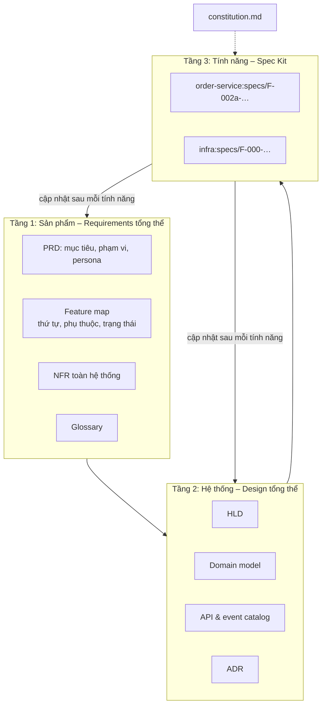

# Giữ cái nhìn tổng thể khi dùng Spec Kit

> Ghi chú tự học · Cập nhật: 2026-11-05
> Liên quan: [speckit-vs-sdlc.md](speckit-vs-sdlc.md) · [sdlc.md](sdlc.md) · [hld-template.md](hld-template.md)
> Bộ khung dùng ngay: [project-docs-skeleton/](project-docs-skeleton/) (repo tài liệu trung tâm) · [team-repo-skeleton/](team-repo-skeleton/) (repo của từng team)

## Vấn đề

Mỗi lần `/speckit.specify` tạo **một `spec.md` cho một tính năng** (gần giống một epic), không phải SRS của cả hệ thống.

- Trong một spec: nhiều user story (P1/P2/P3, mỗi story kiểm thử độc lập), requirement đánh mã FR-001…, success criteria SC-001…
- Nhiều tính năng: chạy `specify` nhiều lần → `specs/001-…`, `specs/002-…`, mỗi tính năng một nhánh git.
- **Không có tài liệu cấp sản phẩm hay hệ thống** gom các spec lại, nên dễ mất cái nhìn tổng thể ở Requirements và Design. `/speckit.analyze` chỉ kiểm tra bên trong một tính năng.

## Giải pháp: mô hình ba tầng

Spec Kit chỉ lo tầng dưới cùng. Hai tầng trên do con người sở hữu. AI phải **đọc** chúng trước khi viết spec hoặc plan, và **cập nhật** chúng sau mỗi tính năng.



| Tầng | Trả lời câu hỏi | Ai sở hữu | Tần suất thay đổi |
| --- | --- | --- | --- |
| 1. Sản phẩm | Làm gì, cho ai, theo thứ tự nào? | PO, BA | Theo roadmap hoặc release |
| 2. Hệ thống | Các phần ghép với nhau thế nào? | Architect, Tech Lead | Khi có quyết định kiến trúc |
| 3. Tính năng | Tính năng này làm gì, xây thế nào? | Team dev cùng AI | Mỗi tính năng |

## Cấu trúc repo

Mỗi team một repo; tầng 1, tầng 2 và tầng điều phối nằm ở một repo trung tâm `project-docs`. Repo team kéo `project-docs` về qua git submodule `.project/` (pin theo commit, nên mỗi plan biết mình viết theo bản HLD nào); `project-docs` đọc spec của mọi team qua `workspace/`.

```
project-docs/                     # Architect, PO, PM giữ
├── docs/
│   ├── product/
│   │   ├── prd.md                # tầm nhìn, mục tiêu, persona, phạm vi, REQ-xx
│   │   ├── feature-map.md        # F-xxx ↔ <repo>:specs/F-xxx-…, phụ thuộc, trạng thái
│   │   ├── nfr.md                # NFR-xxx dùng chung
│   │   └── glossary.md           # thuật ngữ nghiệp vụ thống nhất
│   ├── architecture/
│   │   ├── hld.md
│   │   ├── domain-model.md       # entity, bounded context, ai sở hữu dữ liệu nào
│   │   ├── api-catalog.md        # mọi API/event giữa các service, tài nguyên hạ tầng dùng chung
│   │   └── adr/
│   └── delivery/team-map.md      # team, danh sách repo, ranh giới việc + nơi làm
├── constitution/                 # core.md + profiles/ (service, infra, observability, security-policy, test)
├── templates-additions/
└── workspace/                    # bản checkout repo team, chỉ đọc

infra/                            # Infra giữ; SRE, Security, DBA đóng góp theo đường dẫn
├── .project/ → project-docs
├── .specify/memory/constitution.md   # core + profile infra, observability, security-policy
└── specs/F-000-foundation/, F-011-…/ (tính năng của SRE), …

order-service/                    # Team Order giữ; DBA duyệt migrations/, SRE duyệt observability/
├── .project/ → project-docs
├── .specify/memory/constitution.md   # core + profile service
└── specs/F-002a-…/
```

Một repo có một team giữ và có thể có team đóng góp theo đường dẫn; tính năng của team đóng góp đặt `specs/` trong repo đó. Task không bao giờ sửa repo khác: việc ở repo khác là `[Needs: …]`. Team không có code (ví dụ Security chỉ ra chính sách) không cần repo.

## Bắt AI dùng hai tầng trên

1. **Constitution trỏ tới tài liệu tổng thể** qua `.project/`. Đọc PRD, feature map, glossary, NFR trước khi specify; đọc HLD, domain model, API catalog, ADR trước khi plan. Muốn đi ngược HLD hoặc ADR thì phải đề xuất ADR mới. Phần core giống nhau ở mọi repo; phần profile theo loại việc của repo.
2. **Sửa template của Spec Kit** (thường nằm trong `.specify/templates/`):
   - `spec-template.md`: thêm mục **Liên kết tổng thể** (F-xxx, REQ-xx, phụ thuộc, NFR áp dụng).
   - `plan-template.md`: thêm mục **Ảnh hưởng kiến trúc** (entity, API/event mới, cần ADR không, mục HLD cần sửa).
   - `tasks-template.md`: thêm phase cuối **Đồng bộ tài liệu tổng thể**, coi là Definition of Done.

## Quy trình

```
Giai đoạn 0 – Discovery (con người, một lần)
  PRD → feature map → NFR → HLD v1 → domain model → team map, danh sách repo → constitution core + profile
                              │
Giai đoạn 1 – Foundation (Spec Kit)
  infra:specs/F-000-foundation: account, mạng, K8s, CI/CD, monitoring
                              │
Giai đoạn 2 – Lặp lại theo feature map
  specify → clarify → plan → tasks → implement → đồng bộ tài liệu tổng thể
                              │
Định kỳ – Architecture review (mỗi 2–4 tính năng hoặc mỗi release)
```

- **Giai đoạn 0** thay cho phần Planning, Requirements và Design tổng thể mà Spec Kit không có. AI có thể soạn nháp, con người quyết định.
- **`000-foundation` làm trước**, để các yêu cầu xuyên suốt được hiện thực một lần cho cả hệ thống.

## Kiểm tra chéo giữa các tính năng

- **Lệnh tự viết**, ví dụ `/project.review` (lệnh Spec Kit thực chất là file prompt Markdown), chạy trong `project-docs` sau `scripts/workspace-sync.sh`. Lệnh này đọc mọi `workspace/*/specs/*/spec.md` và `plan.md`, đối chiếu với `docs/` để tìm entity/API trùng, thuật ngữ lệch glossary, NFR chưa có tính năng nào đáp ứng, REQ chưa có tính năng nào nhận.
- **Kiểm tra trong CI** của repo team: đoạn core trong constitution khớp `.project/` (`check-core.sh`); mọi spec phải có mã F-xxx và REQ-xx hợp lệ.
- **Architecture review do con người làm** định kỳ: AI tìm vấn đề, Architect quyết định.

## Phân việc cho nhiều team: tầng điều phối

Sau HLD, công việc được chia cho nhiều team chạy song song (Dev, Platform/DevOps, SRE, Security, QA…). `tasks.md` của Spec Kit chỉ là danh sách việc cho **một tính năng**, người đọc chính là AI khi `implement`. Nó không trả lời được:

| Câu hỏi thực tế | Spec Kit có trả lời không? |
| --- | --- |
| Tính năng nào do team nào làm? | Không |
| Team B đang chờ API nào của team A, chờ đến khi nào? | Không |
| Việc của DevOps, SRE, Security, QA nằm ở đâu? | Không, trừ khi có spec riêng |
| Khi nào các team ghép code? | Không |
| Đường găng của cả release? | Không |

Giải pháp: thêm **tầng 2.5 – Điều phối**, nằm giữa tầng hệ thống và tầng tính năng. Không nhồi vào `tasks.md` của từng tính năng.

```
Tầng 1 – Sản phẩm      PRD, feature map, NFR, glossary
Tầng 2 – Hệ thống      HLD, domain model, API catalog, ADR
Tầng 2.5 – Điều phối   team map, release plan, dependencies   ← docs/delivery/
Tầng 3 – Tính năng     specs/xxx/ (spec, plan, tasks) – Spec Kit
```

1. **Một tính năng, một team.** `feature-map.md` có cột Team. Chia theo lát cắt dọc; tính năng buộc phải trải qua nhiều team thì tách thành nhiều spec (F-002a, F-002b) nối bằng contract trong `api-catalog.md`.
2. **Việc không phải tính năng cũng là spec.** `000-foundation`, golden path, observability stack (Infra), SLO và alert (SRE), `0xx-security-baseline` (Security). Việc thủ công (pentest, UAT, change ticket) để trong `release-plan.md`.
3. **Nhãn trong `tasks.md`:** `[Team: …]` bắt buộc; `[Needs: …]` và `[Provides: …]` khi task phụ thuộc hoặc phục vụ team khác.

   ```markdown
   - [ ] T012 [Team: Order] [Needs: F-000/T005 auth middleware] Kiểm tra token khi tạo đơn
   - [ ] T013 [P] [Team: Order] [Provides: order.created v1] Phát event khi tạo đơn
   ```

4. **Thư mục `docs/delivery/`:**
   - `team-map.md`: team, thành phần sở hữu, tính năng đang làm, RACI.
   - `release-plan.md`: mốc release, mốc tích hợp, việc thủ công, sơ đồ Gantt.
   - `dependencies.md`: bảng Needs/Provides giữa các team (Planned → Contract approved → Ready → Done), cảnh báo.
5. **Lệnh `/project.plan`:** đọc mọi `tasks.md`, ghép Needs/Provides, tính việc theo team, đường găng, rủi ro trễ mốc; sinh bản nháp cập nhật `dependencies.md` và `release-plan.md` để con người duyệt.
6. **Jira / GitHub Projects vẫn là nơi theo dõi chính.** Giao người, ước lượng, tiến độ nằm ở đó. Đồng bộ task từ `tasks.md` sang issue; mỗi issue trỏ ngược về `specs/xxx/tasks.md#Txxx`. Chi tiết cách chia việc từ HLD và tạo backlog: [speckit-backlog.md](speckit-backlog.md).

| Tầng | Ai sở hữu | Trả lời |
| --- | --- | --- |
| Feature map, release plan, dependencies | PO, Architect, Delivery Manager, Tech Lead các team | Ai làm gì, khi nào, chờ ai |
| `specs/xxx/tasks.md` | Team sở hữu tính năng cùng AI | Làm tính năng này theo bước nào |
| Jira / GitHub Projects | Cả nhóm | Ai đang làm, tiến độ đến đâu |

> Spec Kit giúp **từng team** làm đúng và nhanh; tầng điều phối giúp **các team** làm khớp với nhau. Tầng điều phối do con người quyết định; AI hỗ trợ tổng hợp và phát hiện xung đột.

## Tóm tắt

| Vấn đề | Giải pháp |
| --- | --- |
| Không có requirement tổng thể | Tầng 1: PRD, feature map, NFR, glossary |
| Không có design tổng thể | Tầng 2: HLD, domain model, API catalog, ADR |
| AI không biết tới tài liệu tổng thể | Constitution trỏ tới, kèm mục "Liên kết tổng thể" trong template |
| Tài liệu tổng thể lỗi thời | Phase "đồng bộ tài liệu" trong tasks = Definition of Done |
| Mâu thuẫn giữa các tính năng | Lệnh review tự viết, kiểm tra CI, architecture review |
| Mỗi tính năng tự làm security, monitoring | Tính năng `000-foundation` làm trước |
| Không biết team nào làm gì, ai chờ ai | Tầng điều phối `docs/delivery/`, nhãn Team/Needs/Provides, lệnh `/project.plan` |

**Nguyên tắc:** Spec Kit lo **chiều sâu** của từng tính năng; tầng 1 và tầng 2 giữ **chiều rộng** của dự án. AI đọc chiều rộng trước khi đào sâu, và ghi kết quả ngược lại sau khi đào xong.
