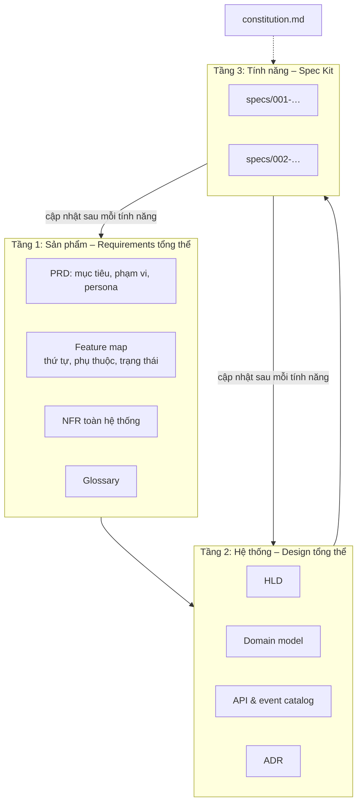

# Giữ cái nhìn tổng thể khi dùng Spec Kit

> Ghi chú tự học · Cập nhật: 2026-11-02
> Liên quan: [speckit-vs-sdlc.md](speckit-vs-sdlc.md) · [sdlc.md](sdlc.md) · [hld-template.md](hld-template.md)
> Bộ khung dùng ngay: [speckit-docs-skeleton/](speckit-docs-skeleton/)

## Vấn đề

Mỗi lần `/speckit.specify` tạo **một `spec.md` cho một tính năng** (gần giống một epic), không phải SRS của cả hệ thống.

- Trong một spec: nhiều user story (P1/P2/P3, mỗi story kiểm thử độc lập), requirement đánh mã FR-001…, success criteria SC-001…
- Nhiều tính năng: chạy `specify` nhiều lần → `specs/001-…`, `specs/002-…`, mỗi tính năng một nhánh git.
- **Không có tài liệu cấp sản phẩm hay hệ thống** gom các spec lại, nên dễ mất cái nhìn tổng thể ở Requirements và Design. `/speckit.analyze` chỉ kiểm tra bên trong một tính năng.

## Giải pháp: mô hình ba tầng

Spec Kit chỉ lo tầng dưới cùng. Hai tầng trên do con người sở hữu. AI phải **đọc** chúng trước khi viết spec hoặc plan, và **cập nhật** chúng sau mỗi tính năng.



| Tầng | Trả lời câu hỏi | Ai sở hữu | Tần suất thay đổi |
| --- | --- | --- | --- |
| 1. Sản phẩm | Làm gì, cho ai, theo thứ tự nào? | PO, BA | Theo roadmap hoặc release |
| 2. Hệ thống | Các phần ghép với nhau thế nào? | Architect, Tech Lead | Khi có quyết định kiến trúc |
| 3. Tính năng | Tính năng này làm gì, xây thế nào? | Team dev cùng AI | Mỗi tính năng |

## Cấu trúc repo

```
docs/
├── product/
│   ├── prd.md            # tầm nhìn, mục tiêu, persona, phạm vi, REQ-xx
│   ├── feature-map.md    # F-xxx ↔ specs/NNN, phụ thuộc, trạng thái
│   ├── nfr.md            # NFR-xxx dùng chung
│   └── glossary.md       # thuật ngữ nghiệp vụ thống nhất
└── architecture/
    ├── hld.md
    ├── domain-model.md   # entity, bounded context, ai sở hữu dữ liệu nào
    ├── api-catalog.md    # mọi API/event giữa các service
    └── adr/
.specify/memory/constitution.md   # trỏ tới docs/
specs/
├── 000-foundation/       # auth, logging, monitoring, CI/CD
├── 001-…/
└── 002-…/
```

## Bắt AI dùng hai tầng trên

1. **Constitution trỏ tới tài liệu tổng thể.** Đọc PRD, feature map, glossary, NFR trước khi specify; đọc HLD, domain model, API catalog, ADR trước khi plan. Muốn đi ngược HLD hoặc ADR thì phải đề xuất ADR mới.
2. **Sửa template của Spec Kit** (thường nằm trong `.specify/templates/`):
   - `spec-template.md`: thêm mục **Liên kết tổng thể** (F-xxx, REQ-xx, phụ thuộc, NFR áp dụng).
   - `plan-template.md`: thêm mục **Ảnh hưởng kiến trúc** (entity, API/event mới, cần ADR không, mục HLD cần sửa).
   - `tasks-template.md`: thêm phase cuối **Đồng bộ tài liệu tổng thể**, coi là Definition of Done.

## Quy trình

```
Giai đoạn 0 – Discovery (con người, một lần)
  PRD → feature map → NFR → HLD v1 → domain model → constitution
                              │
Giai đoạn 1 – Foundation (Spec Kit)
  specs/000-foundation: auth, logging, monitoring, CI/CD
                              │
Giai đoạn 2 – Lặp lại theo feature map
  specify → clarify → plan → tasks → implement → đồng bộ tài liệu tổng thể
                              │
Định kỳ – Architecture review (mỗi 2–4 tính năng hoặc mỗi release)
```

- **Giai đoạn 0** thay cho phần Planning, Requirements và Design tổng thể mà Spec Kit không có. AI có thể soạn nháp, con người quyết định.
- **`000-foundation` làm trước**, để các yêu cầu xuyên suốt được hiện thực một lần cho cả hệ thống.

## Kiểm tra chéo giữa các tính năng

- **Lệnh tự viết**, ví dụ `/project.review` (lệnh Spec Kit thực chất là file prompt Markdown). Lệnh này đọc mọi `specs/*/spec.md` và `plan.md`, đối chiếu với `docs/` để tìm entity/API trùng, thuật ngữ lệch glossary, NFR chưa có tính năng nào đáp ứng, REQ chưa có tính năng nào nhận.
- **Kiểm tra trong CI:** mọi spec phải có mã F-xxx và REQ-xx hợp lệ.
- **Architecture review do con người làm** định kỳ: AI tìm vấn đề, Architect quyết định.

## Tóm tắt

| Vấn đề | Giải pháp |
| --- | --- |
| Không có requirement tổng thể | Tầng 1: PRD, feature map, NFR, glossary |
| Không có design tổng thể | Tầng 2: HLD, domain model, API catalog, ADR |
| AI không biết tới tài liệu tổng thể | Constitution trỏ tới, kèm mục "Liên kết tổng thể" trong template |
| Tài liệu tổng thể lỗi thời | Phase "đồng bộ tài liệu" trong tasks = Definition of Done |
| Mâu thuẫn giữa các tính năng | Lệnh review tự viết, kiểm tra CI, architecture review |
| Mỗi tính năng tự làm security, monitoring | Tính năng `000-foundation` làm trước |

**Nguyên tắc:** Spec Kit lo **chiều sâu** của từng tính năng; tầng 1 và tầng 2 giữ **chiều rộng** của dự án. AI đọc chiều rộng trước khi đào sâu, và ghi kết quả ngược lại sau khi đào xong.
