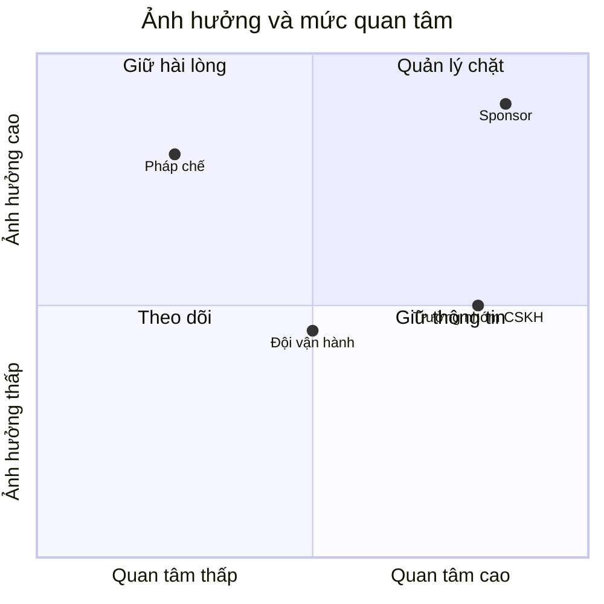

# I2 – Danh sách stakeholder

> Không ghi số điện thoại, email cá nhân vào repo nếu repo không đủ bảo mật; ghi kênh liên lạc nội bộ.

| Người / nhóm | Vai trò | Mối quan tâm chính | Ảnh hưởng (Cao/TB/Thấp) | Quan tâm (Cao/TB/Thấp) | Cách làm việc | Kênh liên lạc |
| --- | --- | --- | --- | --- | --- | --- |
| {Giám đốc kinh doanh} | Sponsor | {Doanh thu, hạn ra mắt} | Cao | Cao | Quản lý chặt: duyệt mục tiêu, cổng B10 | {…} |
| {Trưởng nhóm CSKH} | Người dùng nghiệp vụ | {Giảm thời gian xử lý} | TB | Cao | Giữ thông tin: mời B2, B3, B4 | {…} |
| {Pháp chế} | Compliance | {Dữ liệu cá nhân} | Cao | Thấp | Giữ hài lòng: review NFR, HLD mục compliance | {…} |
| {Đội vận hành} | Vận hành hệ thống | {Dễ vận hành, có cảnh báo} | TB | TB | Tham vấn ở B3, B8 | {…} |

## Bản đồ stakeholder

