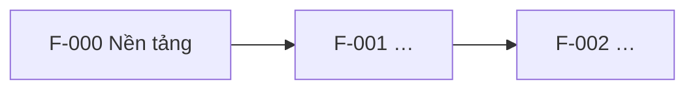

# Feature map

> Tầng 1 – Sản phẩm. Bảng chỉ mục giữ cái nhìn tổng thể: mỗi tính năng ứng với một thư mục `specs/xxx-…` của Spec Kit. Cập nhật trạng thái ở phase cuối của `tasks.md` mỗi tính năng.

## Danh sách tính năng

| Mã | Tính năng | REQ đáp ứng | Team | Phụ thuộc | Spec | Release | Trạng thái |
| --- | --- | --- | --- | --- | --- | --- | --- |
| F-000 | Nền tảng (auth, logging, CI/CD) | — | {Platform} | — | `specs/000-foundation` | {MVP} | {Planned} |
| F-001 | {Đăng nhập} | REQ-01 | {Team Identity} | F-000 | `specs/001-…` | {MVP} | {Planned} |
| F-002a | {Thanh toán – phía đơn hàng} | REQ-02 | {Team Order} | F-001 | — | {v1.1} | {Planned} |
| F-002b | {Thanh toán – phía cổng thanh toán} | REQ-02 | {Team Payment} | F-001 | — | {v1.1} | {Planned} |
| F-010 | {Observability: stack monitoring, SLO, alert} | — | {SRE} | F-000 | — | {MVP} | {Planned} |
| F-011 | {Security baseline: SAST, secret, WAF} | — | {Security} | F-000 | — | {MVP} | {Planned} |

> Việc của từng team và phụ thuộc giữa các team: [../delivery/](../delivery/).

Trạng thái: `Planned` → `Specified` → `Planned (plan.md)` → `In progress` → `Done`.

## Thứ tự và phụ thuộc

## Quy tắc

- Không chạy `/speckit.specify` cho tính năng chưa có dòng trong bảng này.
- Tính năng chỉ được bắt đầu khi mọi tính năng nó phụ thuộc đã `Done`, hoặc phần phụ thuộc đã có contract (API/event) được duyệt trong `api-catalog.md`.
- Một tính năng nên có tối đa khoảng 5–7 user story; lớn hơn thì tách.
- **Một tính năng, một team.** Chia theo lát cắt dọc. Tính năng buộc phải trải qua nhiều team thì tách thành nhiều spec (F-002a, F-002b), nối với nhau bằng contract trong `api-catalog.md`.
- Việc của Platform, SRE, Security cần sinh code hoặc cấu hình (CI/CD, IaC, alert rule) cũng là một tính năng có spec riêng. Việc thủ công (pentest, UAT, change ticket) để trong `docs/delivery/release-plan.md`.
