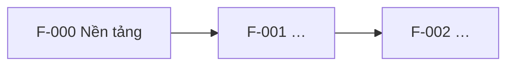

# Feature map

> Tầng 1 – Sản phẩm. Bảng chỉ mục giữ cái nhìn tổng thể: mỗi tính năng ứng với một thư mục `specs/xxx-…` của Spec Kit. Cập nhật trạng thái ở phase cuối của `tasks.md` mỗi tính năng.

## Danh sách tính năng

| Mã | Tính năng | REQ đáp ứng | Phụ thuộc | Spec | Release | Trạng thái |
| --- | --- | --- | --- | --- | --- | --- |
| F-000 | Nền tảng (auth, logging, monitoring, CI/CD) | — | — | `specs/000-foundation` | {MVP} | {Planned} |
| F-001 | {Đăng nhập} | REQ-01 | F-000 | `specs/001-…` | {MVP} | {Planned} |
| F-002 | {…} | REQ-02 | F-001 | — | {v1.1} | {Planned} |

Trạng thái: `Planned` → `Specified` → `Planned (plan.md)` → `In progress` → `Done`.

## Thứ tự và phụ thuộc

## Quy tắc

- Không chạy `/speckit.specify` cho tính năng chưa có dòng trong bảng này.
- Tính năng chỉ được bắt đầu khi mọi tính năng nó phụ thuộc đã `Done`, hoặc phần phụ thuộc đã có contract (API/event) được duyệt trong `api-catalog.md`.
- Một tính năng nên có tối đa khoảng 5–7 user story; lớn hơn thì tách.
