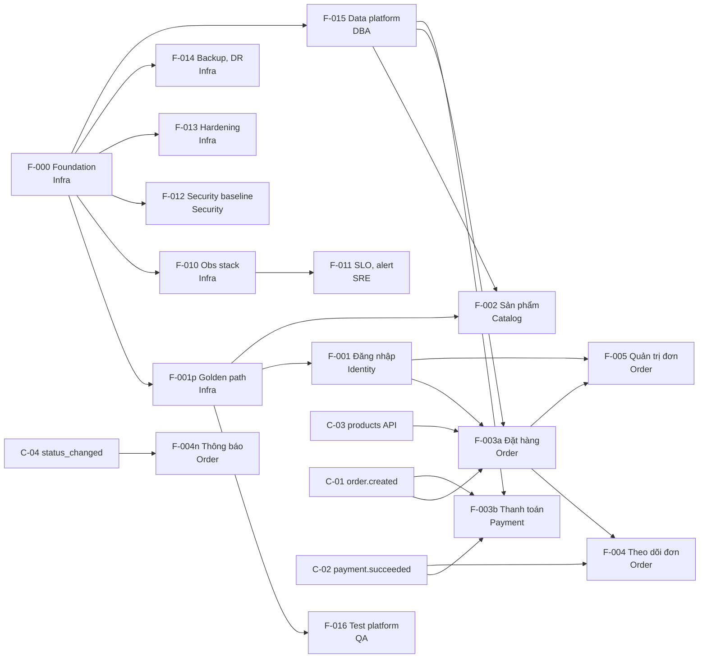

# Ví dụ output của `/project.breakdown` – dự án ShopNow

> **Ví dụ minh họa viết tay**, không phải kết quả chạy lệnh thật. Dùng để biết lệnh `/project.breakdown` nên trả về gì với một bộ đầu vào cụ thể, và để so sánh khi chạy lệnh trên dự án của bạn.
>
> Liên quan: [../.claude/commands/project.breakdown.md](../.claude/commands/project.breakdown.md) · [../docs/product/feature-map.md](../docs/product/feature-map.md) · [../docs/delivery/team-map.md](../docs/delivery/team-map.md)

## Đầu vào giả định

ShopNow là dự án bán hàng online, phạm vi MVP.

| File | Nội dung chính |
| --- | --- |
| `prd.md` | REQ-01 Đăng ký/đăng nhập · REQ-02 Xem, tìm sản phẩm · REQ-03 Giỏ hàng, đặt hàng · REQ-04 Thanh toán thẻ · REQ-05 Theo dõi đơn · REQ-06 Thông báo email/SMS · REQ-07 Nhân viên cập nhật trạng thái đơn |
| `nfr.md` | NFR-001 Availability 99.9% · NFR-002 p95 ≤ 500 ms · NFR-003 OIDC + MFA admin · NFR-004 Mã hóa dữ liệu cá nhân · NFR-005 Observability · NFR-006 RPO ≤ 5 phút · NFR-007 NĐ 13/2023 · NFR-008 WCAG 2.1 AA |
| `hld.md` mục 4 | auth-service → Team Identity · catalog-service → Team Catalog · order-service → Team Order · payment-service → Team Payment · notification-service → *(trống)* |
| `hld.md` mục 7, 8, 10, 11 | Có bảng "Team thực hiện" theo template |
| `hld.md` mục 9 (Scalability) | Không có bảng "Team thực hiện" |
| `team-map.md` | Infra, SRE, Security, DBA, QA, Identity, Catalog, Order, Payment |
| `feature-map.md` (lượt 1) | F-001 Đăng nhập · F-002 Tìm sản phẩm · F-003 Đặt hàng và thanh toán · F-004 Theo dõi đơn và thông báo · F-005 Quản trị đơn |
| `release-plan.md` | Có mốc M0, M1 (MVP), chưa có ngày |

---

## Output

> **Báo cáo chia việc – ShopNow** · Chỉ là đề xuất, chưa sửa file nào.

### 1. Thiếu sót đầu vào và giả định

| # | Thiếu sót | Vị trí | Giả định đã dùng | Mức độ |
| --- | --- | --- | --- | --- |
| G1 | `notification-service` chưa có team sở hữu | `hld.md` mục 4 | Giao **Team Order** (dùng chung event với order-service) | **Cao**: cần quyết định |
| G2 | Mục 9 Scalability chưa có bảng "Team thực hiện" | `hld.md` mục 9 | Auto-scaling, CDN giao **Infra** (ánh xạ mặc định), gộp vào F-000 và F-001p | Trung bình |
| G3 | NFR-008 (WCAG) chưa điền "Mục HLD đáp ứng" | `nfr.md` | Không sinh enabler; đưa vào acceptance criteria của các feature có UI | Trung bình |
| G4 | NFR-002 (hiệu năng) không có team nào kiểm chứng | `nfr.md`, `team-map.md` | Giao **QA** làm load test trong F-016 | Thấp |

### 2. Đề xuất feature map

`🆕` = dòng mới · `✏️` = thay đổi so với lượt 1 · `(gđ)` = dùng ánh xạ mặc định

| | Mã | Feature | Loại | Nguồn | Lớp | Team | Phụ thuộc | Mốc | Cỡ |
| --- | --- | --- | --- | --- | --- | --- | --- | --- | --- |
| 🆕 | F-000 | Foundation: account/IAM, mạng, K8s, CI/CD, auto-scaling (gđ) | Enabler | HLD 11, 7.2, 9 | L0–L3 | Infra | — | M0 | L |
| 🆕 | F-001p | Golden path: Helm chart, ingress, cert-manager, External Secrets, CDN (gđ) | Enabler | HLD 11, 7.3, 9 | L6 | Infra | F-000 | M0 | M |
| 🆕 | F-010 | Observability stack | Enabler | HLD 10 | L5 | Infra | F-000 | M0 | M |
| 🆕 | F-011 | SLO, alert, dashboard, runbook | Enabler | HLD 10, NFR-001, NFR-005 | — | SRE | F-010 | M1 | M |
| 🆕 | F-012 | Security baseline: SIEM, WAF, quét lỗ hổng | Enabler | HLD 7, NFR-003 | — | Security | F-000 | M0 | M |
| 🆕 | F-013 | Hardening OS theo CIS (Ansible) | Enabler | HLD 7, NFR-003 | L4 | Infra | F-000 | M0 | S |
| 🆕 | F-014 | Backup và DR hạ tầng | Enabler | HLD 8.4, NFR-006 | — | Infra | F-000 | M1 | M |
| 🆕 | F-015 | Data platform: cụm PostgreSQL, migration tooling, backup DB | Enabler | HLD 5, 8.4, NFR-004, NFR-006 | L3 | DBA | F-000 | M0 | M |
| 🆕 | F-016 | Test platform: E2E, dữ liệu test, load test | Enabler | NFR-002 (gđ G4) | — | QA | F-001p | M1 | M |
| 🆕 | C-01 | Contract `order.created` v1 | Contract | HLD 6 | — | Order | — | M0 | S |
| 🆕 | C-02 | Contract `payment.succeeded` v1 | Contract | HLD 6 | — | Payment | — | M0 | S |
| 🆕 | C-03 | Contract `GET /api/v1/products/{id}` | Contract | HLD 6 | — | Catalog | — | M0 | S |
| 🆕 | C-04 | Contract `order.status_changed` v1 | Contract | HLD 6 | — | Order | — | M0 | S |
| ✏️ | F-001 | Đăng ký, đăng nhập | Business | REQ-01, NFR-003 | — | Identity | F-001p | M1 | M |
| ✏️ | F-002 | Xem, tìm sản phẩm | Business | REQ-02 | — | Catalog | F-001p, F-015 | M1 | M |
| ✏️ | F-003a | Giỏ hàng, đặt hàng | Business | REQ-03 | — | Order | F-001p, F-001, F-015, C-01, C-03 | M1 | M |
| ✏️ | F-003b | Thanh toán thẻ | Business | REQ-04, NFR-004 | — | Payment | F-001p, F-015, C-01, C-02 | M1 | M |
| ✏️ | F-004 | Theo dõi đơn | Business | REQ-05 | — | Order | F-003a, C-02 | M1 | S |
| 🆕 | F-004n | Thông báo email/SMS (tách từ F-004) | Business | REQ-06 | — | Order (gđ G1) | F-001p, C-04 | M1 | S |
| ✏️ | F-005 | Nhân viên cập nhật trạng thái đơn | Business | REQ-07, NFR-003 | — | Order | F-003a, F-001 | M1 | S |

Lý do các thay đổi:

- **F-003 → F-003a, F-003b:** đặt hàng thuộc order-service, thanh toán thuộc payment-service. Hai service do hai team khác nhau sở hữu, nên tách và nối bằng C-01, C-02.
- **F-004 → F-004, F-004n:** thông báo thuộc notification-service, khác với service xử lý theo dõi đơn.
- Các feature business phụ thuộc **F-001p (golden path)**, không chỉ F-000.

### 3. Việc theo team

| Team | Feature | Số feature | Ghi chú |
| --- | --- | --- | --- |
| **Infra** | F-000 (L0–L3) → F-013 (L4) → F-010 (L5) → F-001p (L6) → F-014 | 5 | ⚠️ **Nằm trên đường găng của mọi team dev** |
| SRE | F-011 | 1 | Bắt đầu sau F-010 |
| Security | F-012 | 1 | Duyệt IAM, firewall trong F-000 và chuẩn CIS cho F-013 |
| DBA | F-015 | 1 | Catalog, Order, Payment phụ thuộc |
| QA | F-016 | 1 | |
| Identity | F-001 | 1 | |
| Catalog | C-03, F-002 | 2 | |
| **Order** | C-01, C-04, F-003a, F-004, F-004n, F-005 | **6** | ⚠️ **Quá tải**: gấp 3 các team dev khác |
| Payment | C-02, F-003b | 2 | |

### 4. Phụ thuộc đề xuất

| Mã | Thứ cần | Bên cung cấp | Bên cần | Hạn chốt contract | Hạn sẵn sàng | Trạng thái |
| --- | --- | --- | --- | --- | --- | --- |
| D-01 | Môi trường staging + golden path | Infra / F-001p | Identity, Catalog, Order, Payment, QA | — | chưa có | Planned |
| D-02 | Cụm PostgreSQL, migration tooling | DBA / F-015 | Catalog, Order, Payment | — | chưa có | Planned |
| D-03 | `order.created` v1 | Order / C-01 | Payment / F-003b | chưa có | chưa có | Planned |
| D-04 | `payment.succeeded` v1 | Payment / C-02 | Order / F-003a, F-004 | chưa có | chưa có | Planned |
| D-05 | `GET /products/{id}` | Catalog / C-03 | Order / F-003a | chưa có | chưa có | Planned |
| D-06 | `order.status_changed` v1 | Order / C-04 | Order / F-004n | chưa có | chưa có | Planned |
| D-07 | Auth middleware, token | Identity / F-001 | Order / F-003a, F-005 | chưa có | chưa có | Planned |
| D-08 | Observability stack | Infra / F-010 | SRE / F-011 | — | chưa có | Planned |

⚠️ D-03 và D-04 tạo thành **phụ thuộc vòng** giữa Order và Payment, nên phải chốt C-01 và C-02 cùng lúc.

**Đường găng tới M1:** `F-000 → F-001p → F-001 → F-003a → F-004 / F-005 → M1`. Infra (F-000, F-001p) và Order (F-003a) là hai điểm nghẽn.

### 5. Sơ đồ phụ thuộc

### 6. Truy vết

| Kiểm tra | Kết quả |
| --- | --- |
| REQ chưa có feature | Không có. REQ-01…07 đều đã có feature nhận |
| NFR chưa có enabler hoặc mục HLD | **NFR-008** (WCAG): không có mục HLD, không có enabler (G3) |
| NFR chỉ có giả định | **NFR-002** (hiệu năng) → F-016 (G4) |
| NFR-007 (NĐ 13/2023) | Có HLD 12 nhưng chưa có feature hay task kiểm chứng; đề xuất thêm vào checklist review của F-003a, F-003b, F-001 |
| Mục HLD chưa có enabler | Mục 9 Scalability chỉ có giả định (G2) |
| Team không có việc | Không có |
| Team quá tải | **Order** (6 feature) |
| Team trên đường găng của nhiều team | **Infra** (F-000, F-001p), **DBA** (F-015) |

### 7. Câu hỏi cần con người quyết định

| # | Câu hỏi | Người quyết |
| --- | --- | --- |
| Q1 | Ai sở hữu `notification-service`? Giữ ở Team Order, hay giao cho Team Identity hoặc lập team mới? (G1) | Architect, EM |
| Q2 | Team Order có 6 feature. Có chuyển F-004n hoặc F-005 sang team khác, hoặc dời F-005 sang sau MVP không? | PO, EM |
| Q3 | Auto-scaling và CDN gộp vào F-000/F-001p, hay tách thành enabler riêng? (G2) | Architect |
| Q4 | WCAG (NFR-008) là tiêu chí của từng feature có UI, hay cần một feature riêng cho design system? (G3) | PO, UX |
| Q5 | Chốt C-01 và C-02 cùng lúc vào thời điểm nào để Order và Payment không chặn nhau? | Tech Lead Order, Payment |
| Q6 | F-014 (Backup, DR) có bắt buộc cho M1 không, hay chỉ cần ở go-live? | PO, SRE |

**Bước tiếp theo:** trả lời Q1–Q6, cập nhật `feature-map.md`, `dependencies.md`, `release-plan.md` qua Pull Request, rồi chạy `/project.backlog`.

---

## Ví dụ này minh họa điều gì

1. **Phát hiện thiếu sót** (G1–G4) và dùng giả định có đánh dấu, thay vì im lặng bỏ qua.
2. **Tách feature theo ranh giới team** (F-003, F-004) và sinh **contract** cho mỗi giao tiếp giữa hai team.
3. **Tách việc hạ tầng theo lớp** (L0–L6) và phân rõ Infra dựng, SRE/Security/DBA/QA làm phần chuyên môn.
4. **Chỉ ra rủi ro điều phối:** team quá tải, team nằm trên đường găng, phụ thuộc vòng.
