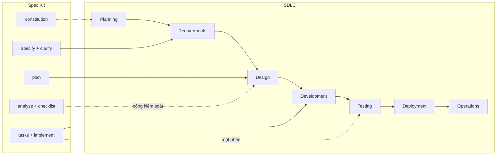

# Spec Kit (AI) và SDLC

> Ghi chú tự học · Cập nhật: 2026-11-02
> Liên quan: [sdlc.md](sdlc.md) · [hld-template.md](hld-template.md) · [monitoring-design-hld.md](monitoring-design-hld.md)
>
> Các lệnh Spec Kit dưới đây theo hiểu biết tại thời điểm viết. Spec Kit cập nhật nhanh, nên đối chiếu với README của [github/spec-kit](https://github.com/github/spec-kit).

## Mục đích của SDLC

SDLC giúp **làm đúng sản phẩm** (đúng nhu cầu) và **làm sản phẩm đúng cách** (đạt chất lượng), với chi phí, thời gian và rủi ro dự đoán được:

1. **Giảm chi phí sửa lỗi.** Lỗi phát hiện ở Requirements rẻ hơn rất nhiều so với lỗi phát hiện trên production.
2. **Làm cho phần mềm kiểm chứng được.** Mỗi yêu cầu được truy vết tới thiết kế, code và test.
3. **Phân rõ trách nhiệm.** Mỗi phase có người làm, người duyệt và đầu ra rõ ràng.
4. **Tạo chung một hiểu biết** giữa business, dev, QA và ops.
5. **Giữ hệ thống sống lâu dài:** dễ bảo trì, dễ vận hành, dễ mở rộng.

> Thước đo khi đánh giá Spec Kit: **AI có thể thay hình thức của một phase, nhưng mục đích của phase đó vẫn phải được đáp ứng.**

---

## Spec Kit ánh xạ vào SDLC

Spec Kit theo hướng *spec-driven development*: bản spec là nguồn sự thật, còn code được AI sinh ra từ spec.

| Lệnh Spec Kit | Tạo ra | Thay cho phase / hoạt động SDLC |
| --- | --- | --- |
| `/speckit.constitution` | `constitution.md`: nguyên tắc dự án | Chuẩn kiến trúc, coding convention, quy định test (một phần của Planning/Design) |
| `/speckit.specify` | `spec.md`: user story, acceptance criteria, chỉ nói *cái gì* và *tại sao* | **Requirements** (SRS/BRD) |
| `/speckit.clarify` | Câu hỏi làm rõ điểm mơ hồ, câu trả lời ghi lại vào spec | Workshop, phỏng vấn stakeholder |
| `/speckit.plan` | `plan.md`, `research.md`, `data-model.md`, `contracts/`, `quickstart.md` | **Design** (HLD/LLD, API spec, data model) |
| `/speckit.tasks` | `tasks.md`: task có thứ tự, phụ thuộc, đánh dấu task chạy song song | Chia nhỏ công việc (WBS, sprint backlog) |
| `/speckit.analyze` | Báo cáo mâu thuẫn và thiếu sót giữa spec, plan và tasks | Design review, ma trận truy vết (RTM) |
| `/speckit.checklist` | Checklist kiểm tra chất lượng của chính yêu cầu | Review yêu cầu |
| `/speckit.implement` | Code và test (test viết trước) | **Development** và một phần **Testing** |



**Không có lệnh tương ứng:** Planning (business case), Deployment, Operations, và HLD mức hệ thống.

---

## Phase nào bị bỏ qua hoặc thu gọn

Có hai loại:

- **Bị gộp hoặc thu gọn:** AI làm thay hình thức, mục đích vẫn được giữ.
- **Nằm ngoài phạm vi:** không có gì thay thế. Đây mới là chỗ nguy hiểm.

| Phase | Tình trạng | Vì sao | AI thay bằng | Con người phải làm |
| --- | --- | --- | --- | --- |
| Planning | Bỏ qua | Spec Kit bắt đầu ở mức tính năng; AI không đánh giá được giá trị kinh doanh | Không có (constitution chỉ thay phần nguyên tắc kỹ thuật) | Business case, ưu tiên, lộ trình |
| Requirements | Thu gọn | Chi phí viết và sửa tài liệu gần như bằng 0 | `specify`, `clarify`, `checklist` | Duyệt spec |
| Design | Thu gọn | Như trên | `plan` + constitution check, `analyze` | Duyệt plan |
| Development | AI làm | Spec, plan, tasks đủ rõ để sinh code | `tasks`, `implement` (TDD) | Code review |
| Testing | Gộp một phần | Test sinh cùng code từ acceptance criteria | Unit, integration, contract test | UAT, load test, pentest, exploratory test |
| Deployment | Bỏ qua | Spec Kit dừng khi code xong | Không có | CI/CD, IaC, kế hoạch rollback |
| Operations | Bỏ qua | Spec mô tả tính năng, không mô tả vận hành | Không có | Monitoring, alert, runbook, backup/DR |
| HLD mức hệ thống | Dễ mất | `plan` viết theo từng tính năng | Không có | Duy trì HLD tổng thể |

### 1. Requirements và Design: gộp và rút ngắn, không mất

- **Vì sao:** trong SDLC truyền thống, viết SRS hay HLD tốn nhiều tuần, sửa rất đắt, nên phải làm kỹ một lần rồi khóa lại. Với AI, bản nháp spec và plan sinh ra trong vài phút, chi phí sửa gần như bằng 0. Không cần một phase dài với nhiều vòng bàn giao nữa.
- **AI thay bằng:**
  - `specify` sinh spec có cấu trúc, tách *cái gì* khỏi *làm thế nào*, đánh dấu `[NEEDS CLARIFICATION]` ở chỗ mơ hồ thay vì tự đoán.
  - `clarify` hỏi có hệ thống thay cho workshop.
  - `plan` sinh tài liệu thiết kế, kiểm tra plan có vi phạm constitution không.
  - `analyze` thay cho design review: phát hiện yêu cầu chưa có task, task không gắn với yêu cầu, thuật ngữ mâu thuẫn.
- **Mục đích được giữ:** yêu cầu vẫn được viết ra, làm rõ, truy vết, và nằm trong git nên có lịch sử thay đổi.

### 2. Development: AI viết code

- **Vì sao:** từ spec, plan và tasks đủ rõ, AI viết được phần lớn code.
- **AI thay bằng:** `tasks` chia việc thành bước nhỏ có thứ tự; `implement` viết test trước rồi mới viết code (TDD) nếu constitution yêu cầu.
- **Mục đích được giữ:** code bám theo thiết kế đã duyệt, không theo trí nhớ của developer.

### 3. Testing: gộp vào implement, chỉ thay được một phần

- **AI thay được:** unit test, integration test, contract test (theo `contracts/`); `checklist` kiểm tra chất lượng yêu cầu.
- **AI không thay được:**
  - **UAT:** chỉ người dùng thật mới xác nhận được phần mềm đúng nhu cầu.
  - **Load test, pentest, exploratory test.**
  - **Lỗi hiểu sai từ đầu:** nếu AI hiểu sai spec, test sai và code sai khớp với nhau, nên mọi test vẫn pass.

### 4. Planning: bị bỏ qua

- **Vì sao:** Spec Kit mặc định quyết định làm tính năng đã có. AI không đánh giá được giá trị kinh doanh, ngân sách hay ưu tiên.
- **Cách bù:** con người vẫn làm business case, ưu tiên và lộ trình trước khi chạy `specify`.

### 5. Deployment và Operations: bị bỏ qua, rủi ro lớn nhất

- **Vì sao:** Spec Kit kết thúc khi code xong. Kết quả có thể là code chạy được nhưng không có monitoring, alert, runbook, backup hay rollback.
- **Cách bù:**
  - Ghi vào **constitution** các nguyên tắc vận hành, ví dụ: *"Mọi service phải có `/health`, structured log có `trace_id`, metrics RED"*.
  - Đưa NFR về availability, observability, DR vào **spec**, để `plan` và `tasks` sinh task tương ứng.
  - Giữ **HLD mức hệ thống** ([hld-template.md](hld-template.md), [monitoring-design-hld.md](monitoring-design-hld.md)) làm đầu vào cho mọi `plan`.
  - Deployment dùng CI/CD và IaC; có thể để AI viết pipeline nhưng con người phải duyệt.

### 6. HLD mức hệ thống: dễ bị mất

- **Vì sao:** `plan` viết cho từng tính năng. Security, DR, monitoring, chi phí, tính nhất quán giữa các tính năng không thuộc riêng tính năng nào, nên dễ rơi mất.
- **Cách bù:** constitution cùng một HLD tổng thể được duy trì riêng; mỗi `plan` mới phải tuân theo HLD này.

---

## Những điểm cần lưu ý

| # | Lưu ý | Vì sao | Cách làm |
| --- | --- | --- | --- |
| 1 | **Spec trở thành code** | Chất lượng phần mềm bằng chất lượng spec | Review spec như review code |
| 2 | **Bắt buộc có người duyệt giữa các bước** | AI có thể tự tin sinh plan sai | Duyệt spec → plan → tasks rồi mới `implement`; không chạy một mạch |
| 3 | **NFR dễ bị thiếu** | AI tập trung vào chức năng | Đưa security, performance, observability vào constitution và spec |
| 4 | **Thiết kế quá phức tạp** | AI hay thêm lớp trừu tượng, thư viện không cần | Constitution ghi nguyên tắc đơn giản; review `plan.md`, `research.md` |
| 5 | **Spec lệch khỏi code (spec drift)** | Sửa code trực tiếp làm mất nguồn sự thật | Mọi thay đổi bắt đầu từ spec, rồi sinh lại plan và tasks |
| 6 | **Test do AI viết** | Code và test có thể cùng sai | Con người viết hoặc duyệt acceptance test; vẫn làm UAT |
| 7 | **Bảo mật của code sinh ra** | Lỗ hổng phổ biến, package không có thật hoặc độc hại | SAST, quét dependency, review bảo mật trong CI |
| 8 | **Hệ thống có sẵn (brownfield)** | AI thiếu ngữ cảnh của hệ thống cũ | Cung cấp tài liệu kiến trúc hiện tại; làm từng tính năng nhỏ |
| 9 | **Giới hạn ngữ cảnh** | Tính năng quá lớn thì AI bỏ sót | Chia nhỏ, mỗi spec một phạm vi rõ |
| 10 | **Trách nhiệm vẫn thuộc về con người** | AI không chịu trách nhiệm khi có sự cố | RACI vẫn áp dụng: người duyệt là người chịu trách nhiệm |

### Gợi ý nội dung constitution để bù các phase bị thiếu

```markdown
## Vận hành
- Mọi service có `/health/live`, `/health/ready`.
- Log dạng JSON, có `trace_id`; không ghi dữ liệu nhạy cảm.
- Mỗi API có metrics RED; service Tier 1 có SLO và alert kèm runbook.

## Bảo mật
- Xác thực qua OIDC; phân quyền RBAC.
- Không hardcode secret; dùng {Vault/KMS}.
- CI chạy SAST và quét dependency, chặn merge khi có lỗi mức High.

## Chất lượng
- Viết test trước khi viết code; acceptance test bám theo spec.
- Ưu tiên giải pháp đơn giản; thêm thư viện mới phải ghi lý do trong research.md.

## Kiến trúc
- Mọi plan phải tuân theo HLD hệ thống tại {đường dẫn}.
```

---

## Kết luận

- AI **không bỏ SDLC** mà **nén** Requirements, Design, Development và một phần Testing thành một vòng lặp nhanh, có tài liệu và có cổng kiểm soát.
- Các phase **thật sự bị bỏ qua** là **Planning, Deployment, Operations**, cùng **HLD mức hệ thống**. Con người phải bù bằng constitution, NFR trong spec, HLD tổng thể và CI/CD.
- Kiểm tra theo mục đích của SDLC: nếu vẫn **đúng nhu cầu, kiểm chứng được, truy vết được, rõ trách nhiệm và vận hành được**, thì quy trình đang đi đúng hướng.
